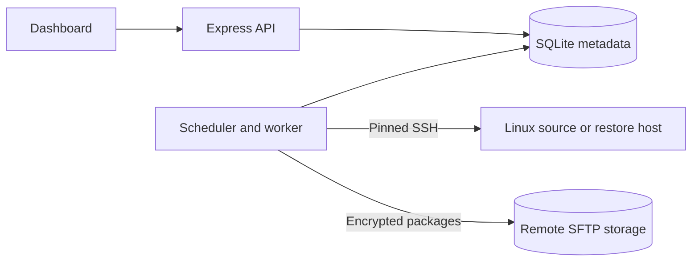

<div align="center">
  
  <p><strong>Back up Docker sites. Verify recovery points. Restore a private copy.</strong></p>
  
  
  
  <p><a href="#quick-start">Quick start</a> · <a href="docs/deployment.md">Deployment</a> · <a href="docs/security.md">Security</a> · <a href="docs/acceptance.md">Verification</a></p>
</div>


DockNest brings server discovery, scheduled backups and recovery into one self-hosted dashboard. It captures containers, images, persistent data and reviewed configuration, stores an authenticated encrypted package on remote SFTP, and supports isolated restores. Native static nginx sites can also be backed up without stopping their web server.

**Every screenshot uses mock data.** Names, addresses, activity and storage totals are synthetic; production accounts and credentials are never used for documentation.

## Features

- **Discover and configure:** connect Linux servers with pinned SSH host keys, search Docker projects and static nginx sites, and review detected URLs and configuration files.
- **Schedule and retain:** timezone-aware schedules, serialized jobs, successful-backup retention and pinned recovery points.
- **Capture and verify:** preserve images, mounts, writable layers and file metadata; authenticate encrypted packages before recovery or export.
- **Recover privately:** restore supported containers into isolated copies or static files into private directories. Live replacement remains blocked.
- **Download your data:** encrypted originals with range support, or authenticated Full ZIP exports with browsable files and original Linux recovery archives.
- **Monitor clearly:** activity charts, job stages, audit history, grouped recovery points and responsive pagination. A sidebar heartbeat reports API/worker availability and jobs needing attention. Light and dark palettes include a saved sun/moon appearance toggle.
- **Manage maintenance:** a visual editor, animated visitor pages and explicit deployment/activation controls.
- **Control access:** a shared password plus each person's TOTP authenticator, expiring invitations, recovery codes and revocable sessions.


## Quick start

Install **Node.js 24+** and **Python 3**. Remote hosts need Linux, SSH and Python; Docker sites also need Docker. Connect an SFTP destination before running a backup.

```sh
npm ci
npm run setup
npm run build
npm start
```

Run the separate worker in a second terminal:

```sh
npm run worker
```

Open **http://127.0.0.1:3000** and complete administrator enrollment using the locally generated setup token. Connect your authenticator and save recovery codes securely. On Windows PowerShell, use `npm.cmd` if npm's wrapper is blocked by execution policy.

To set or rotate the shared password from Windows:

```powershell
powershell.exe -NoProfile -ExecutionPolicy Bypass -File .\scripts\set-admin-password.ps1
```

The script prompts privately and guides first-administrator enrollment. For an enrolled administrator, rotation preserves the authenticator and signs out existing sessions. See [Security](docs/security.md) for exact access behavior.

Setup creates `.env`, `data/master.key` and `data/setup.token`. Keep them private and maintain an independent protected copy of the master key and metadata. Losing the key prevents decryption of saved credentials and backup packages.

## Docker and HTTPS

Follow [Deployment](docs/deployment.md) for Compose, HTTPS, remote prerequisites and disaster recovery. The API and worker share SQLite metadata; neither mounts the Docker socket. Remote operations use pinned SSH connections.



Use **Add server**, verify its connection, then **Add site** to review discovered components and configuration. Check readiness, configure required maintenance routing for Docker sites, and verify a real backup and isolated restore before scheduling. Static captures keep nginx online and detect file changes during capture.

Full ZIP downloads contain decrypted data and configuration, which may include secrets. Keep them private. Physical database files require compatible database images; a ZIP is not a SQL dump. Temporary plaintext exports are cleaned after completion, cancellation or an interrupted API restart.

## Verification

```sh
npm run check
npm run test:integration
```

`check` builds the UI and runs Node/Python tests. Linux Docker integration exercises real SSH, SFTP, capture, tamper rejection, source recovery and isolated restore, including static files. Browser fixtures verify original actions, charts, responsive layouts and pagination. See [Acceptance and limits](docs/acceptance.md).

Automated checks do not prove that every database, mount type or external dependency can be recovered. Unsupported privileges, unsafe paths and unresolved writers fail closed. Replacement and custom network/mount adapters require separate validated workflows.

For frontend development, run `npm run dev:web`. Reproduce documentation screenshots against an isolated preview with `npm run docs:screenshots`; see [capture provenance](docs/media/README.md).

## Documentation and contribution

- [Server connection](docs/server-connection.md) and [site setup](docs/site-setup.md)
- [Backup format](docs/backup-format.md) and [security model](docs/security.md)
- [Interface design](docs/design/DESIGN.md) and [logo assets](docs/design/homebird-brand/README.md)
- [Repository privacy](docs/repository-privacy.md) and [verification checklist](docs/acceptance.md)

Keep changes focused, use mock data in examples and screenshots, and run relevant checks. Report security issues privately to the repository owner; do not include credentials or customer data in issues, commits or logs. Selected [agency-agents roles](docs/agents/README.md) serve as reference guidance.

No project-wide license has been published. Bundled fonts and dependencies retain their own licenses.
