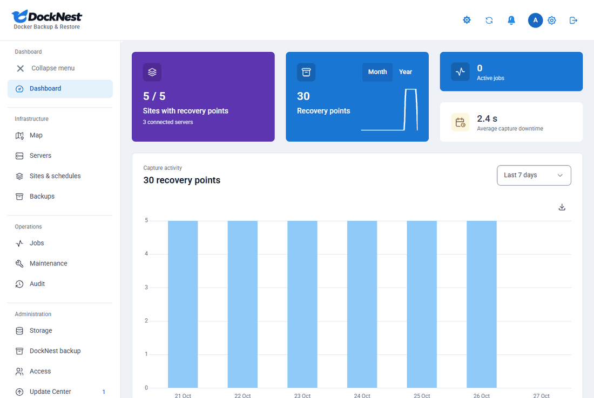
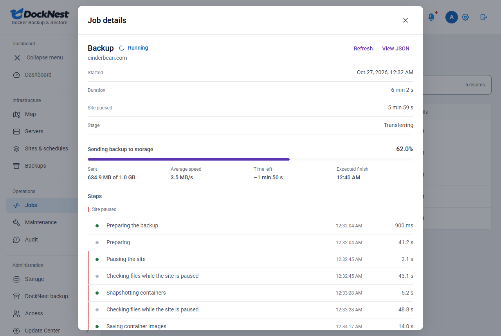
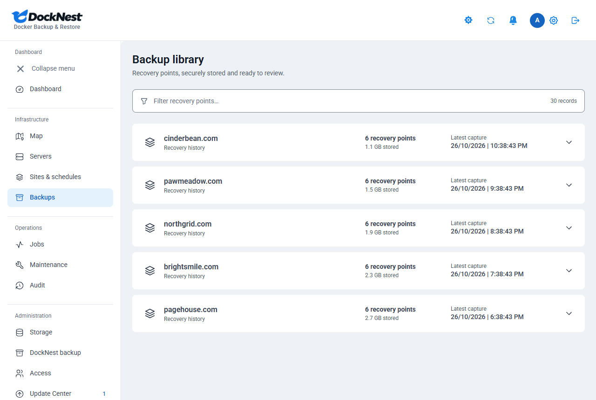
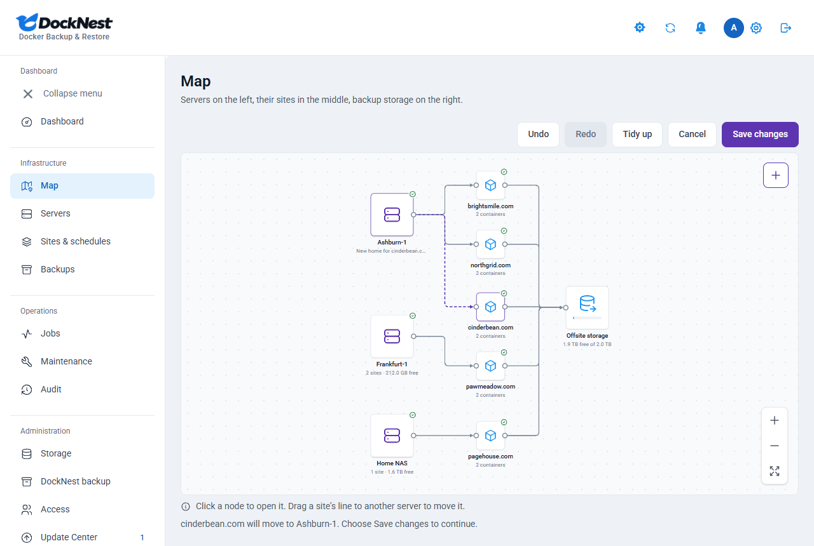

<div align="center">
  
  <p><strong>Self-hosted Docker backup and restore with a visual server map.</strong></p>
  <a href="https://github.com/DahanItamar/DockNest/releases/latest"></a>
  <a href="https://github.com/DahanItamar/DockNest/actions/workflows/ci.yml"></a>
  
  
  <a href="LICENSE"></a>
</div>

<p align="center">
  <a href="#quick-start">Quick start</a> ·
  <a href="#why-docknest">Why DockNest</a> ·
  <a href="#install">Install</a> ·
  <a href="#documentation">Documentation</a> ·
  <a href="https://github.com/DahanItamar/DockNest/releases/latest">Latest release</a>
</p>

- **Back up whole sites, not just files.** Containers, databases and volumes, together.
- **Prove every backup restores.** Restore it to a separate copy and look.
- **Move a site to another server in a few clicks.** Drag its line on the Map.



## Quick start

```sh
git clone https://github.com/DahanItamar/DockNest.git && cd DockNest
npm ci && npm run setup
docker compose --profile https up -d --build
```

Set your domain in `.env` first. See [Install](#install) for the details.

## Why DockNest

### Backups that capture the whole site
DockNest connects to your Linux servers over SSH and finds your Docker and static nginx sites. It captures images, volumes, bind mounts, writable layers and databases (PostgreSQL, MySQL/MariaDB and Redis). Each site has its own schedule, retention and pinned backups. Watch every step on the Jobs page.



### Backups you have proven
Restore any recovery point to a separate copy. The live site is not touched. Open the copy, check it, then delete it. Every backup also shows whether it was verified.



### A map of your servers, and one-drag moves
The Map shows your servers, sites and backup storage as connected nodes. To move a site, drag its line to another server and press Save changes. DockNest shows how long the move takes and how long the site is offline. It backs up the site, tests a copy on the new server, waits for your DNS change, then switches. The old copy stays stopped for 7 days, so you can switch back. See [moving sites](docs/moving-sites.md).



### And the rest
- **Encrypted storage.** Backups are encrypted with AES-256-GCM before they leave your server. Store them on SFTP or S3-compatible storage you own.
- **Plain-language jobs.** Live progress, a step timeline, and a clear reason when something fails.
- **Alerts.** Telegram or email when a backup fails or passes, a move needs you, or a server is low on disk. See [alerts](docs/alerts.md).
- **Click-to-update.** An opt-in update check and one-click updates through a host updater.
- **Safe by design.** Pinned SSH host keys, password plus authenticator app, and no Docker socket on the dashboard.
- **Also:** a maintenance page while a site is paused, light and dark themes, a phone layout, and downloads as an encrypted file or ZIP.

> [!NOTE]
> DockNest is in beta. The [support matrix](docs/support-matrix.md) states what has been tested and what has not. S3-compatible storage is tested against a simulated endpoint, not yet against real providers. Automatic recovery after a server reboot is not ready for production use.

## Why people pick DockNest

| | DockNest | Coolify | restic / Backrest | Duplicati |
| :-- | :-: | :-: | :-: | :-: |
| Backs up whole sites | Yes | Partly | No | No |
| Moves sites between servers | Yes | No | No | No |
| Proves backups restore | Yes | No | Manual | Manual |
| Encrypted storage | Yes | Not documented | Yes | Yes |
| Easy web dashboard | Yes | Yes | Backrest only | Yes |

## Requirements

| Where | What you need |
| :-- | :-- |
| DockNest host (runs the dashboard) | Linux with Docker and Docker Compose, and Node.js 24 for the one-time setup. |
| Each server you back up | Linux, Docker, Python 3 and SSH with a key. Root access, and free disk space for a temporary copy (or use direct streaming). |
| Backup storage | SFTP server that supports `fsync@openssh.com`, or an S3-compatible bucket. S3-compatible storage is in beta: it is tested against a simulated S3 endpoint, not yet against real providers. See [storage backends](docs/storage-backends.md). |
| You | A browser and an authenticator app. |

## Install

### Build from source (default)

```sh
git clone https://github.com/DahanItamar/DockNest.git
cd DockNest
npm ci
npm run setup
```

Setup creates `.env`, `data/master.key` and `data/setup.token`. Keep them private and keep a safe copy of `data/master.key`. Without it your backups cannot be decrypted, and resetting the password does not help.

Point a domain at the host, open ports 80 and 443, and set these in `.env`:

```dotenv
APP_DOMAIN=backup.example.com
APP_ORIGIN=https://backup.example.com
SECURE_COOKIES=true
```

Start everything. Caddy obtains the HTTPS certificate:

```sh
docker compose --profile https up -d --build
```

If you already run an HTTPS reverse proxy, leave out `--profile https`. See [Deployment](docs/deployment.md).

### Published image (alternative)

Final releases are published as a signed `linux/amd64` image, `ghcr.io/dahanitamar/docknest`. Set `DOCKNEST_IMAGE` in `.env` to a tag and use `compose.override.example.yaml` as your `compose.override.yaml`. The steps and the signature check are in [Use the published image](docs/upgrading.md#use-the-published-image). On ARM hosts, build from source.

### Try it locally

```sh
npm ci
npm run setup
npm run build
npm start
```

In a second terminal run `npm run worker`, then open http://127.0.0.1:3000. On Windows PowerShell, use `npm.cmd` if `npm` is blocked.

## Using DockNest

1. **Sign in.** Use the setup token from `data/setup.token`, add your authenticator app and save the recovery codes.
2. **Connect storage** under **Storage**.
3. **Add a server** and confirm its SSH fingerprint. See [server connection](docs/server-connection.md).
4. **Add a site.** DockNest discovers Docker projects and static nginx sites; review what it found. See [site setup](docs/site-setup.md).
5. **Check readiness.** For Docker sites, set up the maintenance page first.
6. **Run a backup**, then watch it under **Jobs**.
7. **Verify and restore.** Restore a recovery point to a separate copy to confirm it works. See [recovery verification](docs/recovery-verification.md).
8. **Turn on the schedule** for the site.

Notes:

- ZIP downloads are not encrypted and can contain passwords and keys. Keep them private.
- To set or change the password on Windows, run `scripts\set-admin-password.ps1`.

## Updating

Version numbers and release notes are on the [latest release](https://github.com/DahanItamar/DockNest/releases/latest) page, and in the [changelog](CHANGELOG.md).

**From the app.** Administrators have an **Update Center** page. Nothing contacts GitHub until an administrator agrees once; after that DockNest checks the public release list daily. An update starts only when an administrator confirms with the password and an authenticator code. It runs through a small root service on the host, the host updater, which you install once on the DockNest host (Linux with systemd and rootful Docker; not Docker Desktop or rootless Docker):

```sh
sudo scripts/install-updater.sh
```

**From the command line.** The updater is optional. Without it:

```sh
scripts/upgrade.sh              # newest final release
scripts/upgrade.sh --dry-run    # show the plan only
```

Details, rollback and exit codes: [Upgrading](docs/upgrading.md) and [Host updater and Update Center](docs/upgrading.md#host-updater-and-update-center). The in-app update path has not been validated on a real Linux Docker host yet; see that section for the current status.

## Security and privacy

- Backups are encrypted, SSH host keys are pinned, and sign-in needs a password plus an authenticator app.
- Update checks are off until an administrator opts in, and send nothing about your servers, sites or users. See [outbound requests](docs/security.md#update-checks-outbound-requests).
- Problem reports contain typed values only (no names, addresses, paths or error text), you review them first, and the server sends nothing. See [problem reports](docs/security.md#problem-reports).

Full model: [docs/security.md](docs/security.md). Report vulnerabilities privately as described in [SECURITY.md](SECURITY.md).

## Documentation

| Topic | Guides |
| :-- | :-- |
| Setup | [Deployment](docs/deployment.md) · [Server connection](docs/server-connection.md) · [Site setup](docs/site-setup.md) · [Storage backends](docs/storage-backends.md) · [Moving sites](docs/moving-sites.md) · [Alerts](docs/alerts.md) |
| Recovery | [Support matrix](docs/support-matrix.md) · [Database contracts](docs/database-contracts.md) · [Recovery verification](docs/recovery-verification.md) · [Independent recovery](docs/independent-recovery.md) · [DockNest self-backup](docs/docknest-self-backup.md) |
| Internals | [Backup format](docs/backup-format.md) · [Security](docs/security.md) · [Interface design](docs/design/DESIGN.md) |
| Upgrades | [Upgrading and rollback](docs/upgrading.md) · [Update Center design](docs/update-center.md) · [Host updater threat model](docs/updater-threat-model.md) · [Release validation](docs/release-validation.md) |
| Quality | [Acceptance and limits](docs/acceptance.md) · [Repository privacy](docs/repository-privacy.md) |

## Support and contributing

- Bug or problem: open an [issue](https://github.com/DahanItamar/DockNest/issues/new/choose), or use **Report a bug** under Settings > About in the app.
- Questions and ideas: [Discussions](https://github.com/DahanItamar/DockNest/discussions).
- Security issues: privately, see [SECURITY.md](SECURITY.md).
- Contributing: [CONTRIBUTING.md](CONTRIBUTING.md) covers setup and the checks every pull request runs.

## License

[GNU AGPL-3.0](LICENSE). Bundled fonts and dependencies keep their own licenses.
