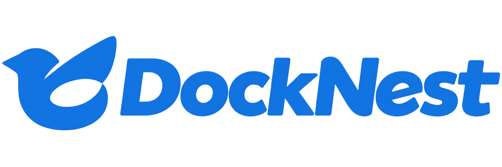
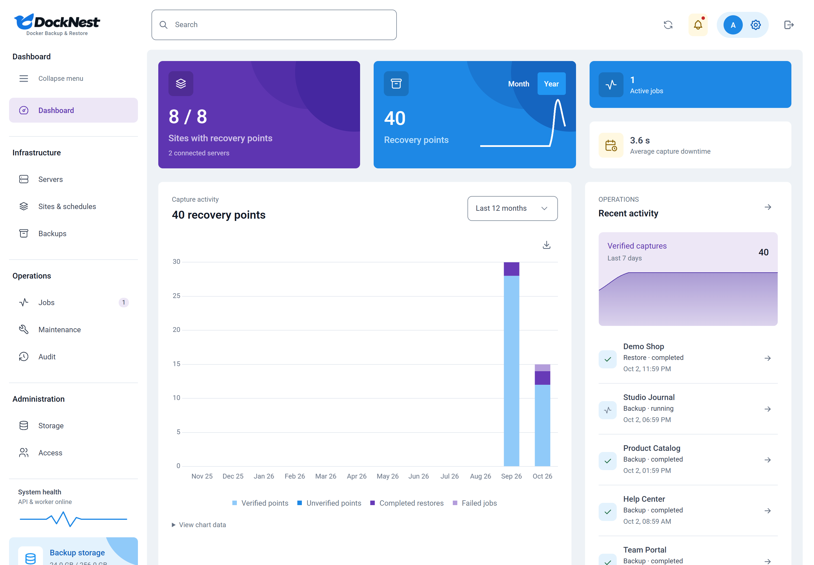
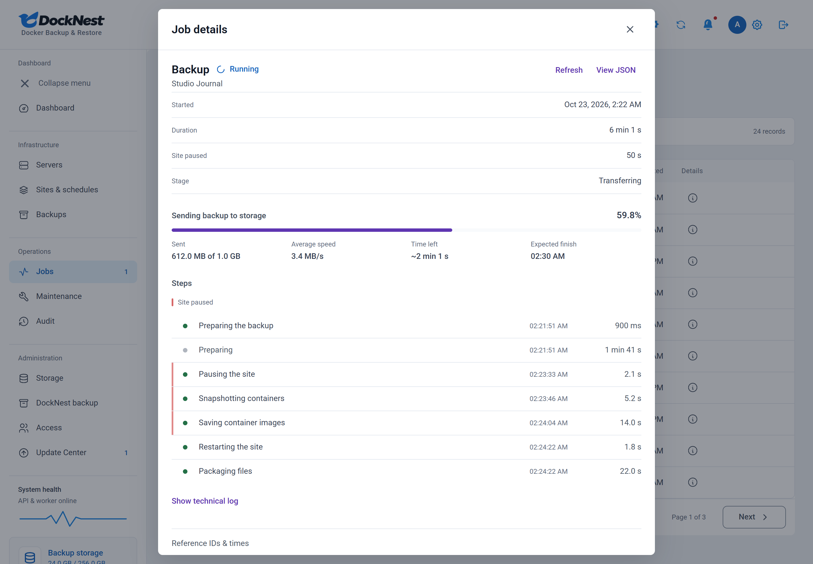
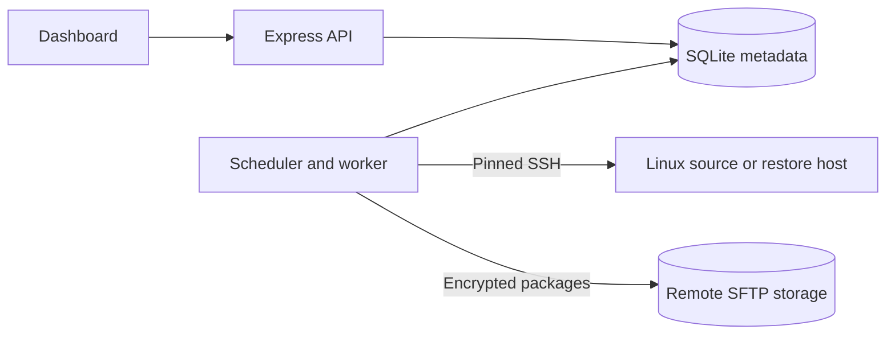
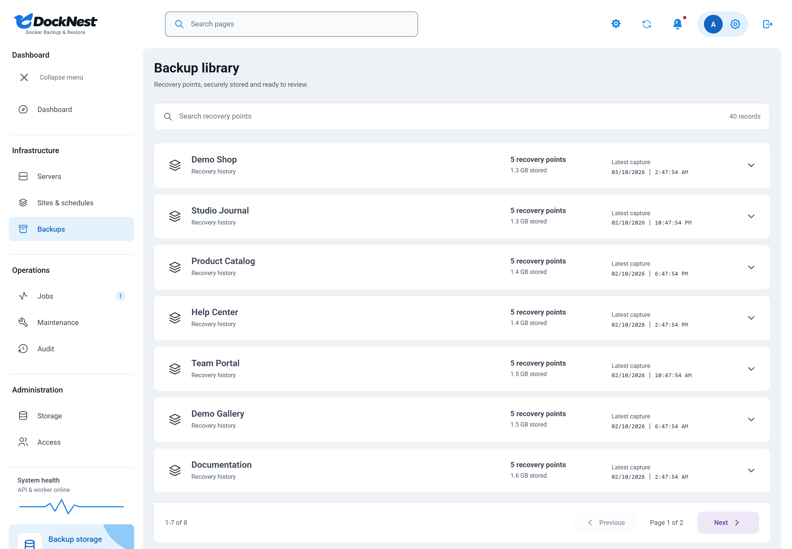

<div align="center">
  
  <p><strong>Back up Docker sites. Verify recovery points. Restore a private copy.</strong></p>
  
  
  
  
  <a href="https://github.com/DahanItamar/DockNest/actions/workflows/ci.yml"></a>
  <a href="LICENSE"></a>
  <p>
    <a href="#features">Features</a> ·
    <a href="#requirements">Requirements</a> ·
    <a href="#installation">Installation</a> ·
    <a href="#your-first-backup">First backup</a> ·
    <a href="#documentation">Docs</a> ·
    <a href="SECURITY.md">Security</a> ·
    <a href="CONTRIBUTING.md">Contributing</a>
  </p>
</div>



## Why DockNest

Most backup tools tell you that a job finished. DockNest is built to show that a site can be restored from it.

It connects to your Linux servers over SSH, captures Docker sites (images, mounts, writable layers and databases) and static nginx sites, and stores authenticated, encrypted packages on your own SFTP storage. Every recovery point can be restored into an isolated copy and checked, without touching the live site.

> [!NOTE]
> DockNest is in controlled beta. Tested versions and known limits are listed in the [support matrix](docs/support-matrix.md). Opt-in boot automation still requires a real host-reboot drill before supported production use.

## Features

### Back up

- **Discover sites:** connect Linux servers with pinned SSH host keys, find Docker projects and static nginx sites, and review detected URLs and configuration files.
- **Capture everything a site needs:** images, mounts, writable layers and file metadata, with per-engine cold database contracts for PostgreSQL, MySQL/MariaDB and Redis.
- **Schedule and retain:** timezone-aware schedules, serialized jobs, retention of successful backups and pinned recovery points.
- **Choose how data leaves the server:** stage a temporary copy on the source server, or stream directly to backup storage when local disk space is short.

### Verify and restore

- **Prove recovery:** packages are authenticated before any recovery or export, and isolated restores record separate integrity, consistency and data evidence.
- **Restore privately:** restore supported containers into isolated copies, or static files into private directories. Live replacement remains blocked.
- **Download your data:** encrypted originals with range support, or authenticated Full ZIP exports with browsable files and the original Linux recovery archives.

### Operate

- **See what a job is doing:** live transfer progress with speed and time left, a plain-language step timeline, and the recorded cause when something fails.
- **Keep visitors informed:** a visual maintenance-page editor, animated visitor pages and explicit deployment and activation controls.
- **Monitor at a glance:** activity charts, audit history, grouped recovery points and a heartbeat for the API and worker. Light, dark and system themes.

### Security

- **Access:** a shared password plus each person's TOTP authenticator, expiring invitations, recovery codes and revocable sessions.
- **Encryption:** AES-256-GCM packages; saved credentials are encrypted with the master key.
- **Recover the manager itself:** an independently encrypted recovery kit for DockNest's own metadata and keys.



<sub>Every screenshot uses mock data. Names, addresses, activity and storage totals are synthetic; production accounts and credentials are never used for documentation.</sub>

## How DockNest compares

| | DockNest | Server snapshot | restic / Borg | docker-volume-backup |
| --- | --- | --- | --- | --- |
| Back up and restore one site | Yes | No, the whole server | Yes, the paths you choose | Yes, the volumes you choose |
| Captures images, mounts and writable layers | Yes | Yes, as part of the disk | No, files only | Volumes only |
| Consistent database capture | Per-engine contracts; fails closed | Depends on the provider | Up to your own scripts | Can stop labeled containers |
| Proves a restore works | Restores an isolated copy and checks it | No | Checks repository integrity | No |
| Maintenance page during capture | Yes | No | No | No |
| Storage | SFTP | Provider only | restic: many (S3, B2, SFTP, local, …); Borg: SSH or local | Many (S3, WebDAV, SSH, local, …) |
| Dashboard | Yes | Provider console | No (CLI) | No (configuration) |

DockNest is younger and narrower: it supports Linux hosts running Docker and SFTP storage only. The tools can work together, for example a server snapshot for the whole machine plus DockNest for verified per-site recovery.

## How it works



The API and worker share SQLite metadata. Neither mounts the Docker socket, and no public Docker API is needed. All remote operations use pinned SSH connections, and backup payloads never fall back to local storage.

## Requirements

| Where | What it needs |
| --- | --- |
| **DockNest manager** (the machine running the dashboard) | Linux with Docker Engine and the Compose plugin for production. Node.js 24 for the one-time setup step, or a temporary Node container. Disk space for metadata only. |
| **Each server you back up** | Linux, Docker, Python 3 (standard library only) and SSH key authentication. The current engine needs root SSH access to preserve file ownership and read volume data. A staging directory (default `/var/lib/docknest`) with room for a full local copy, or direct delivery when space is short. |
| **Backup storage** | An SFTP server reachable from the manager, with password or SSH-key sign-in. |
| **Your computer** | A browser and a TOTP authenticator app. |

To try DockNest locally instead, you only need **Node.js 24+** and **Python 3** on your own machine.

## Installation

### Production: Docker Compose with HTTPS

On the manager:

```sh
git clone https://github.com/DahanItamar/DockNest.git
cd DockNest
npm ci
npm run setup
```

Point a domain at the manager, open ports 80 and 443, and set these values in the generated `.env`:

```dotenv
APP_DOMAIN=backup.example.com
APP_ORIGIN=https://backup.example.com
SECURE_COOKIES=true
```

Then start the API, worker and Caddy (which obtains and renews certificates):

```sh
docker compose --profile https up -d --build
```

Skip `--profile https` if you already run an HTTPS reverse proxy. The API binds only to loopback port 3000. See [Deployment](docs/deployment.md) for updates, monitoring and recovery.

### Local trial

```sh
npm ci
npm run setup
npm run build
npm start
```

Start the worker in a second terminal:

```sh
npm run worker
```

Open **http://127.0.0.1:3000**. On Windows PowerShell, use `npm.cmd` if npm's wrapper is blocked by execution policy.

> [!IMPORTANT]
> Setup creates `.env`, `data/master.key` and `data/setup.token`. Keep them private and store an independent, protected copy of the master key and metadata. Losing the key prevents decryption of saved credentials and backup packages, and resetting the admin password cannot repair it.

## Your first backup

1. **Sign in.** Complete administrator enrollment with the locally generated setup token (`data/setup.token`), connect your authenticator and save the recovery codes securely.
2. **Connect storage.** Under **Storage**, add your SFTP destination. Backup storage starts unconfigured.
3. **Add a server.** Use **Add server**, verify its SSH host key from a trusted console and test the connection. See [server connection](docs/server-connection.md).
4. **Add a site.** Use **Add site** to review discovered components and configuration. See [site setup](docs/site-setup.md).
5. **Check readiness.** Configure the required maintenance routing for Docker sites and run **Check readiness**.
6. **Prove it.** Run a real backup and an isolated restore, then turn on the schedule.

Static captures keep nginx online and detect file changes during capture.

To set or rotate the shared password from Windows:

```powershell
powershell.exe -NoProfile -ExecutionPolicy Bypass -File .\scripts\set-admin-password.ps1
```

The script prompts privately and guides first-administrator enrollment. For an enrolled administrator, rotation keeps the authenticator and signs out existing sessions. See [Security](docs/security.md) for exact access behavior.

## Configuration

Most sites need no changes. Optional capture settings live in a site's configuration.

<details>
<summary><strong>Per-site capture settings</strong></summary>

<br>

The values below are a mock example:

```json
{
  "deliveryMode": "direct",
  "stagingRoot": "/var/lib/docknest",
  "sqliteIntegrityCheck": "full",
  "sqliteOnlineCheckTimeout": 7200,
  "streamCompressLevel": 1
}
```

| Setting | Default | What it does |
|---|---|---|
| `deliveryMode` | `staged` | `staged` builds the package on the source server, restarts services, then uploads. `direct` streams to backup storage without a full local copy; services stay paused until the transfer finishes. |
| `stagingRoot` | `/var/lib/docknest` | Local capture and recovery directory on the source server. Direct delivery keeps only small journals and the image archive here. |
| `sqliteIntegrityCheck` | `full` | `full` runs SQLite's `integrity_check` (online for large WAL databases, before any stop). `off` skips it for databases over 1 GiB; consistency still rests on the verified clean shutdown and SHA-256 evidence, and restore always runs the full check. |
| `sqliteOnlineCheckTimeout` | `7200` | Seconds allowed for the online check (60 to 21600). |
| `streamCompressLevel` | `1` | gzip level for direct streams (1 to 9). Lower is faster while services are paused. |

</details>

## Security and your data

- **Manager recovery kit:** **DockNest backup** saves an encrypted recovery kit for the manager itself to the SFTP destination used for site backups, keeping the latest successful copy. Keep the recovery passphrase and storage sign-in details outside the server. See [manager self-backup and recovery](docs/docknest-self-backup.md).
- **Full ZIP exports** contain decrypted data and configuration, which may include secrets. Keep them private. Physical database files require compatible database images; a ZIP is not a SQL dump. Temporary plaintext exports are cleaned up after completion, cancellation or an interrupted API restart.
- **Reporting vulnerabilities:** privately, as described in [SECURITY.md](SECURITY.md).

## What's new in 2.0

- **Large SQLite sites back up reliably.** Databases over 1 GiB are integrity-checked online before anything stops, an unchanged rollback-journal database reuses its last passed check, and the check can be switched per site between `full` and `off`.
- **Choose how a backup leaves the server.** *Temporary copy, then upload* or *stream directly to backup storage* when the source disk is too small for a local copy.
- **See what a job is doing.** Job details show a plain-language step timeline, live transfer progress with speed and time left, and the exact cause when something fails.
- **Readable details everywhere.** Job, backup, audit, result and restore-plan views share one calm layout; the original JSON is always one click away.
- **Sturdier transfers.** Container images are saved once and streamed byte-for-byte, and long uploads tolerate brief storage stalls.
- **Small comforts.** A time-zone dropdown with common zones, and the activity chart opens on the last 7 days.

See the [2.0 release notes](docs/releases/2026-10-17-v2.0.md).



## Documentation

| Topic | Guides |
| --- | --- |
| Getting started | [Deployment](docs/deployment.md) · [Server connection](docs/server-connection.md) · [Site setup](docs/site-setup.md) |
| Recovery | [Support matrix](docs/support-matrix.md) · [Database contracts](docs/database-contracts.md) · [Recovery verification](docs/recovery-verification.md) · [Independent recovery](docs/independent-recovery.md) |
| Internals | [Backup format](docs/backup-format.md) · [Security model](docs/security.md) · [Interface design](docs/design/DESIGN.md) · [Logo assets](docs/design/homebird-brand/README.md) |
| Quality | [Acceptance and limits](docs/acceptance.md) · [Repository privacy](docs/repository-privacy.md) |

## Development and verification

```sh
npm run check              # build the UI and run Node/Python tests
npm run test:integration   # real Linux Docker integration
npm run dev:web            # frontend development server
```

`check` builds the UI and runs Node and Python tests. Linux Docker integration exercises real SSH, SFTP, capture, tamper rejection, source recovery and isolated restore, including static files. Browser fixtures verify original actions, charts, responsive layouts and pagination. Reproduce documentation screenshots against an isolated preview with `npm run docs:screenshots`; see [capture provenance](docs/media/README.md).

Automated checks do not prove that every database, mount type or external dependency can be recovered. Unsupported privileges, unsafe paths and unresolved writers fail closed. Replacement and custom network or mount adapters require separate validated workflows.

## Contributing

Contributions are welcome. Read [CONTRIBUTING.md](CONTRIBUTING.md) first: keep changes focused, use mock data in examples and screenshots, and run the relevant checks. Ideas and questions go to [Discussions](https://github.com/DahanItamar/DockNest/discussions). Selected [agency-agents roles](docs/agents/README.md) serve as reference guidance.

## License

DockNest is licensed under the [GNU Affero General Public License v3.0](LICENSE). Bundled fonts and dependencies retain their own licenses.
