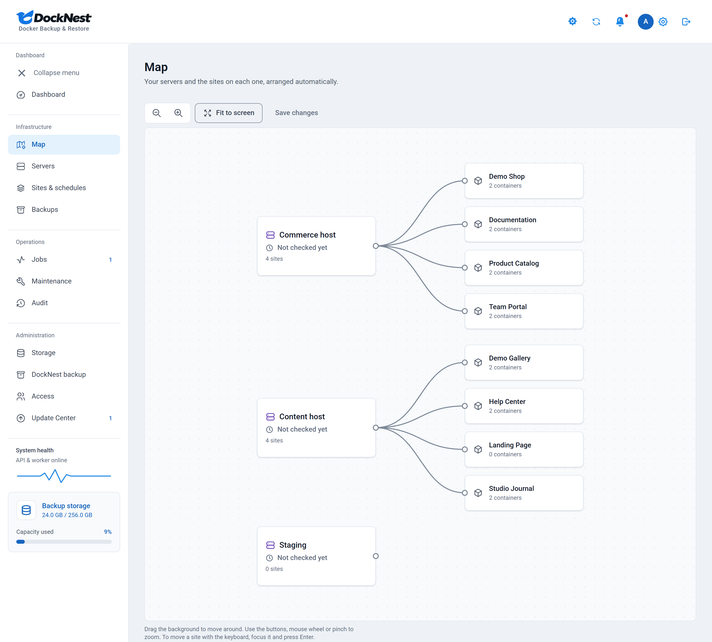
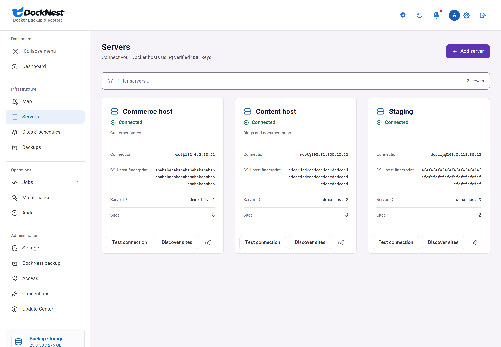
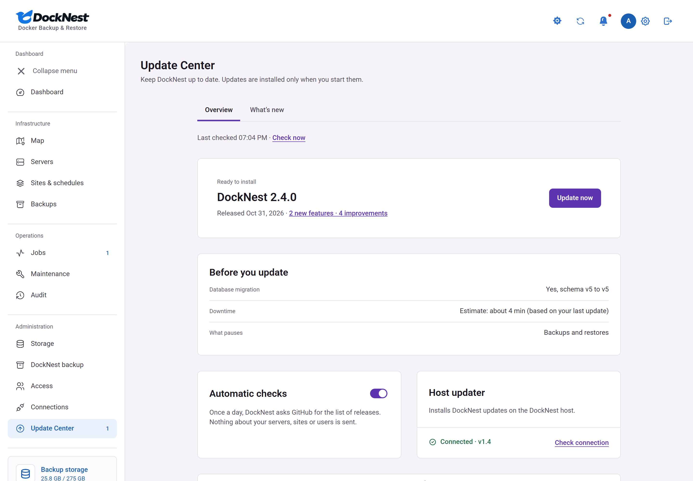

<div align="center">
  
  <p><strong>Back up Docker sites. Verify recovery points. Restore a private copy.</strong></p>
  <a href="https://github.com/DahanItamar/DockNest/releases/latest"></a>
  <a href="https://github.com/DahanItamar/DockNest/actions/workflows/ci.yml"></a>
  
  <a href="LICENSE"></a>
</div>

<p align="center">
  <a href="#install">Install</a> ·
  <a href="#using-docknest">Using DockNest</a> ·
  <a href="#updating">Updating</a> ·
  <a href="#documentation">Documentation</a> ·
  <a href="https://github.com/DahanItamar/DockNest/releases/latest">Latest release</a> ·
  <a href="https://trydocknest.com">Website</a>
</p>


## What it does

DockNest is a self-hosted web app. It connects to your Linux servers over SSH, backs up each Docker or static nginx site to storage you own, and lets you restore any backup to a separate copy to check that it works.

- Discovers the Docker projects and static nginx sites on each server you connect.
- Backs up each site on its own schedule to encrypted SFTP or S3-compatible storage. Connect storage starts with a provider (own server or NAS, Hetzner, rsync.net, MinIO, Amazon S3, Cloudflare R2, Backblaze B2, Wasabi or another) and fills in its defaults.
- Verifies recovery points and restores them to a separate copy. The live site is not overwritten.
- Shows live progress, the steps of each job and the reason when one fails.

> [!NOTE]
> DockNest runs real Docker and static sites in production, and every release passes real Linux Docker tests. The [support matrix](docs/support-matrix.md) lists the tested configurations. Incremental backups are still in beta.

## Features

**Backup and restore**
- Captures images, volumes, bind mounts, writable layers and databases. Database capture is handled for PostgreSQL, MySQL/MariaDB and Redis.
- Per-site schedules, retention, and pinned backups.
- Restore to a separate copy; DockNest does not replace a live site by itself.
- Automatic restore tests: on a schedule, DockNest restores the latest verified backup onto a test server, starts it in isolation, checks it and removes it. See [restore tests](docs/restore-tests-guide.md).
- Keep up to three extra copies of each backup on other storage, for example SFTP plus S3, each with its own retention.
- Download a backup as an encrypted file or as a ZIP. An increment downloads as a chain (encrypted packages plus an order file) from the backup library.
- Incremental backups (beta, off by default): a full backup, then increments that hold only the files that changed in your mounts. Every restore point still restores to a complete copy. Images are saved as before, so the saving comes from mount data. After a backup that contains folder renames, the next backup is full. See [incremental backups](docs/incremental-backups.md).
- Optional maintenance page, designed in a visual editor, while a site is paused. For sites behind nginx on the server, DockNest sets it up, tests it on your domain and undoes it if anything fails.

**Operation**
- Jobs page with transfer progress, a step timeline and plain-language error explanations.
- DockNest can back up its own data to your storage. See [self-backup](docs/docknest-self-backup.md).
- A recovery kit restores DockNest and rebuilds backups without it. See [independent recovery](docs/independent-recovery.md).
- Storage page with space per site and per destination, and growth over time.
- Update Center with an opt-in update check and click-to-update through a host updater.
- Problem reports that open a pre-filled public GitHub issue with typed values only, after you review what is shared.
- Light and dark themes, and a layout for phones.

**Map and moving sites**
- A Map page shows your servers, their sites and your backup storage as connected nodes. Click any node for its details, such as the databases that move with a site.
- The "+" on a server lists sites DockNest found there that you have not added yet.
- Administrators move a site to another server by dragging it to that server and pressing Save changes. DockNest shows how long the move takes and how long the site is offline, then backs up the site, tests a copy on the new server and waits for your DNS change before switching.
- The old copy is kept stopped for 7 days, so you can switch back. Removing it is never automatic. See [moving sites](docs/moving-sites.md).
- When the new server is missing nginx, Docker, Docker Compose or certbot, DockNest can install it for you after you confirm, or show you the command to run yourself.

**Alerts**
- Get an alert in Telegram, email, WhatsApp, Discord, Slack, Microsoft Teams, Google Chat, Mattermost, ntfy, Gotify, Pushover, Matrix or a webhook when a backup fails or passes, a move finishes or needs you, a server is unreachable or low on disk, or a new version is out.
- Save the login once in Administration, Connections (encrypted, never shown again), then add an alert node on the Map, draw a line from DockNest, a server or a site, and pick the events. See [alerts](docs/alerts.md).

**Security**
- Backups are encrypted with AES-256-GCM.
- Optional S3 Object Lock: backups cannot be deleted or changed until the date you set, even by DockNest.
- SSH host keys are pinned and checked before connecting.
- Every user signs in with a password and an authenticator app.
- The dashboard never uses the Docker socket.



<table>
  <tr>
    <td width="50%"></td>
    <td width="50%"></td>
  </tr>
  <tr>
    <td width="50%"></td>
    <td width="50%"></td>
  </tr>
</table>

## Requirements

| Where | What you need |
| :-- | :-- |
| DockNest host (runs the dashboard) | Linux with Docker and Docker Compose, and Node.js 24 for the one-time setup. |
| Each server you back up | Linux, Docker, Python 3.9 or newer and SSH with a key. Root access, and free disk space for a temporary copy (or use direct streaming). |
| Backup storage | SFTP server that supports `fsync@openssh.com`, or an S3-compatible bucket. S3-compatible storage is supported: backup and restore are validated against a MinIO-compatible server, and Cloudflare R2 passed a manual run; other providers are not tested on every release. See [storage backends](docs/storage-backends.md). |
| You | A browser and an authenticator app. |

## Install

### Build from source (default)

```sh
git clone https://github.com/DahanItamar/DockNest.git
cd DockNest
npm ci
npm run setup
```

Setup creates `.env`, `data/master.key` and `data/setup.token`. Keep them private and keep a safe copy of `data/master.key`. Without it your backups cannot be decrypted, and resetting the password does not help.

Point a domain at the host, open ports 80 and 443, and set these in `.env`:

```dotenv
APP_DOMAIN=backup.example.com
APP_ORIGIN=https://backup.example.com
SECURE_COOKIES=true
```

Start everything. Caddy obtains the HTTPS certificate:

```sh
docker compose --profile https up -d --build
```

If you already run an HTTPS reverse proxy, leave out `--profile https`. See [Deployment](docs/deployment.md).

### Published image (alternative)

Final releases are published as a signed `linux/amd64` image, `ghcr.io/dahanitamar/docknest`. Set `DOCKNEST_IMAGE` in `.env` to a tag and use `compose.override.example.yaml` as your `compose.override.yaml`. The steps and the signature check are in [Use the published image](docs/upgrading.md#use-the-published-image). On ARM hosts, build from source.

### Try it locally

```sh
npm ci
npm run setup
npm run build
npm start
```

In a second terminal run `npm run worker`, then open http://127.0.0.1:3000. On Windows PowerShell, use `npm.cmd` if `npm` is blocked.

## Using DockNest

1. **Sign in.** Use the setup token from `data/setup.token`, add your authenticator app and save the recovery codes.
2. **Connect storage** under **Storage**.
3. **Add a server** and confirm its SSH fingerprint. See [server connection](docs/server-connection.md).
4. **Add a site.** DockNest discovers Docker projects and static nginx sites; review what it found. See [site setup](docs/site-setup.md).
5. **Check readiness.** The maintenance page is optional. Without it, visitors may see an error for the few seconds a Docker site is stopped.
6. **Run a backup**, then watch it under **Jobs**.
7. **Verify and restore.** Restore a recovery point to a separate copy to confirm it works. See [recovery verification](docs/recovery-verification.md).
8. **Turn on the schedule** for the site.

Notes:

- ZIP downloads are not encrypted and can contain passwords and keys. Keep them private.
- To set or change the password on Windows, run `scripts\set-admin-password.ps1`.

## Updating

Version numbers and release notes are on the [latest release](https://github.com/DahanItamar/DockNest/releases/latest) page, and in the [changelog](CHANGELOG.md).

**From the app.** Administrators have an **Update Center** page. Nothing contacts GitHub until an administrator agrees once; after that DockNest checks the public release list daily. An update starts only when an administrator confirms with the password and an authenticator code. It runs through a small root service on the host, the host updater, which you install once on the DockNest host (Linux with systemd and rootful Docker; not Docker Desktop or rootless Docker):

```sh
sudo scripts/install-updater.sh
```

**From the command line.** The updater is optional. Without it:

```sh
scripts/upgrade.sh              # newest final release
scripts/upgrade.sh --dry-run    # show the plan only
```

With the host updater installed, a command-line upgrade that cannot register the new version itself (for example a checkout not owned by root) ends by printing the `sudo scripts/install-updater.sh --repair` command to run.

Before going back to 2.11 from 2.12, turn incremental backups off for every site, then make a backup. Details, rollback and exit codes: [Upgrading](docs/upgrading.md) and [Host updater and Update Center](docs/upgrading.md#host-updater-and-update-center). The in-app update path is in use on a real Linux Docker host.

## Security and privacy

- Backups are encrypted, SSH host keys are pinned, and sign-in needs a password plus an authenticator app.
- Backups never copy password files, sudo rules or SSH and GPG keys, including `.ssh` and `.gnupg` folders inside mounted host folders (Docker volumes are copied whole); the job result names what was left out. Restored files never keep setuid or setgid bits.
- Update checks are off until an administrator opts in, and send nothing about your servers, sites or users. See [outbound requests](docs/security.md#update-checks-outbound-requests).
- Problem reports contain typed values only (no names, addresses, paths or error text), you review them first, and the server sends nothing. See [problem reports](docs/security.md#problem-reports).

Full model: [docs/security.md](docs/security.md). Report vulnerabilities privately as described in [SECURITY.md](SECURITY.md).

## Documentation

| Topic | Guides |
| :-- | :-- |
| Setup | [Deployment](docs/deployment.md) · [Server connection](docs/server-connection.md) · [Site setup](docs/site-setup.md) · [Storage backends](docs/storage-backends.md) · [Moving sites](docs/moving-sites.md) · [Alerts](docs/alerts.md) |
| Recovery | [Support matrix](docs/support-matrix.md) · [Database contracts](docs/database-contracts.md) · [Recovery verification](docs/recovery-verification.md) · [Independent recovery](docs/independent-recovery.md) · [Restore tests](docs/restore-tests-guide.md) · [Incremental backups](docs/incremental-backups.md) · [DockNest self-backup](docs/docknest-self-backup.md) |
| Internals | [Backup format](docs/backup-format.md) · [Remote helper](docs/remote-helper.md) · [Security](docs/security.md) · [History API](docs/history-api.md) · [Interface design](docs/design/DESIGN.md) |
| Upgrades | [Upgrading and rollback](docs/upgrading.md) · [Update Center design](docs/update-center.md) · [Host updater threat model](docs/updater-threat-model.md) · [Release validation](docs/release-validation.md) |
| Quality | [Acceptance and limits](docs/acceptance.md) · [Repository privacy](docs/repository-privacy.md) |

## Support and contributing

- Bug or problem: open an [issue](https://github.com/DahanItamar/DockNest/issues/new/choose), or use **Report a bug** under Settings > About in the app.
- Questions and ideas: [Discussions](https://github.com/DahanItamar/DockNest/discussions).
- Security issues: privately, see [SECURITY.md](SECURITY.md).
- Contributing: [CONTRIBUTING.md](CONTRIBUTING.md) covers setup and the checks every pull request runs.

## License

[GNU AGPL-3.0](LICENSE). Bundled fonts and dependencies keep their own licenses.
