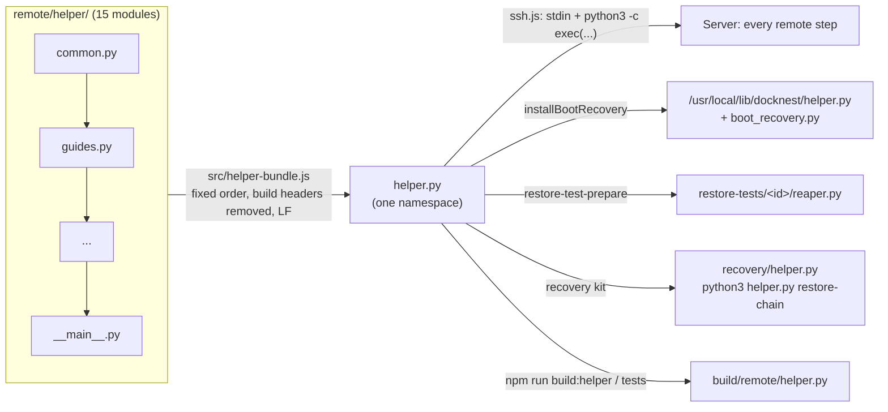
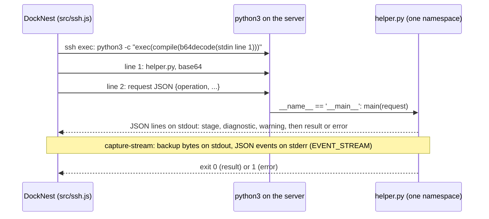
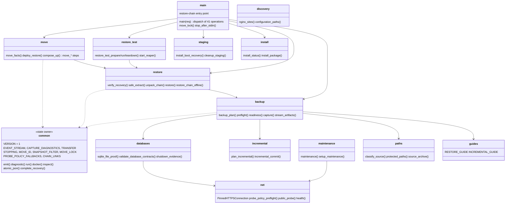

# Remote helper: source package and one-file build

The remote helper is the Python program DockNest runs on each server, as root, for every remote step: discover,
backup, restore, restore tests, moves, installs and the maintenance page. It uses only the Python 3.9+ standard library.

- **Source:** the package `remote/helper/`, one module per domain.
- **Shipped:** one file, `helper.py`, built by `src/helper-bundle.js`. Servers, boot recovery, the restore test reaper
  and the recovery kit all get this one file, exactly as before the split.

## Layout

```text
remote/
├── helper/                 source package (not importable on its own; see __init__.py)
│   ├── common.py           version, emit/diagnostic, run/docker/inspect, staging base, atomic files,
│   │                       and ALL mutable runtime state
│   ├── guides.py           restore guide texts written into every backup
│   ├── paths.py            protected paths, mount table, source classification, source archives
│   ├── databases.py        SQLite proofs, PostgreSQL/MySQL/Redis contracts, clean shutdown, data checks
│   ├── backup.py           backup plan, artifact streaming and checks, static sites, preflight, readiness, capture
│   ├── incremental.py      snapshot state, chain records, commit and discard
│   ├── net.py              pinned HTTP(S), probe URL policy, public probes, health checks
│   ├── maintenance.py      maintenance page on/off, deployment, automatic nginx setup
│   ├── discovery.py        Docker project and nginx site discovery, configuration files, tmpfs
│   ├── restore.py          recovery checks, safe extraction, chains (incl. restore-chain), isolated restore
│   ├── staging.py          boot recovery installation, staging folder list and cleanup
│   ├── move.py             site moves: facts, deploy, compose override, nginx, cut-over steps
│   ├── install.py          fixed-argv package installs (nginx, Docker, Compose, certbot)
│   ├── restore_test.py     automatic restore tests: prepare, run, probe, teardown, reaper
│   └── __main__.py         locks, stdin watcher, operation dispatch (main), command-line entry points
├── boot_recovery.py        boot driver; imports names from the built helper.py
├── export_zip.py           ZIP export
├── helper_path.py          makes the Python tests import the built helper.py (refuses a stale one)
└── test_*.py               Python tests (run against the built helper.py)
src/helper-bundle.js        joins the modules into helper.py (HELPER_MODULES order)
build/remote/helper.py      written by `npm run build:helper` for tests (gitignored, never served)
```

## How it is built and run



The app builds the bundle in memory once per process from the checked-in source (`helperSource()`), so the bytes sent
to a server can never be older than the source. The output is the same on every OS (LF line endings).

A remote step, end to end:



## Modules

Arrows show which module's names a module calls. They are call-time references in one namespace, not imports at load
time, so they cannot form import cycles. `common` and `guides` depend on nothing.



The full, exact dependency list of each module is its build header (the `from .x import ...` lines at the top).

## Rules

1. **Mutable state lives in `common.py` only.** Anything rebound with `global` or changed in place (`EVENT_STREAM`,
   `CAPTURE_DIAGNOSTICS`, `TRANSFER`, `STOPPING`, `MOVE_ID`, `SNAPSHOT_FILTER`, `MOVE_LOCK`, `PROBE_POLICY_FALLBACKS`,
   `CHAIN_LINKS`). The bundle is one namespace, so `main()` setting `EVENT_STREAM` is what `emit()` reads.
   `remote/test_bundle.py` fails if state is defined anywhere else.
2. **Load order.** A top-level statement may only use, while the module loads, names defined earlier in
   `HELPER_MODULES` order. Function bodies may call anything. `remote/test_bundle.py` checks this.
3. **Build header.** Each module has exactly one `# <build:header>` … `# </build:header>` block. It holds imports
   for editors only and is removed from the bundle. Never import shared state there.
4. **New module:** add the file and its name to `HELPER_MODULES` in `src/helper-bundle.js` (the build refuses a
   module that is not listed, or a listed one that is missing).
5. **Tests** import the built file: `import helper_path` before `import helper`. Patch with `patch('helper.name')`.
6. **Never import `remote/helper/` directly**; `__init__.py` refuses it on purpose.

## Compatibility

- `VERSION=1` does not change: it is also the backup `formatVersion` that restores require.
- Old backups, recovery kits and running restore test reapers each hold their own complete helper and keep working.
  Their guide texts (`python3 helper.py restore-chain ...`) stay true: the kit still ships `recovery/helper.py`.
- Boot recovery: the installed copy is compared by SHA-256. After upgrading to the release with this layout, sites
  with boot recovery show it as outdated until it is reinstalled, as after any helper change. The old copy keeps
  working until then.

## Verifying a change to the layout

- `npm run check` runs every test against the built file (the test run writes it first), including `tests/helper-bundle.test.js`
  (every operation through the real server loader answers in JSON; `capture-stream` keeps stdout clean) and
  `remote/test_bundle.py` (state and load-order rules).
- `python3 scripts/verify-helper-split.py OLD_HELPER.py build/remote/helper.py` proves two builds are the same
  program: identical function and class ASTs, identical other statements, safe order. The split itself was checked
  against `git show 48105c3:remote/helper.py` (307 functions and classes, 103 other statements, all identical).
