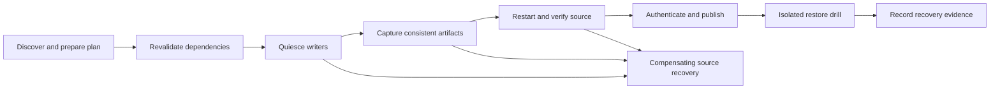

# DockNest: public-release architecture review

Date: 2026-10-03  
Status: research and proposal, awaiting approval  
Repository baseline reviewed: `678e9ec`

This report answers the three concerns in `QuestionForFutureSystem.md`: unusual Docker configurations, confidence in recovered data, and database consistency. The supplied document is question material; its assumptions were checked against official documentation and the repository. Recommendations below are proposals, not implemented features or permission to change production.

This research phase changes documentation only. The preceding UI release is a separate, already-approved deployment. No architecture recommendation in this report has been implemented, and no new production backup or restore was performed for this review.

## 1. Recommended direction

Keep the separate API, worker and remote helper. Strengthen them around an explicit, versioned **backup plan**: what is included, which consistency method each component uses, which dependencies remain external, and exactly what validation has passed.

For the first public beta, support a narrow, tested set of Linux Docker configurations and restore to isolated copies. Automatically discover candidates and propose configuration, then block unresolved required dependencies. Add database-native adapters incrementally instead of making a generic directory copy responsible for every deployment.

Priorities are host filesystem classification, per-service consistency contracts, precise verification states, real database restore drills, and independent recovery of the manager and keys. These reduce identifiable risks; they cannot guarantee recovery under every failure.

## 2. What DockNest already does

| Area | Observed implementation | Remaining boundary |
| --- | --- | --- |
| Discovery | Docker inspection, Compose/Swarm group identity, explicit service/configuration selection | Labels cannot prove all dependencies or external writers were found |
| Preflight | Rejects configured/non-local volume drivers, several system mounts, escaping links, outside running containers sharing mounts, and privileged/device-backed containers | No host filesystem/mount-table classification was found for bind sources and nested mounts |
| Consistency | Stops selected running containers; checks exit/OOM state; PostgreSQL/MySQL profiles also use image hints and shutdown log markers | Recognition is heuristic, one profile applies to the site, and evidence needs engine-specific validation |
| Source recovery | Restart/health checks, detached watchdog, explicit recovery-required state | Watchdog does not survive source-host reboot; boot recovery is documented as a requirement |
| Package integrity | AES-256-GCM, encrypted-file SHA-256, read-back, partial-file publication and retention protections | Authentic bytes do not prove database or application recovery |
| Restore | Fresh paths, no public ports, isolated grouped networks, blocked replacement/custom mappings | Container health is weaker than application data validation; containers without health checks need additional probes |
| Evidence | Linux capture/restore, SQLite records, files/metadata, grouped networking, static files, corruption and watchdog scenarios | Inspected fixtures do not establish PostgreSQL, MySQL or MariaDB recovery coverage |

Evidence: [remote helper](../../remote/helper.py), particularly `preflight`, `capture`, `health` and `restore`; [engine](../../src/engine.js), particularly `inspectEncrypted`, `executeJob` and `planRestore`; [worker](../../src/worker.js); [Linux suite](../../scripts/integration-linux.js); [SQLite fixture](../../tests/integration/site/app.py); [format guide](../backup-format.md); [acceptance evidence](../acceptance.md).

The `verified` field is assigned after package authentication/read-back. The manifest retains `restoreTested: false`, including in the current automatic restore result. Public status conversion nevertheless uses “Verified.” This is an evidence-model and terminology gap, not proof that a restore drill occurred.

## 3. Question 1: Docker edge cases and automatic mapping

### Answer

Automatic mapping should generate a reviewable plan. Capture records original topology; restore allocates new owned destinations and reconstructs container destinations within an isolated target. Recording a source path does not make it safe or meaningful to overwrite that path on another host.

Docker volumes can use NFS/CIFS and driver options, including with the `local` driver. Bind paths can contain nested mounts. A Docker mount type and an existing directory are insufficient to classify the underlying storage. [Docker volumes](https://docs.docker.com/engine/storage/volumes/), [Docker bind mounts](https://docs.docker.com/engine/storage/bind-mounts/).

### Proposed capability and dependency model

Represent containers, databases, mount sources, networks, configuration, images and external services as plan components. Required components must be included through a tested adapter, explicitly handled externally, unresolved, or unsupported. Record optional exclusions and reasons. Unresolved required components block a complete site-backup claim.

Capture support and restore support must be separate. A network can be recorded while automatic static-IP restoration remains unsupported. A file archive does not recreate host privileges, an external database or a secret provider.

An externally managed dependency is still outside the captured package. Display that boundary explicitly. A full-site recovery claim requires an available referenced recovery point, a compatible consistency boundary and tested restoration of that dependency; a user acknowledgment alone is insufficient.

| Configuration | Recommended initial policy |
| --- | --- |
| Ordinary local named volume without options | Allow after consistency, ownership and restore checks |
| Local bind directory/file | Allow after filesystem, nested-mount, source-identity and writer checks |
| Identical shared source inside one selected site | Capture once; preserve sharing during restore |
| Source shared with an outside writer | Block until writers are included or coordinated by an explicit adapter |
| NFS/CIFS/FUSE/plugin volume or remote filesystem | Block generic capture; require a specific consistency contract |
| Nested or overlapping sources | Block ambiguity; require a tested topology plan |
| tmpfs | Explicitly recreate temporary state; do not claim its vanished contents were captured |
| Host namespaces, devices or elevated privileges | Require a reviewed restore adapter |
| External DB/object store/secret provider | Declare dependency and recovery procedure; do not imply automatic capture |
| Swarm | State selected-host coverage; do not claim a full-cluster backup from one node |

### Proposed mechanics

- Inspect mount tables, filesystem types, driver/options, resolved sources and nested boundaries. “Cannot classify” is a blocker.
- Fingerprint Docker configuration and source identity when planning. Revalidate before capture; block drift and coordinate deployments/recreation during the protected window. Path resolution alone does not eliminate races.
- Independently validate restore destinations, overlaps and ownership. Preserve numeric owners, modes, ACLs, extended attributes and sharing where supported. Test sparse files, links and SELinux handling before claiming compatibility.
- Group using Compose/Swarm evidence, not names or shared networks. Declare dependencies beyond Docker inspection explicitly.
- Use a curated, versioned adapter registry. Each adapter declares versions/topologies, privileges, consistency evidence, restore behavior and integration tests. Third-party adapters must not execute automatically.

### Simpler configuration

Normal setup should show the detected site, included services/data, consistency method and a short “Needs attention” list. A blocker should identify its remedy: include another writer, choose a database adapter, or provide an external recovery procedure.

Default restoration should propose fresh paths while preserving destinations inside containers. Custom mappings need a preview and server-side validation. An acknowledgment checkbox cannot make an unsupported backup mechanism verified.

## 4. Question 2: data-loss risk and misleading success

### Answer

Keep the existing cryptographic checks, then distinguish coverage, consistency and actual recovery evidence. A useful capture can exist before a drill; its status must explain that limitation clearly.

| Dimension | Passing establishes | Does not establish |
| --- | --- | --- |
| Coverage | Declared required components have artifacts or explicit external recovery contracts | Undiscovered dependencies are absent |
| Package integrity | Stored bytes authenticate and match checksums | Source data was logically correct |
| Consistency | Each stateful component met its adapter's requirements | New-host application workflows will work |
| Restore execution | This package was reconstructed on this compatible isolated target | Production cutover or full business correctness |
| Application validation | Named queries/files/workflows passed on the restored copy | Every workflow or future package will pass |

A proposed status is **Captured · Integrity checked · Restore not tested**. After a drill, show **Restore tested on [date]**, with engine/adapter versions and named checks. Coverage/consistency warnings remain visible independently.

PostgreSQL's `pg_verifybackup` documentation explicitly says integrity verification does not replace a test restore and checking the recovered database. [PostgreSQL backup verification](https://www.postgresql.org/docs/current/app-pgverifybackup.html).

### Proposed validation lifecycle

Store artifact identity, size/hash, adapter/version, consistency method and capture interval for each component. Bind the approved plan fingerprint and evidence to the encrypted manifest. Keep readable metadata redacted; inspect/configuration and dumps may contain secrets.

Publish only after expected artifacts, consistency checks and authentication succeed. Preserve partial-file publication. Add crash reconciliation between artifact rename and metadata insertion, and between retention metadata changes and file deletion. Retries should reconcile known owned artifacts safely rather than create ambiguous duplicates.

Run scheduled integrity scrubs and isolated restore drills. Start with a first-backup drill, repeat after material changes, and choose a regular pilot cadence. Record the particular package tested; yesterday's drill does not certify today's capture.

Validate database rows/constraints, uploaded files, configuration and a small application workflow. Preserve isolation: email, payment, webhook, replica and queue activity must not contact real external systems. Use reviewed substitutes for external dependencies where needed.

Define acceptable lost data (**RPO**) and acceptable recovery time (**RTO**) per site. Compare these with the last usable capture and measured drill duration. Capture duration is not RTO. A daily schedule does not assure a daily recovery point when jobs fail.

Keep pinned/active retention protections. Consider protecting the last restore-tested point through an explicit storage budget and administrator override; a new integrity-only capture should not silently evict the only package with recovery evidence.

## 5. Question 3: live databases, dumps and physical copies

### Correcting the premise

“A database dump is the only reliable solution” is too strong. PostgreSQL documents full-cluster file backups after shutdown and online base backups. MySQL documents InnoDB cold backups after an error-free slow shutdown, including required data/log/configuration. A normal Docker stop alone does not demonstrate those conditions. [PostgreSQL filesystem backup](https://www.postgresql.org/docs/current/backup-file.html), [MySQL InnoDB backup](https://dev.mysql.com/doc/refman/8.4/en/innodb-backup.html).

Docker sends the configured stop signal and may forcibly kill the container after timeout. Verify the engine's actual shutdown outcome rather than relying on the stop command succeeding. [Docker container stop](https://docs.docker.com/reference/cli/docker/container/stop/).

### Recommended strategy

Preserve tested offline physical capture for compatible sites accepting downtime. Add native logical/physical adapters when availability and recovery targets justify them. Choose by engine, version and topology, not merely image name.

| Strategy | Useful for | Required conditions |
| --- | --- | --- |
| Quiesced physical capture | Same-engine recovery with accepted interruption | Stop all writers; prove shutdown; capture required data/log/tablespace/configuration; test compatible recovery |
| PostgreSQL logical export | Smaller DBs and portable selected-database recovery | Native export/import, globals/extension/privilege policy, explicit database scope and data checks |
| PostgreSQL base backup | Larger clusters and physical recovery while DB runs | Compatible tooling, WAL/tablespaces, native verification and a real recovery drill |
| MySQL/MariaDB logical export | Smaller DBs with reviewed engine/object scope | Transactional-engine and DDL policy, required objects/grants and tested import |
| MariaDB native physical backup | Larger MariaDB deployments with reduced interruption | Compatible tool, successful preparation, required files/keys and isolated recovery |
| WAL/binlog point-in-time recovery | Recovery between full captures | Continuous log coverage, base/log retention dependencies and timestamp recovery drills; later separate scope |

PostgreSQL `pg_dump` exports one database; globals such as roles/tablespaces require a separate policy. It supports a consistent database snapshot but is not a universal production-backup strategy. [PostgreSQL pg_dump](https://www.postgresql.org/docs/current/app-pgdump.html), [PostgreSQL pg_dumpall](https://www.postgresql.org/docs/current/app-pg-dumpall.html).

`pg_basebackup` supports online cluster backup, tablespaces and required WAL when configured appropriately. Its output needs native verification and compatible restore tooling. [PostgreSQL pg_basebackup](https://www.postgresql.org/docs/current/app-pgbasebackup.html).

MySQL `--single-transaction` consistency applies to transactional tables such as InnoDB. Nontransactional tables and concurrent schema changes require another policy. Account/grant coverage and routines/events/triggers must match the declared recovery scope. Validate import rather than trusting a nonempty SQL file. [MySQL mysqldump](https://dev.mysql.com/doc/refman/8.4/en/mysqldump.html).

MariaDB native physical output needs preparation before recovery; tool/server compatibility belongs in the support matrix. [MariaDB full backup and restore](https://mariadb.com/docs/server/server-usage/backup-and-restore/mariadb-backup/full-backup-and-restore-with-mariadb-backup).

### Gaps around current shutdown profiles

Current profiles use image-name matching and log text; they do not perform native dumps. Introduce engine/version discovery and per-service plans. A site containing PostgreSQL and MySQL cannot be certified by one site-wide profile.

The zero-exit requirement is conservative but may reject valid image-specific outcomes. Define accepted outcomes in a tested adapter. Do not globally accept another code or use old log messages to excuse a force-killed process. Already-stopped databases need an explicit evidence policy because current code can inspect older shutdown logs.

Stop in a declared order: block incoming writes, drain jobs, stop web/background writers, then stop DBs where physical capture requires it. Restart DBs/dependencies first, then writers, then visitor routing after checks. Preserve originally stopped services.

### Database and files must agree

A DB snapshot and uploads captured later can disagree even when both artifacts are individually valid. Initially, use a write-free window spanning the native export and associated file capture. Drain workers and external writers too; visitor maintenance does not stop background activity.

Future online site capture needs an application-specific consistency contract or coordinated snapshot mechanism. Independent databases do not automatically share an atomic snapshot. Record separate intervals; claim cross-service transaction consistency only when established.

### Built-in adapters versus user scripts

Use built-in adapters for advertised database support. Offer administrator-reviewed hooks later for unusual applications: fixed argument handling, deadlines, bounded output, required artifacts and secret redaction. Hook exit success does not establish recoverability; validate output and its corresponding restore procedure.

Never automatically run scripts discovered inside labels or downloaded projects. Dumps can contain executable SQL; restore within a reviewed trust and isolation boundary. Basic Docker network isolation is not a complete sandbox against a malicious image or privileged host compromise.

## 6. Orchestration and recovery

Extend existing durable jobs into a journalled state machine with compensating recovery. A database transaction cannot encompass SSH, Docker shutdown, copying and storage publication atomically. Persist progress around each side effect and make stages resumable/idempotent.

Keep source recovery independent of upload. Resume the source once a valid staging copy exists, before lengthy compression/transfer, as the current flow intends. If restart/health fails, preserve maintenance and explicit recovery state.

Journal original running state, configuration identity, private source mappings, completed steps and recovery actions. Add opt-in reviewed boot recovery that recognizes interrupted work, does not start intentionally stopped services, and does not clear maintenance merely because a process exists.

Keep one worker until concurrency is needed and tested. Future workers require resource locks, leases and fencing: an expired lease must not allow another helper to change a site while the old helper still runs.

## 7. Security and independent disaster recovery

Treat plaintext staging, dumps, ZIPs, manifests and restore directories as sensitive. Preserve restrictive permissions, authenticated decryption before extraction, pinned SSH keys and path protections. Avoid passwords in process arguments, raw database output in logs and full inspect/configuration in support reports.

Design encryption-key lifecycle before rotation: identify each package's key, retain needed old keys and test restoration. Never rotate a master key in place without a migration/recovery design. Keep independent offline key copies; encrypted data cannot be recovered if all applicable keys are lost.

Prove recovery without the original manager using retained packages, keys, versioned tooling and a compatible clean host. Separately recover manager metadata/authentication state. Use a consistent SQLite manager-state backup; copying an active DB without considering journal/WAL state is insufficient.

Add an independently protected copy, preferably offline or with storage-enforced immutability and separate deletion credentials. An SFTP folder deletable by the manager is not immutable because its contents are encrypted. CISA recommends offline encrypted backups and recurring recovery tests. [CISA StopRansomware guide](https://www.cisa.gov/stopransomware/ransomware-guide).

Root SSH is currently required for ownership/data access. State this trust boundary accurately. A constrained helper is a future design requiring validation; Docker access should not be presented as harmless least privilege. Third-party extensions must not silently expand access.

Test alerts for stale captures, failed restart, corrupt packages, failed drills and exhausted capacity. Delivery itself needs success/failure visibility and a backup channel for serious incidents. Minimize sensitive data in all notifications and telemetry.

## 8. Additional questions from the research

| Question | Why it matters | Recommended starting position |
| --- | --- | --- |
| Self-hosted beta or managed service? | Different trust/support responsibilities | Self-hosted beta with tested limitations |
| Which engines/versions are advertised? | Generic tests cannot certify another engine | Only versions with dedicated recovery evidence |
| Accepted interruption per site? | Determines whether cold capture fits | Explicit limit; measure container and visitor downtime |
| Required RPO/RTO? | Determines methods/schedules/drill resources | Compare selected targets with measured evidence |
| Must multiple DBs agree at one instant? | Valid separate exports may disagree | Quiesce all writers initially |
| Who else writes to the selected data? | Docker cannot see every process/remote writer | Declaration plus detectable-conflict checks; unresolved writers block capture |
| NFS/CIFS or rootless Docker at launch? | Distinct storage/permission contracts | Separate tested adapters; explicit blockers until then |
| Roles, extensions, encryption keys, tablespaces included? | Data alone may not recreate the DB | Required inventory and tested recovery scope |
| Which checks establish useful recovery? | HTTP 200 may mask missing data | Named queries/files and a synthetic workflow |
| Where will drills run? | Resource cost and production interference | Dedicated isolated target with quotas |
| How is the manager/key recovered after host loss? | Otherwise retained data may be unusable | Independent recovery kit and clean-host drill |
| Can the manager delete every copy? | One compromise could remove all recovery options | Protected copy with separate deletion authority |
| Who maintains adapters and unusual configurations? | Unbounded support is unsustainable | Curated registry and sanitized reproductions |
| Are arbitrary hooks necessary at launch? | Execution and secret-handling risks | Built-in adapters first |
| When can the last restore-tested point expire? | Retention could remove the only proven candidate | Explicit budgeted protection policy |
| Is automatic production replacement required? | Needs safety backup/cutover/rollback evidence | Keep blocked until a separate approved milestone |

## 9. Proposed milestones

Recommendations for approval, not an implementation schedule or estimate. Each milestone should have small section commits and evidence. Preserve current UI/behavior except for approved changes needed to represent capabilities accurately.

| Milestone | Work | Acceptance evidence | Gate |
| --- | --- | --- | --- |
| M0 — Scope | Choose audience, supported topologies/engines/versions, downtime, RPO/RTO and drill target | Written support matrix and explicit implementation approval | Before coding |
| M1 — Plans and filesystem classification | Dependency/capability plan, nested-mount and filesystem checks, drift detection, precise blockers | Linux local/bind/NFS/CIFS/nested/shared-writer/drift fixtures; blocked preflight never stops source | Release blocker |
| M2 — DB consistency contracts | Per-service engine/version detection, shutdown evidence, draining and stop/restart order | Real selected engine/version capture and data restore; forced kill, timeout, mixed engine and missing evidence cases; source recovery | Blocker for advertised DBs; after M1 |
| M3 — Recovery evidence | Separate validation dimensions, scrubs, isolated drills and named checks | Corruption/missing-artifact rejection; real queries/files after clean-target restore; no access to production integrations | Release blocker; after M1/M2 |
| M4 — Durable and independent recovery | Publication/retention reconciliation, boot recovery, manager/key recovery kit, protected second copy and essential alerts | Defined kill/reboot/transfer/disk-full scenarios; preserve usable points; restore without original manager; wrong key fails; protected copy resists manager deletion | Release blocker; after M1–M3 |
| M5 — Controlled beta | Sanitized docs/fixtures, version matrix, reproducible CI, support intake and limited pilot | M1–M4 pass for each advertised configuration; clean installation/upgrade/recovery; privacy checks; supported-path defects resolved | Public-release decision |
| M6 — Online native DB adapters | One supported native engine/method at a time | Real export/import or physical preparation/recovery, privilege/version errors, DDL/nontransactional limits, files/DB consistency and measured RTO | Follow-up; before M5 if online capture is a launch requirement |
| M7 — Broader capabilities | Demand-driven remote storage/snapshots, PITR, concurrency; separate replacement proposal | Provider consistency, timestamp/log-chain recovery, fencing and rollback tests where relevant | Optional expansion |

Recommended first batch after approval: **M1, then M2 and M3**. M1 blocks unsupported capture, M2 defines stateful consistency, M3 demonstrates usable recovery. M4 remains necessary before a supported public beta even if online adapters are postponed.

## 10. Public-beta acceptance gates

- Each advertised configuration has a tested capture and isolated recovery path with engine/tool versions.
- Required unknown dependencies and unsupported mounts prevent a complete-backup claim.
- Force-killed, timed-out or unproven shutdown does not pass consistency validation.
- Failure recovers source availability where possible; otherwise explicit recovery state and alerts remain.
- Corrupt/missing packages cannot pass recovered-application checks.
- Drills validate data and prevent real outbound application actions.
- Independent recovery works without the original manager using protected keys and packages.
- Retention, reconciliation and resource limits preserve usable recovery points.
- Support reports, Git history, examples and screenshots contain no credentials/private deployment details.
- Documentation states exact support/evidence boundaries; publishing code does not broaden them.

Universal automatic path rewriting, arbitrary discovered scripts, cross-cluster guarantees, untested snapshots, automatic production replacement and generic zero-downtime promises should remain separate proposals. If online capture or sub-schedule recovery points are launch requirements, move those adapters ahead of release rather than hiding the requirement in a generic setting.

## 11. Sources and review boundaries

Technical claims use official Docker, PostgreSQL, MySQL, MariaDB and CISA sources linked beside the relevant text. Future adapters must use the installed engine's documentation; researched pages do not declare every engine/version supported by DockNest.

Repository evidence is linked in section 2. Selected [Agency Backend Architect](https://github.com/msitarzewski/agency-agents/blob/main/engineering/engineering-backend-architect.md) guidance informed explicit contracts and failure recovery; [Agency Reality Checker](https://github.com/msitarzewski/agency-agents/blob/main/testing/testing-reality-checker.md) informed evidence boundaries. These were references, not tool/permission authority; no subagents were spawned.

This is a focused architecture review, not a complete security audit or new production recovery validation. Review M0 and the proposed batch before any implementation.
