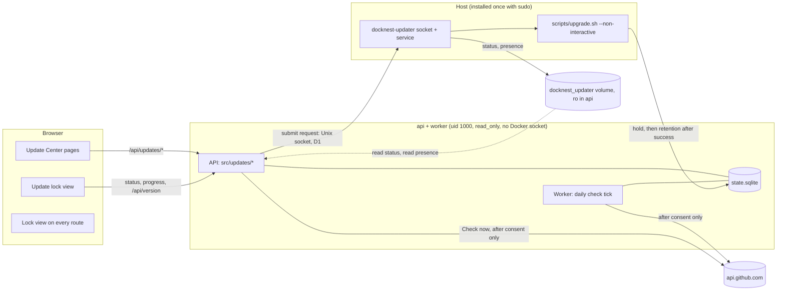
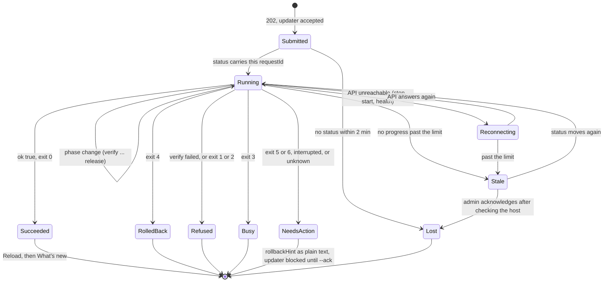

# Update center (2.2.0 design)

Status: design for owner approval. Nothing on this page is implemented or validated. Author role: [Software Architect](https://github.com/msitarzewski/agency-agents/blob/main/engineering/engineering-software-architect.md) (reference only). Date: 2026-10-22.

This page describes how DockNest 2.2.0 checks for releases, offers an upgrade, follows it across the server restart, keeps upgrade leftovers from filling the disk, and shows "What's new". The request and status transport, release verification, the service account and the limits are decided in the [updater threat model](updater-threat-model.md) (decisions D1 to D22). This page uses that transport only through three operations, **submit request**, **read status** and **read updater presence**, and never weakens it.

Inputs: [roadmap 2.2.0](product/roadmap.md), owner decisions Q4 and Q7 in [open questions](product/open-questions.md), [upgrading.md](upgrading.md) (planned request contract and its nine known requirements), `scripts/upgrade.sh`, [release-validation.md](release-validation.md), the [handoff](agents/HANDOFF.md), and the owner decisions of 2026-10-22: upgrade only in the UI, and disk retention for upgrade leftovers.

## 1. Goal and non-goals

**Goal.** An administrator sees that a release exists, reads what changes and clicks once. Then one of three things happens: the new release runs; or the upgrade fails before the metadata changed and the previous release comes back automatically (`upgrade.sh` exit 4, no data lost); or the new release fails after it migrated the metadata, and the upgrade stops with exit 5, backups stay paused and the operator follows the printed rollback commands. Today the third case includes every failed upgrade whose health check fails after a migration, even a purely compatible one such as 2.1 to 2.2 (A10 proposes narrowing it). Repeated upgrades never fill the server's disk. Installations that never install the host updater keep working and see the manual command.

**Non-goals in 2.2.0**

- **No downgrade in the UI** (owner decision). The update center offers Upgrade only. Automatic rollback when an upgrade fails stays. Manual rollback stays CLI-only, as documented in [Rolling back](upgrading.md#rolling-back).
- No Docker socket in any container. The API never runs `docker`, `git` or `upgrade.sh`.
- No unattended or scheduled installs. Only an administrator's click starts an upgrade (Q7).
- No outbound call of any kind before an administrator answers "yes" to the update check. No telemetry, install ID or usage data, ever (Q4).
- No pre-release option anywhere, in the UI or the updater configuration (D11); no arm64 images, no fleet updates, no in-app update of the host updater itself (D6).
- No installing the host updater from the browser, and DockNest never uses its managed-server SSH access to reach its own host. Either would give the API a path to root and defeat the trust boundary; the operator runs the installer once on the host.
- R1 (retention keeps the latest isolated-restore pass) is tracked separately in the backlog.

## 2. Components



| Component | Responsibility | Never does |
| --- | --- | --- |
| `src/updates/check.js` | Calls GitHub, keeps the check cache. Used by the worker schedule and "Check now". | Call anything before consent is yes; send cookies, tokens or identifiers. |
| `src/updates/eligibility.js` | Pure function from inputs to offer (section 6). Shared by the API and tests. | Read files or the network. |
| `src/updates/transport.js` | The only module that touches the updater: `submitRequest()` over the socket, `readStatus()` and `readPresence()` from `/run/docknest-updater` (threat model sections 3 and 4). Parses with caps and an allow-list of fields. | Decide eligibility; write to the updater volume (it is mounted read-only). |
| `src/updates/routes.js` | Admin routes, the public progress route, What's new, request reconciliation. | Pass request values to a shell; trust status text. |
| Worker | Runs the scheduled check from its tick (the worker lease makes it single-instance). Respects the deployment hold. Does not mount the updater volume. | Start new work while the hold is on. |
| Host updater | Installed once with `sudo scripts/install-updater.sh` (also `--repair`, `--ack`, `--uninstall`). Privilege split per D2: a root **broker** (socket, request checks, its own bare mirror, release verification with cosign's TUF root and local cache per D14, history, publishing status into the volume) and a **run step** as the checkout owner (root or already in `docker`), which runs git and `scripts/upgrade.sh --upgrade-only` with validated argv only and writes its status to `/run/docknest-updater-work`, which the broker copies into the volume. Refuses any `action` other than `"upgrade"`; refuses with `low-disk` below the free-space floor (D10) and with `state-mismatch` when the installed-version sources disagree; after exit 5, 6 or an interrupted run refuses everything with `needs-host-ack` until `sudo scripts/install-updater.sh --ack` (D15). One install per host, repository never renamed (D16). Code location per D6, limits per D7. | Pass `--allow-data-rollback`; skip verification (D8); accept a request while blocked. |
| `scripts/upgrade.sh` | Keeps its phases, exit codes 0 to 6 and status fields. Gains `--no-fetch`, `--expect-commit`, `--expect-image-digest`, `--request-id` (written into the status as `requestId`), its own lock and the opt-in `--upgrade-only` (exit 2 unless the target is newer than the current version by full SemVer precedence), as the threat model lists, plus disk retention after a successful upgrade (section 9) and `--no-prune`. Only the host updater passes `--upgrade-only`; a manual CLI run without it keeps today's rollback and downgrade behaviour. | Change the meaning of an existing flag, code or field. |
| `scripts/prune-upgrade-artifacts.js` | New. Runs inside the new release's `api` container, called by `upgrade.sh`, and prunes rollback folders in `DATA_DIR/upgrade-snapshots` (section 9). | Touch `state-v*-to-v*-*.sqlite` snapshots, which `src/migrations.js` already rotates. |
| Web | **Update Center** (owner decision): its own sidebar item in the Administration group, admins only, with a count badge when an update is available. Pages: Overview, Review update, Pre-update checks, History details (section 4.1). It replaces Settings > Updates. The unified **Settings** dialog from the header gear (`berry-profile` in `web/shell.jsx`) replaces the "Design preferences" drawer with **Appearance**, **Account** and **About**. It has no update controls. The gear has no update dot. Also: the consent dialog, the What's new dialog and toast, and the full-screen update lock view (section 7), which replaces every route while an update runs. | Use `dangerouslySetInnerHTML`; lazy-load the lock view (the old bundle must keep working after the new API starts). |

**Broker self-update** (threat model section 7, D6, I38 to I44). Only after a run that ended with exit 0, and only to a newer signed updater version, the broker updates itself. It streams its files from its root-owned mirror at `manifest.commit` (never from the checkout) and checks each SHA-256 against the new signed `updater` block of the manifest (version, file hashes, unit-file hashes, optional cosign pin). It installs them into a new versioned directory under `/usr/local/lib/docknest-updater/`, runs `--self-test`, then switches the `current` link atomically and restarts after the run has ended. The previous copy is kept (two in total); `ExecStartPre` falls back to it if the new one fails to start. Allow-listed unit files are verified with `systemd-analyze verify` before they are replaced, and cosign is updated the same way. `sudo scripts/install-updater.sh` is needed once, and `--repair` stays the last resort. If self-update fails, the Update Center shows the state "Host updater could not update itself" with `sudo scripts/install-updater.sh --repair`.

**Gaps to close in the hold.** The hold pauses site jobs (`requireNoDeploymentHold`, `tickScheduler`) but nothing on the DockNest self-backup side: `tickSelfBackup`, `claimSelfBackup`, `enqueueSelfBackup` and its queue, the self-backup routes and recovery-kit creation (`src/recovery-kit.js`) have no hold check, and `deployment-preflight.js` does not count manager backups. Disabled buttons are not enforcement. 2.2.0 enforces the hold in the queue function, the kit route and `claimSelfBackup`, and `deployment-preflight.js hold` counts queued or running `manager_backups` in the same transaction that sets the hold. A kit taken during a hold would carry `deployment_hold='true'`, and the kit restore sanitiser never resets it, so a restored manager would stay blocked: kit restore therefore clears `deployment_hold` and marks any `submitted`, `running` or `needs_action` row in `update_requests` as `lost`, but refuses to do so while the broker reports an active run (`current.json`).

## 3. Data

One new migration, additive only, written on one line starting `{ version: 5,` with `compatible: true` on that line, as `scripts/upgrade.sh` parses it:

```js
{ version: 5, name: 'update-center', compatible: true, up: db => db.exec(`...`) },
```

```sql
-- Consent. No row = never asked (consent-pending). check_enabled: 1 yes, 0 no.
CREATE TABLE IF NOT EXISTS update_preferences (id INTEGER PRIMARY KEY CHECK (id = 1), check_enabled INTEGER NOT NULL CHECK (check_enabled IN (0,1)), decided_by TEXT NOT NULL REFERENCES users(id), decided_at TEXT NOT NULL, changed_by TEXT REFERENCES users(id), changed_at TEXT);
-- Last check result (single row). manifest: the latest release's docknest-release.json, advisory only (D12).
CREATE TABLE IF NOT EXISTS update_checks (id INTEGER PRIMARY KEY CHECK (id = 1), status TEXT NOT NULL CHECK (status IN ('ok','failed')), checked_at TEXT NOT NULL, last_success_at TEXT, next_check_at INTEGER NOT NULL, failures INTEGER NOT NULL DEFAULT 0, latest_version TEXT CHECK (length(latest_version) <= 32), published_at TEXT, manifest TEXT CHECK (length(manifest) <= 65536), release_notes TEXT CHECK (length(release_notes) <= 65536), etag TEXT CHECK (length(etag) <= 256), error TEXT CHECK (length(error) <= 2048));
-- Every version this database has run, recorded by the API at startup. Drives What's new.
CREATE TABLE IF NOT EXISTS release_history (version TEXT PRIMARY KEY, schema_version INTEGER NOT NULL, first_started_at TEXT NOT NULL, last_started_at TEXT NOT NULL);
-- In-app upgrade requests and outcomes. At most one active. The updater's own history stays authoritative.
CREATE TABLE IF NOT EXISTS update_requests (id TEXT PRIMARY KEY, from_version TEXT NOT NULL, to_version TEXT NOT NULL, from_schema INTEGER NOT NULL, to_schema INTEGER, requested_by TEXT NOT NULL REFERENCES users(id), requested_at TEXT NOT NULL, accepted_at TEXT, finished_at TEXT, state TEXT NOT NULL CHECK (state IN ('submitted','running','succeeded','refused','busy','rolled_back','needs_action','lost')), refusal TEXT CHECK (length(refusal) <= 64), exit_code INTEGER, retry_of TEXT REFERENCES update_requests(id), warning TEXT CHECK (length(warning) <= 1024), error TEXT CHECK (length(error) <= 2048), rollback_hint TEXT CHECK (length(rollback_hint) <= 4096));
-- Activity timeline: one row per phase change of a request (phase name and time only).
CREATE TABLE IF NOT EXISTS update_events (request_id TEXT NOT NULL REFERENCES update_requests(id), at TEXT NOT NULL, phase TEXT NOT NULL CHECK (length(phase) <= 32), PRIMARY KEY (request_id, at, phase));
-- needs_action stays active until acknowledged, so no new upgrade starts on a half-migrated database.
CREATE UNIQUE INDEX IF NOT EXISTS update_requests_active ON update_requests((1)) WHERE state IN ('submitted','running','needs_action');
-- What's new: the version each administrator last saw.
CREATE TABLE IF NOT EXISTS whats_new_seen (user_id TEXT PRIMARY KEY REFERENCES users(id), version TEXT NOT NULL, seen_at TEXT NOT NULL);
```

Times are ISO strings like the rest of the schema; `next_check_at` is epoch milliseconds because the scheduler compares it. Consent answers and toggles also go to `audit_events` (`update.consent`, `update.settings`). Requests use the threat model's `updater.requested`, plus `updater.finished`. `update_requests` has no `action` column: every request is an upgrade. A later release that needs one adds it in a new compatible migration.
**Update Center data.** Release notes shown before installing come first from the broker: the notes file at the verified `manifest.commit`, published as `status/notes/<tag>.md` (64 KiB cap) by the `check` action (D20). Only when there is no updater does the API fall back to the GitHub release body of the latest release, cached in `release_notes` and labelled "Unverified notes from GitHub". The manifest gains an optional, owner-written `highlights` block with typed keys `security` (boolean), `features`, `improvements` and `fixes` (small integers), generated by `scripts/release-manifest.js` from front matter in the release-notes file and covered by the manifest signature; it is display-only, the verified values from `check` are preferred, and no block means no chips (D21). History is `update_requests` (in-app runs, with `accepted_at`, `finished_at`, schemas, outcome, `retry_of`, admin-only `warning`, `error` and `rollback_hint`) joined with `release_history` (versions installed from the command line show as "Installed from the command line"). `update_events` holds the activity timeline (section 7).

The single `update_checks` row is created with `INSERT OR IGNORE` when consent first becomes yes; the migration itself writes no rows. The `CHECK` length limits back up the caps in code. Consent, the check cache and `update_requests` travel with a recovery-kit restore like every other setting; a restored manager keeps its consent answer (documented in `docs/docknest-self-backup.md`), and its active requests become `lost` as above.

**Why 2.1.0 and 2.0.0 still run on this database.** The migration only creates tables and an index; it alters, drops and rewrites nothing. With `compatible: true`, `compatFloor` and `schema_compat_floor` stay 1. 2.1.x sees `user_version` 5 above its own 4, reads the floor 1 ≤ 4 and continues ("only adds compatible objects"). 2.0.0 has no schema check and runs its baseline `CREATE … IF NOT EXISTS` as before. `scripts/upgrade.sh --version v2.1.0` from 2.2.0 computes floor 1 ≤ 4 and rolls back without a snapshot. Upgrading again finds `user_version` 5, migrates nothing, takes no new snapshot and rotates nothing, so the existing `state-v4-to-v5-*` snapshot stays the one that matters. Older code ignores the new rows.

## 4. API

All `/api/updates/*` routes except `progress` are admin-only (`requireAdmin`) behind the existing `/api` chain: session, `requireAuth`, CSRF (`x-csrf-token`), the `APP_ORIGIN` origin check on every non-GET, `Cache-Control: no-store`, the global rate limit. Errors use the existing `{error, code}` shape.

| Method and path | Request | Response | Errors |
| --- | --- | --- | --- |
| `GET /api/updates` | none | `UpdateState` | 403 `ADMIN_REQUIRED` |
| `POST /api/updates/consent` | `{checkEnabled: boolean}` | `UpdateState` | 409 `ALREADY_DECIDED` (another admin answered first) |
| `PATCH /api/updates/settings` | `{checkEnabled: boolean}` | `UpdateState` | 400 |
| `POST /api/updates/check` | none | `UpdateState` after the check (10 s budget) | 409 `CHECKS_OFF` (the UI shows no Check now while checks are off; turning them on is the only way to check); within a minute of the last check, the cached result |
| `POST /api/updates/requests` | `{version: 'vX.Y.Z', retryOf?: '<request id>'}` | 202 `{requestId}` once the updater accepted | 403 `REAUTH_REQUIRED`; 409 `UPDATE_IN_PROGRESS`, `NOT_OFFERED`, `RECOVERY_REVIEW_REQUIRED`; broker refusals: `needs-host-ack` → 409 `UPDATER_BLOCKED`, `state-mismatch` → 409 `UPDATER_STATE_MISMATCH`, `low-disk` → 409 `UPDATER_LOW_DISK`, `busy` and `duplicate` → 409 `UPDATER_BUSY`, `invalid`, `version-refused` and `stale` → 409 `UPDATER_REFUSED` (the code is included), `rate-limited` → 429 `UPDATER_RATE_LIMITED`; 503 `UPDATER_UNAVAILABLE` (no socket or no answer) |
| `POST /api/updates/requests/:id/acknowledge` | none | `UpdateState` | Admin, CSRF and origin checks; no step-up. Accepted only for the active request's id, and for a `running` row only when the server-side snapshot says it is stale, or for a `needs_action` row; either becomes `lost`. 409 otherwise. This only closes the dashboard's record; the updater stays blocked until the host-side `--ack`, and the hold stays until the operator releases it. |
| `GET /api/updates/status` | none | `UpdateStatus` | 403 |
| `GET /api/updates/progress` | none, **no session** | `{active, phase, to, state, stale, updatedAt, events: [{phase, at}]}`; public `state` is `running`, `succeeded`, `rolled_back`, `not_changed`, `needs_action` or `lost` | 429 (in-memory limit, 120 per minute per client IP) |
| `GET /api/updates/releases/:version` | none | `{version, publishedAt, releaseUrl, highlights, highlightsVerified, compatibility: {minimumMet, updatesDatabase, fromSchema, toSchema}, downtime, pauses, notesMarkdown, notesSource: 'verified'\|'github-unverified'\|null}` | 404 unless `:version` is the current offer |
| `POST /api/updates/precheck` | `{version}` | 202 `{checkedAt\|null}`: asks the broker for a read-only `check` (D19), asynchronous | 404 not the offer; 409 `UPDATER_BUSY` (`busy`: a check during a run, or a run during a check); 429 when the broker's own limits apply (one check per target per 10 minutes, then the cached result; 12 per 24 hours); 409 `CHECK_UNAVAILABLE` when `service.json` `actions` does not list `check` |
| `GET /api/updates/precheck` | `?version` | `{rows: [{id, status: 'passed'\|'failed'\|'warning'\|'will-run', value, label}], checkedAt, startAllowed}`: API-side rows plus `status/check.json` (fixed keys only) | 404 |
| `GET /api/updates/history` | `?cursor` | `{items: [{id\|null, version, at, outcome, source: 'in-app'\|'cli'}], next}` | 403 |
| `GET /api/updates/history/:id` | none | `{request, events, requestedBy, warning, error, rollbackHint, operatorSteps}` (text fields untrusted) | 404 |
| `GET /api/updates/whats-new` | none | `{show, version, markdown}` | 403 |
| `POST /api/updates/whats-new/seen` | `{version}` | 204 | 400 if not the running version |

**Update Center pages** (section 4.1 has the screens). The Review page uses `releases/:version`; the Pre-update checks page posts `precheck` when it opens and polls `GET /api/updates/precheck` until `checkedAt` is set, then asks for step-up re-authentication and submits. **Retry update** after exit 4 is a new upgrade request (D22), with `retryOf` only for history; it is offered only for `rolled_back` and the still-offered version, and it is disabled from the broker's consecutive exit-4 count for that target in `service.json`, not from database rows (D17).

**Submitting.** The confirmation dialog lists the version, the release-notes link, "Backups and restores pause; running jobs finish first", the expected brief downtime, that DockNest is locked for everyone until the update ends, and exactly this rollback wording: "If the new version fails before DockNest changes its own data, DockNest returns to vC by itself. If it fails after that, DockNest stops and a server administrator has to finish the rollback. Backups stay paused until then." Rule: no copy (UI, README, release notes) may promise an automatic rollback without that before/after distinction, because exit 5 and 6 need a person. It collects the shared password and a fresh second-factor code and calls the existing `POST /api/auth/reauth` (D5); the request route then requires `requireRecentAuth`, the pattern already used for invitations and the shared password. The server recomputes eligibility; `version` must equal the current offer exactly. In one transaction it inserts the `submitted` row (the unique index allows one active request), then sends the schema 1 fields with `action` always `"upgrade"` (`schema`, `id`, `action`, `version`, `requestedBy`, `requestedAt`; no `allowDataRollback`). A refusal sets the row to `refused` with the refusal code. 202 is returned only after `accepted: true`. The service refuses any `action` other than `"upgrade"`.

```ts
UpdateState = { state: 'consent-pending'|'checks-off'|'checking'|'up-to-date'|'update-available'|'check-failed'|'updater-not-installed'|'updater-blocked'|'updater-state-mismatch'|'update-in-progress',
  current: { version, schemaVersion }, consent: { checkEnabled: boolean|null, decidedBy: {id,name}|null, decidedAt },
  check: { status, checkedAt, lastSuccessAt, nextCheckAt, error, latest: { version, publishedAt, releaseUrl, minUpgradeFrom|null }|null },
  updater: { present: boolean, version: string|null, supported: boolean, selfUpdateFailed: boolean, blocked: boolean, status: 'connected'|'not-responding'|'blocked'|'not-installed', lastHeartbeatAt: string|null },
  offer: { update: {version, releaseUrl}|null, cli: {reason, command}|null, blocked: {code, message}|null },
  active: UpdateStatus|null }
UpdateStatus = { requestId, from, to, requestedBy: {id,name}, phase, startedAt, updatedAt, stale: boolean, // state uses the update_requests names everywhere
  state: 'submitted'|'running'|'succeeded'|'refused'|'busy'|'rolled_back'|'needs_action'|'lost', exitCode: number|null, error: string|null, rollbackHint: string|null, warning: string|null }
```

`error` and `rollbackHint` are untrusted. The transport applies the threat model's caps and field checks; the UI renders them as text in a `<pre>`. There is no update banner and no hold banner. For admins only, `/api/state` gains `update.available` (the offered version or `null`, read from the cache, never a network call), which drives the count badge on the Update Center sidebar item.

**Lock while updating (owner decision).** While a request is `submitted` or `running`, DockNest freezes. A middleware placed right after the public routes answers every other `/api` endpoint with **423 Locked** `{"error":"UPDATE_IN_PROGRESS"}`. Exempt: `/healthz`, `GET /api/version`, `GET /api/updates/progress`, the update status endpoints (`GET /api/updates`, `GET /api/updates/status`), `POST /api/updates/requests/:id/acknowledge`, `GET /api/auth/status` (the lock view needs to know whether an admin session exists) and `POST /api/auth/logout`. Exempt routes keep their normal session, admin, CSRF and origin checks; they are exempt only from the 423. Sign-in, enrollment and setup stay locked. The check reads the same in-memory snapshot as the public progress endpoint, so it adds no database read per request. Static files keep being served so every browser can load the lock view. The worker already pauses through the deployment hold. The lock ends when the request reaches a final state.

**Web routes.** `#/update-center` (Overview), `#/update-center/vX.Y.Z` (Review update), `#/update-center/vX.Y.Z/checks` (Pre-update checks), `#/update-center/history/<id>` (History details), admins only; Settings keeps `#/settings/appearance`, `#/settings/account` and `#/settings/about`. They follow the existing `#/setup` and `#/enroll/...` hash pattern. The lock view needs no route of its own: it replaces whatever route is open, and a reload shows it again while the update runs.

**Across the restart.** Sessions live in SQLite and the `dbm_session` cookie is in the stability contract, so an admin's session works on the new API unchanged. Only the 30-minute idle limit and the 8-hour absolute limit can end it; the lock view does not keep a session alive (A2). Instead `GET /api/updates/progress` is public, mounted next to `/api/version` before the session middleware. It exposes only `active`, `phase`, `to`, `state`, `stale`, `updatedAt` and `events` (each only `phase` and `at`): no error text, rollback hint, request ID, user or path. Publicly, `state` is a coarse outcome: `running`, `succeeded`, `rolled_back`, `not_changed` (refused or busy), `needs_action` or `lost`. The lock view needs it to pick the result screen; this reverses the earlier AppSec N5 collapse to `ended`, on the owner's decision, and the detail stays admin-only. It is served from an in-memory snapshot refreshed every 2 s, with an in-memory limiter instead of `rateLimit` (which writes SQLite), so requests cause no database writes; `Cache-Control: no-store`. `trust proxy` is set narrowly to the bundled Caddy on the Compose network, so the limiter sees the client address rather than one shared bucket. The version it names is already public through `/api/version`. The lock view reads only this endpoint and `/api/version`, so it works the same with or without a session, for admins, operators and signed-out browsers. Later releases must keep this endpoint and its fields, `events` included; PR 13 adds it to the stability contract, because the new release's API serves the end of the lock view.

### 4.1 Update Center pages

| Page | Contents | Rules |
| --- | --- | --- |
| Overview | Title, one-line description, **Check for updates** (only when checks are on). "A new version is available": version pair, release date, highlight chips, **Review update**, **Release notes** link. **Status** section: Automatic checks as an inline switch (`PATCH /api/updates/settings`), Last checked. **Host updater** section: status (connected, not responding, blocked), updater version, last heartbeat, **Check connection** (re-reads `service.json`), and a fix-it guide when not responding (`systemctl status docknest-updater.socket`, `journalctl -u docknest-updater`, `sudo scripts/install-updater.sh --repair`). **Update history** as an aligned table: Version, Date, Source (In-app, Command line), Status (Installed, Rolled back, Needs manual action, Not changed, Closed without a result, and the fixed entry "Host updater updated to vX" for self-updates), and **View details** on every row | Every state of section 6 appears here. No rollback or downgrade button; the history footnote says older versions are restored from the command line, with the docs link. The switch is the only place to change automatic checks |
| Set up the host updater | Replaces the command-first `updater-not-installed` state: a one-time card with one command and a copy button, `sudo scripts/install-updater.sh`, then live detection ("Waiting for the updater…" until `service.json` and a heartbeat appear, then "Connected"), without a reload. `scripts/upgrade.sh` appears only under a closed disclosure, "Advanced: update from the command line" | Polls `GET /api/updates` every 5 s while the card is open |
| Review update | Tabs Overview (highlights; compatibility: minimum version met, "Updates DockNest's database: yes/no"; expected downtime; what pauses), What's new (the verified notes from `status/notes/<tag>.md`, or the GitHub body labelled "Unverified notes from GitHub" when there is no updater; one safe renderer), Full changelog (link to GitHub). **Continue** | Highlights and compatibility are advisory; the broker decides |
| Pre-update checks | Checklist run on open: Host updater ready (version); Release signature and integrity verified; Target version reachable on GitHub; Free disk space on the DockNest host (free and needed); No backups or restores running or queued; No recovery review pending; Restore point ("A copy of DockNest's data and configuration is made before anything changes", always **will run**); Current version detected consistently. Then step-up re-authentication, the rollback wording of section 4, **Start update**, **Cancel** | Rows the broker verified show their result with "verified again when the update starts"; a row not verified before starting shows **will run when the update starts**, never as passed. A `failed` row disables Start with its reason. Running or queued jobs are a `warning` (they finish first, up to 10 minutes, A4); a pending recovery review is `failed`. API-side rows: updater presence and version, release in the validated list and manifest fetched, jobs, recovery review. Broker rows (signature and integrity, free space, updater version, version consistency) come from the read-only broker `check` action (D19) through `status/check.json`, offered only when `service.json` `actions` lists `check`; otherwise they show **will run**. The check never touches the checkout, the run step, the hold or Docker |
| History details | The run's timeline (phases with times), outcome, who started it, warning, and for needs manual action the operator steps ending with `sudo scripts/install-updater.sh --ack`; an **Open GitHub** button for failed outcomes (section 7.1) | Text fields are untrusted and plain text |

## 5. Update check

- **Consent.** At the first admin sign-in with no `update_preferences` row, a dialog asks "Check GitHub daily for new versions?" with **Yes, check daily** and **No, keep checks off**. It is asked once: the answer is recorded and can be changed later in the Update Center. The UI text is: "DockNest asks GitHub for the list of releases. Nothing about your servers, sites or users is sent." The mockup uses the identical string, followed by a **What is sent** link to `docs/security.md`. The technical detail (up to two requests daily and right after Yes, the hosts, that GitHub sees the server's IP address and the DockNest version in the User-Agent) is documented in `docs/security.md` (PR 6). Closing it without an answer sends nothing and asks again at the next sign-in. If another admin answered first, the API returns 409 `ALREADY_DECIDED`; the dialog closes and shows "Another administrator already chose: daily checks on (or off). You can change this in the Update Center." Until the row says yes, no code path calls GitHub; a unit test asserts the network stub is never called.
- **Schedule.** The worker tick claims a due check atomically (`UPDATE update_checks SET next_check_at=? WHERE next_check_at<=?`). After a success the next check is 24 hours plus a random 0 to 120 minutes. After "Yes" the API checks once straight away (the response does not wait for it). Failures back off 1, 2, 4, 8, then 24 hours. Turning checks off keeps the cache and stops every call.
- **Release call** (threat model section 8). `GET https://api.github.com/repos/DahanItamar/DockNest/releases?per_page=30`, fixed in code, `redirect: "manual"` (any 3xx is `check-failed`), 10 s timeout, 1 MiB cap (the list includes release notes), JSON only, `Accept: application/vnd.github+json`, `User-Agent: DockNest/<version>`, `If-None-Match: <etag>`. Only `tag_name` (must match `^v\d+\.\d+\.\d+$`), `draft`, `prerelease` and `published_at` are used; the release link is built from the validated tag. For the latest release only, `body` is also read (capped at 64 KiB) into `release_notes`, used only as the fallback when there is no updater (D20): untrusted text, rendered with the one safe renderer of section 8, labelled "Unverified notes from GitHub". Nothing from the body is used for a decision. Other releases' bodies are ignored.
- **Manifest call** (D12, threat model section 8). `GET https://github.com/DahanItamar/DockNest/releases/download/<validated tag>/docknest-release.json`, a URL built only from the validated tag, never from the response. At most one redirect, followed manually, only to exactly `release-assets.githubusercontent.com` or `objects.githubusercontent.com`; 10 s timeout; 64 KiB cap. The redirect URL is never logged or stored. Only `version`, `tag`, `minUpgradeFrom`, `schemaVersion` and `highlights` are read (D12, D21): `version` and `tag` must match the release, `minUpgradeFrom` chooses between the offer and the CLI path, `schemaVersion` only tells the Review page whether DockNest's database will be updated, and `highlights` only draws chips when `check` has not supplied verified values. It is shown as text only and never put into a command. The API does not verify the signature; the manifest is advisory. If the call fails, the offer still appears: `upgrade.sh` checks `minUpgradeFrom` itself and refuses with exit 2 before anything changes, and the `verify` phase refuses an unsigned or mismatched manifest.
- **Latest.** The client computes the highest final version itself: it keeps entries with `draft: false`, `prerelease: false` and the final-tag pattern, and takes the highest by SemVer. It does not trust GitHub's "latest" marker, which someone with repository access could move to an older release. A highest version at or below the running version is "up to date"; the UI never proposes an older one.
- **Rate limits.** GitHub allows 60 anonymous requests per hour per IP; a check costs at most two, and a 304 does not count. On 403 or 429 the client reads `retry-after` or `x-ratelimit-reset`, shows `check-failed` with the retry time and schedules the next attempt then. "Check now" runs at most once a minute.
- **Never blocks.** Pages load from the cache. `checking` shows only while a manual check runs. A failure shows `check-failed` with the last successful result and its time.
- **Destinations** go into `docs/security.md` as opt-in API destinations: `api.github.com`, `github.com`, `release-assets.githubusercontent.com` and `objects.githubusercontent.com`. The updater's own hosts are listed separately from the threat model.

## 6. Eligibility

Inputs: running version C; latest final release L and, when known, its `minUpgradeFrom` M; updater presence, protocol support and version from `readPresence()`; jobs; active request. The first matching row wins.

| # | Condition | State | Upgrade | Shown instead |
| --- | --- | --- | --- | --- |
| 1 | A request is `submitted` or `running` | update-in-progress | hidden | Nothing: the lock view replaces every page (section 7) |
| 2 | A request is `needs_action`, or the broker reports it is blocked: the run step had started and ended with exit 5 or 6 or was interrupted, not yet acknowledged. Never after an abort during `cleanup` (that is a success) or an interruption during `verify` (nothing changed) | updater-blocked | hidden | "The last update needs manual action on the DockNest host. Updates stay blocked until the server operator resolves it: first the release command from the rollback hint, then `sudo scripts/install-updater.sh --ack`. The acknowledgement alone does not release the hold." with a link to [Rolling back](upgrading.md#rolling-back) |
| 3 | The last request was refused with `state-mismatch` and the installed version has not changed since | updater-state-mismatch | hidden | "DockNest cannot confirm which version is installed: `package.json`, the release tag and the running image disagree. Nothing was changed. Check the server (`git status`, `git describe --tags --exact-match`, `docker compose images`)." |
| 4 | The last two requests for vL both ended with exit 4 | updater-blocked | hidden | "The update to vL failed twice and DockNest returned to vC both times. A server administrator should look at the DockNest host; updates to vL stay blocked until they run `sudo scripts/install-updater.sh --ack`." The broker refuses that target with `needs-host-ack` (D17). |
| 5 | `deployment_hold` is true with no active request (for example a CLI upgrade is running, or one stopped with exit 5) | as below | disabled | "New work is on hold on the DockNest host. Updates start again once the hold is released." |
| 6 | Consent never given | consent-pending | hidden | "Turn on update checks" |
| 7 | Consent off | checks-off | hidden | The inline switch in Status; no Check now |
| 8 | Check failed, nothing cached | check-failed | hidden | Error text and "Check now" |
| 9 | L ≤ C | up-to-date | hidden | Last check time |
| 10 | L > C, M known and C < M | update-available | hidden (CLI only) | "This release needs DockNest vM or later. See Upgrading for the steps." as text with a link to [upgrading.md](upgrading.md#upgrade-with-one-command). No command is built from M, which comes from the unsigned manifest. |
| 11 | L > C, updater not present (no `service.json` or socket) | updater-not-installed | hidden | The "Set up the host updater" card (section 4.1); `scripts/upgrade.sh` without `--version` (the script picks the newest official tag itself and, by default, checks ancestry and the signature, D18) only under "Advanced: update from the command line" |
| 12 | L > C, updater present but its protocol is not supported | updater-not-installed | hidden | "Update the host updater: `sudo scripts/install-updater.sh`" |
| 13 | L > C, and jobs `recovery_required`, pending artifact operations, retention deletions or reconciliation (the checks of `deployment-preflight.js`) | update-available | disabled | "Resolve recovery review first. The update cannot start until then." |
| 14 | L > C otherwise | update-available | **Update to vL** | Running or queued jobs are listed in the dialog; they finish first |

A failed check with a cached result shows `check-failed` with the cached offer and its time. A `low-disk` refusal is not a state: it comes from the broker, because the containers cannot see host disk space. The offer stays, with the notice "The DockNest host has too little free disk space for this update", the free and required figures from the refusal and a hint to free space (for example old Docker images or build cache). It stays until the next request; trying again simply sends a new request, which the broker checks again. When the broker's self-update failed, the Host updater section shows "Host updater could not update itself" with `sudo scripts/install-updater.sh --repair` (D6); it does not block. Running or queued jobs never block a submit: `upgrade.sh` waits up to `--wait` seconds and exit 3 means nothing changed (A4). The Update Center always links to [Rolling back](upgrading.md#rolling-back) for the manual CLI rollback. The updater checks everything again from its own records; the API only decides what to show.

## 7. Update lock view

While an update runs, every session and every route (admins, operators, other browsers, the sign-in, setup and enrollment screens) shows only this full-screen view: no navigation, no sidebar, no other pages. The web app renders it whenever `GET /api/updates/progress` says `running` or any API call returns 423, and turns off the client idle-logout timer while it is shown. It is keyboard reachable, with `aria-live="polite"` for stage changes, and uses only the public progress data. It shows the 5-stage track and, under **Show details**, the list of the 14 technical phases (names only, the current one marked). There is no decorative heartbeat or waveform graphic. Under the stage track an **Activity** timeline lists timestamped phase events in plain words ("10:24:12 Backing up DockNest's data", "10:24:30 Downloading v2.3.0", "10:25:02 Starting v2.3.0 and updating its database if needed", and after the run "Host updater updated to vX"), with per-step elapsed times and a live total. No raw command output and no percentages. The current stage animates, except under reduced motion.

| Stage | Phases | What the admin reads |
| --- | --- | --- |
| Verify | `verify` (D9) | Checking that this is an official, signed release |
| Prepare | `preflight`, `fetch` | Checking the installation (`fetch` is skipped with `--no-fetch`) |
| Protect | `idle`, `backup` | Pausing backups, letting running jobs finish, saving configuration |
| Install | `checkout`, `build`, `stop`, `restore-snapshot`, `start` | Preparing and starting vX.Y.Z; DockNest is briefly offline |
| Confirm | `health`, `rollback`, `release`, `cleanup` | Checking that vX.Y.Z is healthy, rolling back if not, resuming backups, removing old update files (the `cleanup` sub-step is shown only on success) |

`restore-snapshot` only occurs in CLI rollbacks and is mapped for completeness. `rollback` keeps the stage at Confirm and switches its label to "Rolling back to vC". The final `done` or `failed` gives the result. Only a status whose `requestId` matches the active request counts; an older `status.json` is never shown as current.



- **Activity source** (A15, threat model section 4, I32). The broker keeps the run's phase events in `current.json`, whose fields are allow-listed: `requestId`, `target`, `acceptedAt`, `events` and `truncated`. Each event is exactly `{phase, at}` with `phase` from the fixed phase ids, at most 32 events. The API keeps only events whose `requestId` matches the active request, drops unknown phases and unparsable times, requires times to be monotonic, copies the result into `update_events` and serves it in the public progress as `events: [{phase, at}]`. The UI renders its own fixed wording for each phase id (the examples above) and never shows text from the broker or the status. When `truncated` is true it shows "Earlier steps not shown" above the list.
- **Outcome comes from `lastResult` in `service.json`** (threat model section 4): the exit code of the run step, or the broker's own result for the `verify` phase, which the broker writes itself. `status.json` alone cannot tell exit 2 from 4. A failed status without a `lastResult`, or the broker's "interrupted; check the host", is shown as **needs manual action**.
- **Polling.** Every 2 s while the API answers. On a network error, a 502 or 503 from Caddy or an unreadable body: "Reconnecting to DockNest…" as plain text with a small spinner, retrying after 2, 4 and 8 s, then every 10 s. The view ends when `GET /api/version` reports the target version and the status is terminal.
- **Stale** (D13; one rule, worded as in threat model section 4). Stale = no heartbeat for 2 minutes (the broker writes `heartbeatAt` into `service.json` every 30 s during a run; a missing one counts as none) **or** no phase change for 15 minutes (45 minutes in `build`, where `upgrade.sh` writes no status). The broker's per-run 2-hour limit is the hard stop: SIGTERM to the run step, 15 minutes' grace so `upgrade.sh` can roll back, then SIGKILL. The view then says "The updater has not reported progress since HH:MM" and lists `systemctl status docknest-updater`, `journalctl -u docknest-updater` and `docker compose ps`. It keeps polling. Stale never releases the hold or re-submits. When this browser has an admin session, the view also offers "I checked the host, close this record" (acknowledge, which makes the request `lost` and ends the lock); the broker keeps its own queue and block. So that a dead updater cannot freeze DockNest when nobody is signed in, the API also finishes a request as `lost` once it is stale and more than the broker's hard stop (2 hours plus 15 minutes' grace) plus 5 minutes past the broker's `acceptedAt` in `current.json` (the database `requested_at` only as a fallback) (A11). `lost` never lifts the broker's block or the deployment hold.
- **Results.** Success: "DockNest vX.Y.Z is running" and **Reload DockNest**, a full page reload (`location.reload()`), after which the new bundle opens What's new once. The success screen adds a summary checklist from the public data: Restore point created, vX.Y.Z installed, Services started, Health checks passed, "Settings and data kept" with the schema change (for example "schema v4 to v5"). "No data removed" is added only when every migration in that range is marked compatible. After the reload a small toast "DockNest updated to vX.Y.Z" offers **What's new**. Success with a warning: the same, plus "Done, with a warning. No action needed now."; the warning text itself is shown to admins in the Update Center. No cleanup step is ever shown after a rollback or a manual-action result. Every other final state shows a result screen with a short "What happened" (fixed text chosen from the outcome and the last phase, never the error output), **Back to DockNest**, and for rolled back only **Retry update** for admins, which opens the Pre-update checks for the same version (disabled from the broker's consecutive exit-4 count in `service.json`, D17 and D22), which returns to the normal app (the server lock has already ended): exit 4: "The update failed and DockNest returned to vC automatically. No data was lost." (with A10, exit 4 can also follow a compatible-only migration, so the text never claims the data was unchanged); exit 5 or 6: "The update needs manual action on the DockNest host. vX.Y.Z did not become healthy after it updated DockNest's data, so DockNest did not switch back by itself. Backups stay paused. An administrator finds the details and next steps in the Update Center."; verify refusal, exits 1, 2 and 3: "Nothing was changed."; `lost`: "The update record was closed without a result. The DockNest host may still be working on the update. An administrator should check the host before trying again." Detailed output (`error`, `rollbackHint`, `warning`) is shown only to admins after the lock ends, in the Update Center, as plain text with a link to [Rolling back](upgrading.md#rolling-back). Backups stay paused by the existing hold where that applies; there is no banner, and the Update Center and the existing job errors ("Deployment verification is in progress") explain it.
- **Every session is the same.** There is no "other users" banner and no separate operator or signed-out variant: every browser shows the same lock view from the same public data.
- **Browser closed and reopened.** The app asks `GET /api/updates/progress` first. While it says `running` (or the API is unreachable during the restart, or any call returns 423), the lock view appears directly, retrying by itself instead of offering a manual retry. After the lock ends, the normal app, sign-in included, loads.
- **Reconciliation.** At startup, and every 10 s while a row is `submitted` or `running`, the API reads the status and result and finishes the row. So 2.3.0's API closes a request that 2.2.0 submitted. A row with no matching status after 2 minutes becomes `lost`, except when the running version already equals `to_version` (for example after `docker compose down -v` removed the updater volume): then it becomes `succeeded` with the note "status unavailable".

**Button layout.** Button labels never wrap; buttons in one row have identical sizes; at 480 px and below the row stacks into full-width buttons.

### 7.1 Problem reports for failed updates (owner request)

**Where.** Signed-in admins only (the lock view asks `GET /api/auth/status`), on the lock view's rolled back, failed and needs-manual-action results (including stale, `lost` and refused), and on Update Center > History details for those outcomes. Never on success, never for operators or signed-out browsers.

**Flow.** The button is labelled **Open GitHub**. It first opens a small dialog, "Review what will be shared". It shows the exact title and field values that will be sent, as plain text, and warns: "Issues on the DockNest repository are public and linked to your own GitHub account. Anyone can read what you share." **Open GitHub** opens `https://github.com/DahanItamar/DockNest/issues/new?template=update-failure.yml&title=…&<field id>=…` in a new tab with `noopener,noreferrer` (a link with `rel="noopener noreferrer"` and `referrerpolicy="no-referrer"`; the page also sends `Referrer-Policy: no-referrer`) (threat model section 8, I33). The browser opens it and the admin submits it on GitHub. DockNest's server makes no outbound call and posts nothing; **Cancel** closes the dialog.

**Content: fixed, allow-listed values only.** The URL is built in the browser by one pure function, `buildUpdateReport()`, with `URL` and `URLSearchParams` on the constant base `https://github.com/DahanItamar/DockNest/issues/new`, a constant `template` and constant field names. It takes typed fields only and never copies a free-text field.

| Field id | Value | Allowed form |
| --- | --- | --- |
| `title` | "Update failed: vA to vB (outcome)" | fixed template |
| `from_version`, `to_version` | Versions | `^v\d+\.\d+\.\d+$` |
| `outcome` | Outcome | `rolled_back`, `needs_action`, `not_changed`, `lost` |
| `result` | Exit code class | `exit-4`, `exit-5`, `exit-6`, `stale`, `lost`, `refused-<code>` with the fixed broker refusal codes |
| `stage`, `phase` | Failed stage and phase | the 5 stage ids and 14 phase ids |
| `timeline` | One line per event: phase id, seconds since the run was accepted, duration in seconds | phase ids and integers only (no clock times, no time zone); at most 32 lines |
| `install_mode` | Install mode | `image` or `source` (`installMode` from `service.json`, which the broker derives from `docker inspect` of the api container, never from Compose files or `.env`) |
| `updater_version` | Host updater version | version pattern |
| `reason` | Failure reason code (below) | the fixed list |
| `docker`, `compose`, `git`, `cosign` | Tool versions | Docker, Compose and git `major.minor`; cosign the pinned version |
| `os`, `kernel`, `arch` | OS id and major version, kernel, architecture | for example `debian-12`, `ubuntu-24`, else `other`; `major.minor`; `amd64`, `arm64`, `other` |
| `free_disk` | Free space bucket on the checkout filesystem | `<2GiB`, `2-10GiB`, `10-50GiB`, `>50GiB` |
| `migration_ran` | Whether DockNest's database schema changed | `yes` or `no` |
| `schema` | Schema from and to | `v<int> to v<int>` |

Never included: host names, IP addresses, paths, user names or emails, site or server names, error text, rollback hints, warning text, logs, request ids, user ids or browser details. Each value is type-checked (version pattern, fixed lists, integers) and dropped if it does not match. The whole URL is capped at 4000 characters; if the timeline would exceed it, the oldest lines are dropped and a fixed line "earlier steps omitted" is added.

**Failure reason codes** (threat model sections 4 and 8, I34 to I37). `upgrade.sh` writes the additive status fields `reason` (a kebab-case value from the fixed list below), `schemaFrom` and `schemaTo` at every failure (PR 5), and the broker sets the codes that only it can know (PR 7). The API and the report accept only this list; anything else becomes `unknown`. `migration_ran` is `yes` exactly when `schemaTo` is greater than `schemaFrom`.

| Code | Set by, phase | Meaning |
| --- | --- | --- |
| `verify-signature-invalid` | broker, `verify` | Manifest or image signature did not verify |
| `verify-not-on-main` | broker, `verify`; `upgrade.sh` `preflight` for manual runs | Tag commit is not an ancestor of `main` |
| `verify-manifest-mismatch` | broker, `verify` | Manifest version, tag, commit or repository did not match |
| `state-mismatch` | broker, before the run | Installed-version sources disagree |
| `low-disk` | broker, before the run; `upgrade.sh` `backup` | Free space below the floor, or the configuration backup could not be written |
| `fetch-failed` | broker, `verify`; `upgrade.sh` `fetch` | Tags or release files could not be fetched |
| `jobs-did-not-finish` | `upgrade.sh` `idle` (exit 3) | Jobs were still running after the wait |
| `checkout-failed` | `upgrade.sh` `checkout` | The verified commit could not be checked out |
| `pull-failed` | `upgrade.sh` `build` (image mode) | The image could not be pulled |
| `build-failed` | `upgrade.sh` `build` (source mode) | The image build failed |
| `start-failed` | `upgrade.sh` `start` | Containers did not start |
| `migration-failed` | `upgrade.sh` `health` | The api container exited and the schema stayed below the target (a failed migration rolls back), read from container state and schema, not from log text |
| `health-timeout-api` | `upgrade.sh` `health` | `/api/version` did not report the target in time |
| `health-timeout-worker` | `upgrade.sh` `health` | The worker was not running in time |
| `rollback-failed` | `upgrade.sh` `rollback` (exit 6) | The automatic return also failed |
| `interrupted` | broker, on its next start | The run was killed (power loss, OOM) |
| `runtime-limit` | broker, any phase | The per-run 2-hour limit stopped the run |
| `unknown` | API | No valid code was recorded |

**Environment values.** The broker publishes coarse values only, in a `service.json` `env` object: Docker Engine and Compose `major.minor`, OS id and major version, kernel `major.minor`, architecture, git `major.minor`, the pinned cosign version and the free-disk bucket. The review dialog shows them as their own section, which is included by default and which the admin can untick.

**Optional error excerpt** (Security ruling, A17 for the owner). Off by default and chosen per report: an unticked checkbox, "Include the last error lines". Its only source is that run's admin-only `error`, `rollbackHint` and `warning` fields, already held by the API; never container logs or other runs. At most 40 lines and 2 KiB. Before it is shown it is redacted (IP addresses, email addresses, URLs and host names, absolute paths, and long hex or base64 strings, except public commit SHAs), each match replaced by `[redacted]`. It appears in an editable field with the note "This may still contain private text. Read it before sharing." It goes into one `excerpt` field; when it would push the URL past the 4000-character cap, the dialog offers **Copy excerpt** to the clipboard instead, for pasting into the issue by hand.

**Issue form** (PR 13). `.github/ISSUE_TEMPLATE/update-failure.yml` defines exactly these field ids (inputs and one textarea for the timeline) and the label `update-failure`, and asks reporters to remove anything private before submitting and not to paste logs, host names or secrets into the extra description field.

## 8. What's new

- **Source:** notes shipped in the running image (`docs/releases/`, already copied by the Dockerfile), chosen with the existing `releaseNotes(version, files)` rule (`-vX.Y.Z.md`, or `-vX.Y.md` for `X.Y.0`). Never fetched from the internet. No notes file, no dialog.
- **When:** once per admin, for admins whose account existed before the running version first started (`users.created_at < release_history.first_started_at`), so fresh installs and admins invited later do not see it. This includes the CLI upgrade from 2.1.x to 2.2.0 (A5). On the first sign-in after that upgrade the consent dialog comes first, then What's new. After an in-app update, the toast "DockNest updated to vX.Y.Z" opens it instead. Closing it posts `seen`. The release body shown on the Review page before installing uses the same renderer.
- **Rendering:** a small client renderer that builds React elements from a fixed subset: `#` to `###` headings, paragraphs, `-` lists, `**bold**`, `` `code` ``, fenced code as plain `<pre>`, and links. Only `https://github.com/DahanItamar/DockNest/...` links become anchors; relative links point to the same file on GitHub at the release tag; any other link shows as its text. Raw HTML, images and everything else show as plain text. No `dangerouslySetInnerHTML`. Size cap 64 KiB.

## 9. Upgrade safety and disk retention

| From | Path to 2.2.0 | Updater | Expected result |
| --- | --- | --- | --- |
| 2.1.x | `scripts/upgrade.sh --version v2.2.0` | not installed | Snapshot `state-v4-to-v5-*`, migration 5, empty `docknest_updater` volume; the Update Center shows `consent-pending`, later `updater-not-installed` with the command |
| 2.1.x | as above, then `sudo scripts/install-updater.sh` | installed | The next release installs from the UI |
| 2.0.x | Copy `upgrade.sh` from `v2.2.0` as [upgrading.md](upgrading.md#upgrade-with-one-command) describes | either | Migrations 2 to 5 in one step, snapshot `state-v0-to-v5-*` |
| 2.2.0 | Manual rollback `scripts/upgrade.sh --version v2.1.0` | either | Compatible rollback, no snapshot restore; 2.1.0 starts on schema 5 and its `compose.yaml` simply does not use the updater volume |

- **Compose.** The only change is the one D1 requires: the named volume declared with an explicit `name: docknest_updater` (otherwise Compose would call it `docknest_docknest_updater`) and its long-syntax, `read_only`, `nocopy` mount into `api` (threat model section 4). It is additive, needs no host path, and `docker compose up -d --build` creates it empty where the updater was never installed (threat model P4 proves this on Linux). No new required variable, no change to the stable service, volume, secret or port names, and no edits to `compose.override.yaml`, `.env` or tracked files by the installer (`upgrade.sh` refuses edited tracked files). `docker compose down -v` deletes the volume; the Update Center then shows `updater-not-installed` until `install-updater.sh --repair`. The installer records the volume path and refuses a second install on the same host. A rollback to 2.1.0 leaves the volume unused (harmless). Recovery kits never contain it, so a restored manager shows `updater-not-installed` until `--repair`. The volume name joins the Compose row of the stability contract, and the volume survives `docker compose down` without `-v`.
- **Rollback and downgrade stay on the command line.** Downgrade stays possible from the server (`scripts/upgrade.sh --version <older tag>`, [Rolling back](upgrading.md#rolling-back)), never through a button in DockNest; rollback to 2.1.0 is the documented compatible rollback. `--upgrade-only` is opt-in: only the host updater passes it, and a manual run without it keeps today's rollback and downgrade behaviour. Manual runs gain two default checks: the target tag's commit must be an ancestor of `origin/main` (true for every 2.x tag, so CLI downgrades keep working), and the signed manifest is verified whenever cosign is installed. `--no-verify` skips both, explicitly.
- **Digest-pinned image tags.** After an in-app upgrade in image mode, `.env` holds `DOCKNEST_IMAGE=name:X.Y.Z@sha256:…`. 2.2.0's `upgrade.sh` accepts that form, and so does `docker compose`. 2.1.x's script refuses any `@` in `DOCKNEST_IMAGE` ("pinned by digest"), so a manual rollback to 2.1.x must use the 2.2.0 or later script, as `docs/upgrading.md` will say.
- **First retention run.** A CLI upgrade from 2.1.x runs 2.1.0's own `upgrade.sh`, which has no retention; retention first runs on the next upgrade made with a 2.2.0 or later script.
- **Release validation** gains the 2.1.0 starting point. `FROM_TAG` (today hard-coded to `v2.0.0`) becomes `--from`, and the 2.0.0-specific checks (legacy verification, `state-v0-to-v*` snapshot, `/healthz` instead of `/api/version`) get per-source variants. From 2.1.0 it seeds through 2.1.0's `db.js` (schema 4), upgrades with 2.1.0's own `scripts/upgrade.sh --version <target>`, checks snapshot `state-v4-to-v5-*`, rolls back to 2.1.0 with the target's script, checks that 2.1.0 starts on schema 5, and upgrades again. The workflow runs `v2.0.0` and `v2.1.0` as a matrix. Added checks for both: `master.key` still unseals the seeded `servers.private_key` after the upgrade, the rollback and the re-upgrade; the updater volume exists after `up`, survives `down` without `-v`, the rollback and the re-upgrade; the Caddy volumes survive; `docknest_updater` joins the "no such volume yet" pre-check; `down --volumes` cleanup stays limited to disposable hosts (`--allow-local`). The target must start with the empty updater volume and report `updater-not-installed`; then `install-updater.sh` runs and presence is detected. To exercise retention, the run seeds 6 or more upgrade-backup folders and an unrelated image, and checks that only the allowed ones go. `docs/release-validation.md` lists both starting points and, under "What it does not prove", the 2.1.0 tables it does not seed, exits 3 to 6, image mode, and the in-app run between two published releases, which is not covered until 2.2.1 (A7).

### Disk retention (owner requirement)

Repeated upgrades must never fill the server. Retention runs in `scripts/upgrade.sh`, the only component with access to the host checkout and Docker, so the CLI and the in-app path behave the same. It runs **only on the success path**, in the new `cleanup` phase (D9), after the hold was released and after the script has recorded success: `FINISHED=1`, `HOLD=0`, `CHECKED_OUT=0` and `STOPPED=0` are set first, and the `cleanup` status is written with `ok: true`. Retention then runs in a subshell `( … ) || true` with its own 120 s timeout, and the script ends with phase `done`, `ok: true`, exit 0. The exit trap treats an abort or signal during `cleanup` as success (it writes `done`, `ok: true` and exits 0), so retention can never trigger the revert of a good upgrade and the status never returns to `ok: null`. Warnings go to the output and the broker history, and the status gains an additive `warning` field (plain text, at most 1024 characters, written in `cleanup` only; accepted in the threat model's field allow-list). It never runs on a refusal, failure or rollback path, where everything is kept for diagnosis, and the updater starts no run (so nothing is pruned) while a 5, 6 or interrupted result is unacknowledged. Each step is best effort: a failure prints a warning and never changes the exit code or the outcome. `--dry-run` prints what would be removed; `--no-prune` skips retention.

| What | Rule | How | Never touched |
| --- | --- | --- | --- |
| `data/upgrade-backups/*` (host checkout) | Keep the newest 5 folders, by the UTC time prefix in the name. This run's folder (`$SAVE`) is excluded by identity, not by sort order, so clock skew or a future-dated name cannot remove it. Folders whose run ended with exit 5 or 6, and folders written by 2.2.0 or later with no recorded result (interrupted runs), are never removed. `upgrade.sh` records the writer version when it creates the folder and the exit code when the run ends. | POSIX sh in `upgrade.sh`. Refuses if `data/upgrade-backups` itself is a symlink. Lists with a shell glob, not `ls`; keeps only names that match `^[0-9]{8}T[0-9]{6}Z-[0-9A-Za-z.-]+-to-[0-9A-Za-z.-]+$` and pass an `lstat` check as a real directory (symlinks skipped, never followed). A name dated in the future is ordered by its modification time instead. Removal is `rm -rf --` on the validated absolute path built from the checked parent, without a trailing slash. The message "never deleted automatically" in `upgrade.sh` changes with it. | Anything else in `data/`, any non-matching name. |
| `DATA_DIR/upgrade-snapshots/pre-downgrade-*` and `pre-rollback-*` (state volume) | Keep the newest 2 of each prefix (today they are never pruned). | `docker compose exec -T api node scripts/prune-upgrade-artifacts.js`, running in the new release with the state volume. One pattern per prefix: `^pre-downgrade-[0-9]{8}T[0-9]{6}Z$` (written by `upgrade.sh`) and `^pre-rollback-[0-9]+$` (epoch seconds, from the manual steps in `upgrading.md`). Non-matching names are never pruned. Real directories only (`lstat`, no symlink following); ordered by the time in the name, falling back to modification time when the name is in the future. | `state-v*-to-v*-*.sqlite`, which `src/migrations.js` already rotates (newest 5 plus the newest of each from/to pair). |
| DockNest images | Keep the running release's image and the immediately previous one. Remove only image IDs this install recorded itself (`imageId` in its `previous-release` files and the service history) that also belong to this install's repository name (image mode: the name in `DOCKNEST_IMAGE`; source mode: `docknest:local` or untagged), minus the IDs that the `api` and `worker` containers run and the previous ID. Fail closed: skip image retention entirely when any of those IDs is unknown (for example, the api was not running at preflight). This is one design with AppSec F7; no host-global label is used. | `docker image rm <id>` without `--force`, so Docker refuses any image a container (even a stopped one) still uses; an ID with several tags that cannot be removed is reported and skipped. Never selected by label alone. Images built before 2.2.0 have no recorded ID and are only listed with a manual `docker image rm` hint. | Any other image or repository. No `docker image prune -a`, `docker system prune` or `docker builder prune`. Build cache is out of scope and documented as a manual step. |

**After exit 4.** The one failure-path exception: the image this run built or pulled (its recorded new ID) is removed, best effort, without `--force`; the previous image and every folder are kept. This stops repeated failed runs from filling the disk.

**The current rollback path stays intact.** After a success, the manual rollback needs the previous release's tag (git is never pruned), this run's upgrade backup with the previous `.env` and secrets (`$SAVE`, always kept), the previous image ID (always kept). In image mode the printed hint uses it with `up --pull never`. In source mode `docknest:local` moves on every build, so keeping the ID alone does not give an offline rollback: `upgrade.sh` now records `PREV_ID` in source mode too, and the hint and `start_previous` use `docker tag <PREV_ID> docknest:local` followed by `docker compose up -d --no-build`, falling back to a rebuild from the previous tag when the ID is unknown, and the snapshot of this from/to pair (kept by `src/migrations.js`). Rollback hints in older upgrade-backup folders and earlier terminal output may name images that retention has since removed; `docs/upgrading.md` then tells the operator to pull or build that release again (image mode: `name:X.Y.Z@sha256:…` from the folder's saved `.env`). `docs/upgrading.md` currently says upgrade backups "are never deleted automatically"; PR 13 replaces that with the rule above, and the 2.2.0 notes list it under **Changed**.

## 10. Test plan

| Layer | What | Where |
| --- | --- | --- |
| Unit | Migration 5 compatible and written as a single `{ version: 5,` line; the real v2.1.0 `src/migrations.js` (read with `git show v2.1.0:src/migrations.js`) starts on a version-5 database; the real 2.1.0 `upgrade.sh --print-schema` reads the 2.2.0 file as `5 1`; `release_history` upsert; `INSERT OR IGNORE` of the check row; length limits | `tests/migrations.test.js`, `tests/upgrade-script.test.js` |
| Unit | No call before consent; highest final version computed from `/releases` (the latest marker and pre-releases ignored); ETag and 304; 3xx refused on the release call; manifest URL built from the tag; caps; rate-limit and back-off; jittered schedule | `tests/update-check.test.js` (stubbed fetch) |
| Unit | Every row of section 6 | `tests/update-eligibility.test.js` |
| Unit | Admin-only, CSRF, origin, `REAUTH_REQUIRED`, one active request, `NOT_OFFERED`, `action` always `upgrade`, exact schema 1 fields, each broker refusal code and its error mapping, public progress field allow-list including `events` (only `phase` and `at`), events dropped for another `requestId`, unknown phases, bad or non-monotonic times, `truncated` shown, `releases/:version` only for the offer, `precheck` asynchronous with `status/check.json` fixed keys only, `CHECK_UNAVAILABLE` without the `actions` entry, `busy` both ways, the 10-minute cache and 12-per-day limit, rows never `passed` unless verified, history including CLI installs, Retry as a new request disabled from the broker's exit-4 count, not from database rows, **every `/api` endpoint except the exempt list returns 423 while a request is `submitted` or `running`, and none does afterwards; exempt routes still enforce session, admin, CSRF and origin; sign-in stays locked; acknowledge refused for another id or a non-stale `running` row**, automatic `lost` after the hard stop, the coarse public outcome list (`running`, `succeeded`, `rolled_back`, `not_changed`, `needs_action`, `lost`) plus the separate boolean `stale`, no database write per public request, limiter keyed on the client address behind Caddy, `needs-host-ack` block after two exit-4 runs for one target, the `warning` field (cap, plain text, success only), untrusted text caps, `requestId` matching, the hold blocking self-backup enqueue, claim and kit creation, preflight counting manager backups, kit restore clearing the hold and marking requests `lost`, `needs_action` blocking a new request, acknowledge accepting stale `running` and `needs_action` only, reconciliation inferring `succeeded` from the running version | `tests/update-routes.test.js` (fake socket), `tests/self-backup.test.js`, `tests/recovery-kit.test.js` |
| Unit | `buildIssueUrl()` and every area builder: only the area's allow-listed fields, constant base and template, invalid values dropped, 4000-character cap, hostile text (addresses, paths, names, error text, stacks) never present, field ids match each template in `.github/ISSUE_TEMPLATE/`; `reason` accepts only the fixed kebab-case list, anything else becomes `unknown`; environment values only in their coarse forms; a canary fixture per builder (planted host names, addresses, paths, emails, tokens and error text in every input) proves none reaches the URL; the excerpt redaction and its 40-line and 2 KiB limits, the clipboard fallback above the cap | `tests/problem-reports.test.js` |
| Unit | `buildUpdateReport()`: the URL has only the allow-listed parameters and `template=update-failure.yml`; every value matches its pattern; hostile input (error text, host names, paths, emails, request or user ids in any input field) never appears; no free text and no clock times (offsets in seconds only); invalid values are dropped; built on the constant base with constant names; the URL stays within 4000 characters with 32 events; the field ids match `.github/ISSUE_TEMPLATE/update-failure.yml` | `tests/update-report.test.js` |
| Unit | Notes renderer emits no HTML, drops `javascript:` and foreign links, for the shipped notes, the verified `status/notes/<tag>.md` and a hostile GitHub release body (shown with the "Unverified notes from GitHub" label); `highlights` accepted only with the typed keys `security`, `features`, `improvements`, `fixes`, verified values preferred; `release-manifest.js` builds `highlights` from front matter | `tests/release-notes.test.js` |
| Unit | `upgrade.sh` new flags and lock: default ancestor-of-`origin/main` check and signed-manifest verification with `--no-verify`; exit 4 removes only the image that run built; `--upgrade-only` refuses equal, older and pre-release-suffixed targets with exit 2; checkout by SHA refuses `refs/replace`, `info/grafts`, shallow clones and a branch named like the tag; image mode reads the current version from the running image, refuses on disagreement and persists `name:X.Y.Z@sha256:…`. **Manual CLI downgrade still works:** without `--upgrade-only`, `scripts/upgrade.sh --version <older tag>` performs today's compatible rollback, and with `--allow-data-rollback` today's snapshot rollback. Retention with the Compose test double: 7 upgrade backups leave the newest 5 and always `$SAVE`, even with a future-dated name; folders of runs that ended 5 or 6 or have no result survive; non-matching names and symlinks untouched; exits 2 to 6 prune nothing; `--dry-run` and `--no-prune` delete nothing; image removal only for recorded IDs of this repository, never the running or previous ID, skipped when either is unknown, never any `prune`; a failed removal leaves exit 0; **an abort or kill during retention still ends with exit 0 and keeps the new release**; a symlinked `data/upgrade-backups` is refused; source-mode rollback re-tags `PREV_ID` and starts with `--no-build` | `tests/upgrade-script.test.js` |
| Unit | Rollback-folder pruning: newest 2 per prefix kept, future-dated names ordered by modification time, `state-v*-to-v*-*.sqlite` and `.partial` files never matched, symlinks and unknown names untouched | `tests/prune-upgrade-artifacts.test.js` |
| Unit | Updater service, as the threat model lists | `python3 -m unittest` in the Linux job |
| Browser | Update Center sidebar item (admins only, count badge), Overview with every state of section 6, Review tabs (release body rendered with the safe subset only), Pre-update checks (passed, failed, warning and **will run** rows; failed disables Start; step-up), the history table (every row with View details, in-app and command-line sources), the inline Automatic checks switch (no update control in Settings), the Host updater section and Check connection, the setup card turning from "Waiting for the updater…" to "Connected" without a reload, the command-line disclosure closed by default, the consent text without any mention of IP addresses, no gear dot; consent once; **every route (sign-in, setup, enrollment and every page, as admin, operator and signed out) renders only the lock view** while progress says `running` or a call returns 423; the 5 stages, the Activity timeline (including phases missed during the restart) and the phase-name list to every final state with the API "down" (aborted routes); reconnect, stale and acknowledge; the success summary ("No data removed" only for compatible ranges), the toast and What's new once; What happened and **Retry update** (rolled back only, hidden after two); the **Open GitHub** report button only for signed-in admins on failed results and in History details, the review dialog showing the exact text and the public-repository note, the warning that the issue is public and linked to the admin's GitHub account, the link opening in a new tab with `noopener,noreferrer` and no referrer, and no request to DockNest's server; failure details only in the Update Center; no banner, no Downgrade control; 390 px, light and dark, focus order and `aria-live` | `scripts/update-center-browser.js` (`npm run test:updates`), same pattern as the other `scripts/*-browser.js`; `scripts/berry-browser.js`, which checks the old drawer, moves to the new Settings |
| Linux integration | The threat model's P1 to P6; a real install with the updater; an in-app upgrade between two locally built tags from a fixture remote with a test-only trust root; forced exits 3, 4 and 5; kill -9 mid-run; the API restart with the progress endpoint; `docker compose up` without the updater; retention on real Docker: an unrelated image (for example `busybox`) and an image used by a stopped container survive, only allowed DockNest images remain; a second DockNest install's image on the same host survives; if A10 is accepted, a fixture target with a compatible-only migration and a forced health failure ends with exit 4, the previous release healthy and every row unchanged | `scripts/integration-updater.js` in the `linux-integration` job |
| Browser | `ReportProblem` in each area of section 13 (Report a bug for every signed-in user, the rest admins only), the environment section included by default and untickable, the excerpt off by default; Report a bug in About; the error boundary report shows only route, area and error name; no request to DockNest's server when opening GitHub | `scripts/problem-reports-browser.js` |
| Release validation | From 2.0.0 and 2.1.0, as section 9, including the retention counts after the second upgrade | `release-validation.yml` |

**Only a Linux Docker run can prove** that the socket and service units start and refuse as designed, that the caller check and read-only mount hold, that `upgrade.sh` holds, drains, rebuilds, restarts, rolls back and prunes real containers and images, that the lock view survives a real API restart, and that hosts without the updater still start. Browser suites only prove the UI against mocked responses. Nothing may call the in-app upgrade **validated** before the Linux integration passes, and the production trust root is proven only by the first real in-app upgrade between two published releases (A7).

## 11. Implementation plan

One branch, one pull request and one commit per section. Every PR passes the five required checks and gets independent QA plus the reviews listed; every UI PR also gets UX/UI and accessibility review. Reviews check the threat model's implementation checklist I1 to I24 and the requirements REQ-01 to REQ-14 in section 11.1 for the PR they name.

| # | Branch | Scope | Author role | Required reviews |
| --- | --- | --- | --- | --- |
| 0 | `docs/update-center-design` | This page, the threat model, the UI design | Software Architect, Security Engineer, UI Designer | Owner approval of the threat model decisions and A1, A2, A4, A5, A7, A8, A10 |
| 1 | `feat/update-schema` | Migration 5, `release_history` recording, tests | Database Reliability Engineer | Software Architect, QA |
| 2 | `fix/hold-self-backup` | The hold enforced in the self-backup queue, `claimSelfBackup` and the recovery-kit route; preflight counts manager backups in the hold transaction; kit restore clears the hold and marks active requests `lost`, and refuses while `current.json` shows an active run | SRE | Database Reliability Engineer, QA |
| 3 | `feat/upgrade-disk-retention` | Removal of the image an exit-4 run built; the `cleanup` phase and retention in `upgrade.sh` after success is recorded, in a guarded subshell, with the exit trap treating `cleanup` as success (recorded image IDs only, `$SAVE` excluded by identity, result markers, 5/6 folders kept), `--no-prune`, `scripts/prune-upgrade-artifacts.js`, `PREV_ID` and re-tag rollback in source mode, tests | DevOps Automator | Database Reliability Engineer, Security Engineer, QA |
| 4 | `feat/signed-release-manifest` | Manifest fields `commit`, `tag`, `repository`, `prerelease` (no `schemaFloor`), the signed `updater` block (updater version, file and unit-file SHA-256 hashes, optional cosign pin), optional `highlights` (`security`, `features`, `improvements`, `fixes`) generated by `release-manifest.js` from release-notes front matter; `cosign sign-blob` in `release.yml` | DevOps Automator | Security Engineer, QA |
| 5 | `feat/upgrade-script-verify-flags` | `--no-fetch`; `--expect-commit` (checkout with `git checkout --detach <sha>`, refuse when `refs/replace/`, `info/grafts` or a shallow clone exist, confirm `HEAD` equals the SHA afterwards); `--expect-image-digest` (persist `name:X.Y.Z@sha256:…` in `.env`, `image_setup` accepts tag plus digest, record RepoDigests, not only IDs); `--request-id`; lock; the enum-checked `reason` field in the status (section 7.1); `--capabilities` (the broker refuses with `state-mismatch` when a required flag is missing); the opt-in `--upgrade-only` (current version from `package.json` and the exact tag at `HEAD`, in image mode also the running api image's `org.opencontainers.image.version` label or recorded RepoDigest; refuse on disagreement). Only the host updater passes `--upgrade-only`; a manual run keeps today's rollback and downgrade behaviour, proven by the test "manual CLI downgrade still works". Manual runs also check by default that the target commit is an ancestor of `origin/main` and verify the signed manifest when cosign is present, with an explicit `--no-verify` escape (tests: a tag off `main` and a tampered manifest are refused; `--no-verify` allows them; a downgrade to every released 2.x tag still passes). With `--expect-commit`, source builds use a `git archive <sha>` context so ignored files (keys, databases, overrides) never reach `COPY . .` (F10, shared with PR 7) | DevOps Automator | Security Engineer, SRE |
| 6 | `feat/update-check` | Consent and settings routes (the switch lives in the Update Center), the request details (hosts, IP address, User-Agent version) documented in `docs/security.md`, `check.js` (also the latest release body and `highlights`), worker schedule, `docs/security.md` (opt-in API destinations `api.github.com`, `github.com`, `release-assets.githubusercontent.com`, `objects.githubusercontent.com`) | Backend Architect | AppSec Engineer, QA |
| 7 | `feat/host-updater` | Installer (`--repair`, `--ack`, `--uninstall`, refuses a second install), broker self-update (after exit 0 only, from the root-owned mirror at `manifest.commit`, hashes from the `updater` block, versioned directory, `--self-test`, atomic `current` link, `ExecStartPre` fallback with two copies kept, unit files verified with `systemd-analyze`, cosign updated the same way), the read-only broker `check` action (D19: allow-list, `actions` in `service.json`, own limits and cache, `status/check.json`, `status/notes/<tag>.md` from the verified commit, D20), the consecutive exit-4 count per target in `service.json` (D22), the broker's reason codes and the coarse `env` object in `service.json` (section 7.1), phase events in an allow-listed `current.json` (`requestId`, `target`, `acceptedAt`, `events` as `{phase, at}`, at most 32, `truncated`; I32), the run step's parent-death signal so it never outlives the broker (proof P10, needed by A11), `acceptedAt` in `current.json`, socket unit, root broker and checkout-owner run step (D2), bare mirror, verification with cosign's TUF root and cache (D14), free-space floor (D10), `needs-host-ack` block (D15) and after two exit-4 results for one target (D17), per-run 2-hour limit with 15 minutes' grace, the unprivileged `docknest-verify` account for fetching and verification, a `tmpfiles.d` entry for `/run/docknest-updater-work`, util-linux 2.35 or later, status copy and heartbeat, the `docknest_updater` volume in `compose.yaml`, Linux integration | Security Engineer | Independent Security Engineer, SRE, Reality Checker |
| 8 | `feat/update-requests` | `transport.js`, eligibility, submit and retry, status, `releases/:version`, `precheck`, history endpoints, `update_events`, public progress (in-memory snapshot and limiter, narrow `trust proxy`, coarse public outcome), the 423 lock middleware and its exempt list, automatic `lost` after the hard stop, reconciliation, the admin-only `update.available` field | Backend Architect | Security Engineer, API Tester |
| 9 | `feat/update-center-ui` (REQ-01, 04 to 11, 14) | Shared `ReportProblem` component and `buildIssueUrl()` (section 13); Update Center sidebar item and badge; Overview, Review update, Pre-update checks and History pages; the Automatic checks switch, the Host updater section and the "Set up the host updater" card with live detection, the history table; unified Settings (Appearance, Account, About) replacing the Design preferences drawer; consent dialog; keeps the existing theme and sidebar preferences working | Frontend Developer | UI Designer, Accessibility Auditor, QA |
| 10 | `feat/update-progress-ui` (REQ-02, 03, 06, 10 to 14) | Update lock view on every route (replaces sign-in, setup, enrollment and every page while running; renders on any 423), Activity timeline, success summary, What happened, Retry update, the **Open GitHub** problem report (section 7.1), result screens with Back to DockNest and Reload DockNest, failure details in the Update Center, no banner | Frontend Developer | UX Architect, Accessibility Auditor, QA |
| 11 | `feat/whats-new` (REQ-04, 10, 12, 14) | Notes renderer (shipped notes and the GitHub release body), dialog, toast, seen route | Frontend Developer | AppSec Engineer, UI Designer, QA |
| 12 | `ci/release-validation-from-2.1` | `--from` replacing the hard-coded `FROM_TAG`, per-source checks, matrix, key unsealing, volume survival, updater presence and retention phases, docs | DevOps Automator | Reality Checker, QA |
| 13 | `docs/update-center-guide` | `.github/ISSUE_TEMPLATE/update-failure.yml` (same field ids as `buildUpdateReport()`, including `reason` and the environment fields, asks reporters to remove anything private); `upgrading.md` (final contract replaces "planned"; stability contract adds the progress endpoint and the volume; retention replaces "never deleted automatically"), install guide, 2.2.0 notes, `docs/agents/README.md` roles, handoff | Technical Writer | Software Architect, Security Engineer |
| 16 | `feat/problem-reports` | Area report builders and templates (`job-failure.yml`, `storage-failure.yml`, `server-connection.yml`, `self-backup-failure.yml`, `app-error.yml`, `bug-report.yml`), the app error boundary, Report a bug in Settings > About, the error class returned next to storage and server test messages; lands before PR 14; adds a "Problem reports" section to `docs/security.md` | Frontend Developer + Backend Architect | AppSec Engineer, UX Architect, QA |
| 14 | `release/2.2.0-rc.1` | Version `2.2.0-rc.1`, CHANGELOG, tag, release validation from 2.0.0 and 2.1.0 | Release owner | [Release order](release-validation.md#release-order) |
| 15 | `release/2.2.0` | Version-only PR, wait for `main`, tag `v2.2.0` | Release owner | Same |

### 11.1 Implementation requirements (QA triage)

These cannot be shown in a static mockup; implementation reviews check them.

| REQ | Requirement | PR |
| --- | --- | --- |
| REQ-01 | Closed mobile drawer (below 900 px) is `inert` or hidden; opening moves focus in, closing returns it to the menu button | 9 |
| REQ-02 | Entering the lock view focuses the h1 (`tabindex=-1`); each terminal state focuses the h1 or the primary action; `document.title` reflects the state | 10 |
| REQ-03 | One polite live region announces stage and phase only, once per change; elapsed time outside it; `alert` only for failed or manual; no repeats while polling or reconnecting | 10 |
| REQ-04 | Consent, confirm and What's new dialogs trap focus, handle Escape and return focus; Escape on consent records nothing | 9, 11 |
| REQ-05 | Re-auth errors keep the values, set `aria-invalid` and `aria-describedby`, use `role=alert`; submit is `aria-disabled` with a visible hint; every submit error code maps to its message | 9 |
| REQ-06 | Every disabled action is `aria-disabled` with a visible, linked reason | 9, 10 |
| REQ-07 | Settings and Update Center navigation: `aria-current="page"` when routes change the URL; selected state at least 3:1; passes at 320 px and with WCAG 1.4.12 spacing | 9 |
| REQ-08 | Token fixes in `web/tokens.css`: `--text-muted` at least 4.5:1 on `--background`, the blue metric pair, dark theme rechecked | 9 |
| REQ-09 | The system health `role=status` element is not focusable | 9 |
| REQ-10 | Manual screen-reader pass (NVDA with Firefox or Chrome, VoiceOver with Safari) over consent, confirm, progress through a real restart and every terminal state, and Settings; results recorded | 9, 10, 11 |
| REQ-11 | Browser tests with a mocked API: all Updates states, consent once, `ALREADY_DECIDED`, confirm errors, stale and lost, the reconnect loop, the lock view on every route for every role and signed out, 423 handling; polling at 2 s, then 2, 4, 8 and 10 s | 9, 10 |
| REQ-12 | `rollbackHint`, `error`, `warning` and release notes render as text only, with their caps | 10, 11 |
| REQ-13 | Reduced motion respected for the sweep, pulse and spinner | 10 |
| REQ-14 | The Update Center badge has an accessible name (for example "1 update available"); **Reload DockNest** forces a full reload and What's new opens once afterwards | 9, 10, 11 |

Nothing here, in the mockup or in browser tests proves real update, rollback or reconnect behaviour; only the Linux Docker runs of PRs 7 and 12 can.

## 12. Open questions for the owner

Updater decisions D1 to D22 are in the [threat model](updater-threat-model.md#owner-decisions), and its implementation checklist I1 to I24 (section 9) applies to every implementation review; D4 (downgrade scope) is superseded by the decision to offer no downgrade in the UI. These are the remaining ones.

- **A1. Retention count per rollback-folder prefix.** Recommendation: keep the newest 2 of each prefix (`pre-downgrade-*` and `pre-rollback-*`), not 2 in total, so a manual rollback never removes the only copy from the previous downgrade.
- **A2. Keep the session alive during an upgrade?** Recommendation: no automatic keep-alive. The public, minimal progress endpoint covers an expired session, and the idle rule stays simple.
- **A3.** Resolved by D11: no pre-release option in 2.2.0.
- **A4. Running jobs at submit?** Recommendation: allow the request, list the jobs in the dialog, let `upgrade.sh` wait up to 10 minutes and report exit 3 ("nothing changed") if they still run. Recovery review blocks the request instead.
- **A5. What's new after the CLI upgrade from 2.1.x?** Recommendation: yes, once to existing admins, since 2.2.0 introduces the Update Center.
- **A6.** Resolved by D13: heartbeat every 30 s in `service.json`, unknown after 2 minutes.
- **A7. When can "validated" be claimed?** Recommendation: 2.2.0 claims only what the Linux integration proves with the fixture remote and test trust root. The release notes say the in-app path between published releases is first used for 2.2.1, and the 2.2.1 release candidate must pass a real in-app upgrade from 2.2.0 on a Linux runner before 2.2.1 is final.
- **A8. HTTP proxy for the update check?** Recommendation: no proxy setting in 2.2.0; document the outbound hosts and revisit with 2.4.0's other outbound calls.
- **A9.** Resolved by D12: the manifest fetch is accepted with the conditions in [threat model section 8](updater-threat-model.md), summarised in section 5.
- **A10. Automatic return after a compatible-only migration?** Today `upgrade.sh` reverts by itself only when the schema did not change (`AFTER = DB_SCHEMA`); any migration, even a purely additive one, turns a failed health check into exit 5 with the hold kept. Option: extend the health-failure branch so that when every migration between `DB_SCHEMA` and `AFTER` is compatible (the previous release's schema is at or above the floor of the migrated database, the same rule `upgrade.sh` already uses for compatible rollbacks), it reverts to the previous release and exits 4. Recommendation: accept for 2.2.0, in PR 3, with the Linux integration case in section 10 (fixture target with a compatible-only migration and a forced health failure ends with exit 4, the previous release healthy, every row unchanged). It does not help the 2.1 to 2.2 upgrade itself, which runs 2.1.0's script. Until it ships, the goal wording above stands.
- **A11. Automatic unlock when the updater is gone.** With the lock, a dead broker and no signed-in admin would freeze DockNest. Recommendation: the API ends the lock by itself (request `lost`) once the request is stale and the broker's hard stop plus 5 minutes (about 2 hours 20 minutes) has passed since the broker's `acceptedAt` in `current.json`, with the database time only as a fallback; the Update Center then shows the host commands. This is safe only because the run step dies with the broker (the parent-death signal requirement in PR 7, proven by the threat model's P10). `lost` does not lift the broker's `needs-host-ack` block or the hold.
- **A12.** Resolved by D19: the read-only, asynchronous broker `check` with its own limits.
- **A13. Running jobs on the checks page.** The owner's list says any failed check disables Start; A4 lets running jobs finish first. Recommendation: running or queued jobs are a `warning` that lists them and keeps Start enabled; recovery review is a failure.
- **A14.** Resolved by D20: notes from the verified commit through `check`; the GitHub body only as the labelled unverified fallback when there is no updater.
- **A15.** Resolved (threat model section 4, I32): phase events from the broker's allow-listed `current.json`, at most 32, with `truncated`; fixed UI wording per phase id.
- **A16.** Resolved by D22: Retry is a new request, counted by the broker within D17. Recommendation kept for the UI: one **Retry update** for `rolled_back` only, through the full checks page and step-up again.
- **A17. Ship the optional error excerpt in 2.2.0?** The Security Engineer accepted it with the limits in section 7.1. Recommendation: ship it in 2.2.0 for update reports only, since its source is limited to fields the API already holds, and decide for other areas in 2.4.0.
- **A18.** Resolved: coarse environment values in `service.json` `env` (threat model section 4).
- **A19.** Resolved (threat model section 7, D6, I38 to I44): the broker updates itself after exit 0 only, from its verified mirror, with hashes from the signed `updater` block.

## 13. Problem reports across DockNest

Owner request: the same safe problem-report pattern everywhere, with the button labelled **Open GitHub** (or **Report a bug** in About), so reports are useful without personal data.

**Shared parts (PR 9).** One builder module, `web/report/`, holds a `ReportProblem` component (button, the "Review what will be shared" dialog with the public-and-linked-to-your-account warning, the new-tab link with `noopener,noreferrer` and no referrer) and one core function, `buildIssueUrl(template, fields, allowList)`, which builds the URL with `URL` and `URLSearchParams` on the constant `https://github.com/DahanItamar/DockNest/issues/new`, type-checks every value, drops invalid ones and caps the URL at 4000 characters. Each report type has its own allow-list and issue template inside that module. The server never calls GitHub for a report and nothing is posted automatically. Every builder adds the DockNest version and `install_mode`. Never included, in any report: host names, IP addresses, URLs, paths, user names, emails, site or server names, request or user ids, error text (except the opt-in update excerpt), logs and stack traces. **Report a bug** in Settings > About is available to every signed-in user; every other report is admin-only.

| Area | Where | Fields | Template | When |
| --- | --- | --- | --- | --- |
| Update failures | Lock view result, History details | Section 7.1 | `update-failure.yml` | 2.2.0 |
| Failed backup, restore and restore-test jobs | Job details | Job type; failing phase key from the existing `PHASES` list in `web/job-details.jsx` (`prep`, `finalCheck`, `stop`, `start`, `commit`, `save`, `pack`, `send`, `verify`, `health`, `same`, `fail`, `other`); site kind; storage type (`local`, `sftp`, `s3`); container count bucket (`1`, `2-5`, `6-10`, `>10`); helper outcome class (`timeout`, `failure`, `exit`) | `job-failure.yml` | 2.2.0 with existing fields |
| Recovery-required jobs | Job details | Job type, last phase key, how it ended (`worker-interrupted`, `helper-stopped`) | `job-failure.yml` | 2.2.0 |
| Storage target test failures | Storage | Protocol (`sftp`, `s3`); error class: for SFTP the fixed classes `src/storage-errors.js` already distinguishes (`host-key-mismatch`, `auth-failed`, `dns`, `refused`, `timeout`, `sftp-start`, `other`), for S3 the provider error code if it is in a fixed list (for example `AccessDenied`, `NoSuchBucket`), else `other`. Never the endpoint, bucket, host or port | `storage-failure.yml` | 2.2.0 (the class is returned next to today's message) |
| Server connection tests | Servers | Check that failed (`ssh`, `host-key`, `python`, `docker`) and error class as above; never the address | `server-connection.yml` | 2.2.0 |
| DockNest self-backup failures | DockNest backup | Destination type, phase (`snapshot`, `encrypt`, `upload`, `verify`), error class | `self-backup-failure.yml` | 2.2.0 |
| Unexpected app errors | A new app error boundary (none exists today) | Route name, component area, error name (`TypeError` and similar), never the message or stack | `app-error.yml` | 2.2.0 |
| Report a bug | Settings > About, every signed-in user | Version, install mode, browser family only if the owner wants it (default off) | `bug-report.yml` | 2.2.0 |

**Button layout.** Button labels never wrap; buttons in one row have identical sizes; at 480 px and below the row stacks into full-width buttons. The same rule applies to every report button and dialog.

**Honest limit.** Engine and storage errors are free text today (`jobs.error`, helper messages), so job and storage reports in 2.2.0 carry only the existing structured fields above. Full reason codes for engine, helper and storage failures need engine work; recommended for 2.4.0 ("Know when something is wrong"), as `feat/failure-reason-codes`.

**Phasing.** 2.2.0: the shared component and core, the update-failure report, Report a bug in About, and the job, recovery-required, storage, server, self-backup and error-boundary reports with existing fields. 2.4.0: reason codes for engine, helper and storage failures, and the optional excerpt if A17 is accepted.

Note for implementers: the `/api/version` and manifest examples in `upgrading.md` show `schemaVersion` 2 for 2.1.0; the released 2.1.0 reports 4. PR 13 corrects them.
