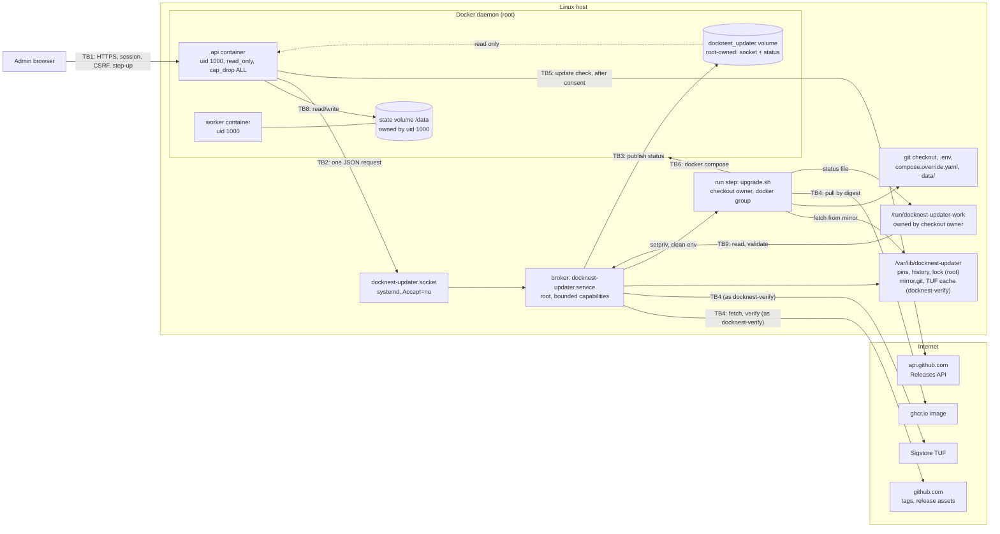

# In-app updater threat model (2.2.0)

Status: design for owner review, revised after independent AppSec review 1 (findings F1 to F19). Nothing on this page is implemented, and nothing is validated. Every item marked "prove on Linux" must pass on a real rootful Linux Docker host before the feature is called safe.

Role reference: Security Engineer from [agency-agents](https://github.com/msitarzewski/agency-agents/blob/main/engineering/engineering-security-engineer.md) (used as a checklist only).

Inputs: [upgrading.md](upgrading.md) (request contract and the nine known requirements, R1 to R9 below), `scripts/upgrade.sh`, `scripts/release-manifest.js`, `.github/workflows/release.yml`, `compose.yaml`, `Dockerfile`, [HANDOFF](agents/HANDOFF.md), [update-center.md](update-center.md), [roadmap](product/roadmap.md) and [open questions](product/open-questions.md) Q4, Q5 and Q7.

## 1. Scope and system diagram

In scope: the update check, the request from the dashboard to the host, the host updater, release verification, the status shown back to the dashboard, and disk use by repeated upgrades.

Owner decisions: the in-app path only upgrades. Downgrades stay supported from the server command line (`scripts/upgrade.sh --version <older tag>`, [Rolling back](upgrading.md#rolling-back)). A manual CLI run is outside the updater's trust boundary: the operator already has host access, so it keeps today's behaviour, including compatible downgrades and `--allow-data-rollback`. The automatic return to the previous release when an in-app upgrade fails (`upgrade.sh` exit 4) stays.

| Boundary | Between | Why it matters |
| --- | --- | --- |
| TB1 | Browser and API | Admin sessions can be phished or hijacked. |
| TB2 | API container and broker | The central boundary: a compromised API must not turn into root on the host. |
| TB3 | Broker and API (status) | Status flows back into a component we do not trust to write it. |
| TB4 | Host and the internet | Release code and images arrive from outside and later run as root-equivalent. |
| TB5 | API and GitHub (update check) | First outbound call DockNest makes. Advisory only. |
| TB6 | Run step and Docker daemon | Docker socket access is root on the host. |
| TB7 | Local host users and the checkout, config and updater state | Anyone who can write these controls what the run step executes. |
| TB8 | API and state volume | Once the API is compromised, everything in the state volume is attacker-controlled. |
| TB9 | Run step and broker | The broker (root) reads a file written by another account. |

## 2. Assets and attackers

| Asset | Notes |
| --- | --- |
| A1 Host root | The broker is root; the run step drives Docker, so it is root-equivalent. |
| A2 Backup data and secrets | `state.sqlite` holds sealed SSH keys and storage credentials; `data/master.key` unseals them. |
| A3 Integrity of the running release | Which code and image run, and that it is an official release. |
| A4 Availability | Backups pause during an update; a failed update can leave the hold on; repeated upgrades can fill the disk. |
| A5 Audit trail | Who asked for which change, and when. |

| Attacker | Capability | Must not gain |
| --- | --- | --- |
| T1 Compromised API container | Code execution as uid 1000; read/write on the state volume (and so on A2 already); can send anything to the socket. | Host root; a non-official or older release; a snapshot restore; unlimited restarts; a full disk. |
| T2 Malicious or phished admin session | Every admin API call, within CSRF and rate limits. | Anything beyond an upgrade to an official, verified, newer release. |
| T3 Network attacker | Blocks, delays or tampers with traffic; TLS intact unless a CA is compromised. | A fake "update available" that leads to installing anything; a fake release. |
| T4 Rogue or force-moved tag, compromised GitHub account | Pushes tags, edits releases and assets, marks releases "latest", possibly pushes to `main` and runs workflows. | Code that is not on `main`; silent replacement of a version already installed; an older release presented as newest. |
| T5 Unprivileged local host user | Shell on the host, not root, not in `docker`. Often uid 1000 (same as the container user). | Any request to the broker; any write to the checkout, config or updater state. |
| T6 Replayed old request | Resends an earlier valid request, or one that lingered on disk. | A second run of an old action. |

Review result worth stating: apart from the container-log forgery fixed in section 7 (F5), the independent design-level review found no path from T1 to root-equivalent execution or to wider data destruction than T1 already has. That is a review of this design, not of code.

Finding labels: F1 to F19 are AppSec review 1; AR2-N1 to AR2-N10 are AppSec review 2. The rows N1 to N16 in section 9 are this document's own requirement numbers.

## 3. Request channel

### Options

| | (a) Hardened file channel (upgrading.md) | (b) systemd socket-activated Unix socket |
| --- | --- | --- |
| What root touches | Files and directories inside a uid 1000 directory | Bytes from one connected socket; never a file in an attacker directory |
| R1 symlinked path components | Needs an `openat2`/`O_PATH` descriptor chain and only `*at()` calls | Not applicable: no path is resolved in attacker space |
| R2 validate-then-use | Read once from a descriptor, copy to root-owned state | Not applicable: the message is in memory when read |
| R3 FIFOs, hardlinks, sparse files | `fstat` checks, `O_NONBLOCK`, size cap | Not applicable; read is bounded (4 KiB, 2 s deadline) |
| R4 `id` as a file name | Canonical UUID check | Same check, but names are built only in root-owned directories |
| R8 trigger at will | Path unit fires on any change the API makes | Activation needs a connect; limits in section 7 |
| Feedback | None until status changes | Immediate `accepted` or a fixed refusal code |
| Implementation risk | High: easy to get one call wrong | Lower: standard systemd and stdlib socket code |

**Recommendation: (b).** It removes the whole class of filesystem races (R1 to R3) instead of defending against them, and gives synchronous refusals.

The socket lives in a dedicated **named volume**, `docknest_updater`: declared in `compose.yaml` with an explicit `name:`, root-owned, mounted `:ro` with `nocopy` into `api` only. Not a host bind mount: a bind mount in `compose.yaml` breaks `docker compose up` on Docker Desktop, rootless Docker and every install without the updater (section 4). One DockNest install per host is a stated requirement (the state volume name is already global).

Read-only mount, plainly: `:ro` protects the files, not the socket. `connect()` works through a read-only mount, which is what we want (P1). uid 1000 in `api` cannot unlink, rename or replace the socket or anything in `status/` (EROFS). The worker has no mount. The per-run `docker inspect` check (section 4) is the backstop against a later Compose change.

### Protocol (schema 1)

- Socket unit: `ListenStream=<volume mountpoint>/updater.sock`, `SocketUser=root`, `SocketGroup=<group of GID 1000>` (an existing group with GID 1000, else a `docknest-api` system group the installer creates and `--uninstall` removes), `SocketMode=0660`, `Accept=no`, `Backlog=8`, `TriggerLimitIntervalSec=60`, `TriggerLimitBurst=10`, `ConditionPathIsDirectory=<volume mountpoint>`, `RequiresMountsFor=<Docker data root>`. The condition stops systemd from creating directories under `/var/lib/docker/volumes` outside Docker's metadata after `docker compose down -v`; re-creation happens only through `install-updater.sh --repair`.
- Before binding (installer, `--repair` and every broker start): the volume driver is `local` with no driver options, `_data` is root:root 0755, is not a symlink and is not a mount point (same `st_dev` as its parent), and the path fits in `sun_path` (107 bytes).
- Request: one JSON object, at most 4096 bytes, ended by the client's half-close, read within 2 seconds. Fields: `{"schema":1,"id":"<uuid>","action":"upgrade","version":"vX.Y.Z","requestedBy":"<user id>","requestedAt":"<ISO time>"}`. `action` must be exactly `"upgrade"` or `"check"` (D19, below): any other value, including `"downgrade"`, a different case or a non-string, is refused with `invalid` before any other check and logged. The broker lists the actions it supports in `service.json` (`actions`), and the API sends `check` only when it is listed, so an older broker simply has no pre-check. Unknown or missing fields, duplicate keys, non-canonical UUIDs and invalid UTF-8 are refused. `allowDataRollback` no longer exists; its presence is a refusal. The parser catches every exception, including `RecursionError` and `MemoryError`, as `invalid`.
- Caller check: `SO_PEERCRED` uid must be 1000, and the peer's `/proc/<pid>/cgroup` must name the current `api` container id (accepted forms: `/system.slice/docker-<id>.scope` at the root of the cgroup path, so a nested copy in a user's delegated subtree does not match, `/docker/<id>`, and a configured `cgroup_parent`). Use `SO_PEERPIDFD` where the kernel has it (Linux 6.5+) and confirm the pidfd is still live; otherwise accept a small PID-reuse window. Honest scope: this does nothing against T1, which is the api container. It matters for a Docker data root that others can traverse (0711) and for a stray second install.
- Response: `{"accepted":true,"id":"..."}` or `{"accepted":false,"code":"busy|invalid|rate-limited|version-refused|state-mismatch|low-disk|duplicate|stale|needs-host-ack"}`. Never echoes request text.
- After acceptance, verification (section 5) runs as a new first phase `verify`, then the run step. No value from the request reaches the run step except the validated version and the re-serialised UUID (section 7).

### Read-only pre-check: `action: "check"` (D19)

Accepted, with these limits. It lets the Update Center show real pre-update results instead of guesses.

- **What it does.** For the requested target, the verifier (`docknest-verify`) fetches into the mirror and runs the same verification as the `verify` phase: signature, manifest fields, tag commit, ancestor of `main`, TOFU pin. The broker adds the free space against the floor, the updater and cosign versions, the consistency of the installed version (section 6) and whether the updater is blocked. It never touches the checkout, never starts the run step or `upgrade.sh`, never takes the hold and never changes Docker. A successful check may record the TOFU pin, which is verified data.
- **Asynchronous.** The connection gets `accepted` within the usual 2 s bound. The result goes to `status/check.json`, written by the broker like the other status files: `requestId`, `target`, `checkedAt`, and only fixed keys whose values are booleans, numbers, the validated target and updater version strings, or a refusal code from the fixed list. No text from the network, git or cosign ever reaches it.
- **Limits.** Its own bucket, separate from runs: one check at a time; at most one per target every 10 minutes (a repeat within that time returns the cached result without network); at most 12 per 24 hours. Refused with `busy` during a run. A run request during a check gets `busy`. Checks are allowed while the updater is blocked and report `blocked: true`. Same id, replay and parser rules as `upgrade`.
- **Meaning.** The result is a snapshot at `checkedAt`. The `upgrade` request repeats every check; the UI says "verified again when the update starts". Anything a check cannot prove before the update (jobs finishing, the build, health) stays labelled "will run when the update starts".
- **What T1 gains.** The host's free disk space and the updater version, and a way to make the verifier fetch from GitHub within the limits. Accepted as low value.

### Which requirements (b) closes

| Req | How |
| --- | --- |
| R1, R2, R3 | Closed by design: root never opens a path in a uid 1000 directory. |
| R4 | Closed: canonical UUID, file names built from the parsed value, only in root-owned directories. |
| R8 | Mostly closed (section 7). Availability cannot be fully protected from T1. |
| R5, R6, R7, R9 | Independent of the channel: sections 4 to 7. |

### Prove on Linux before shipping

- P1: `connect()` works from uid 1000 in a `read_only`, `cap_drop: [ALL]`, `no-new-privileges` container to a socket in a volume mounted `:ro` (expected to hold; the reviewer agrees; still to be shown).
- P2: `SO_PEERCRED` and, where present, `SO_PEERPIDFD` from a rootful container report uid 1000 and a PID whose cgroup names the api container, with the systemd and cgroupfs cgroup drivers.
- P3: after `systemctl restart docknest-updater.socket`, a running api container sees the new socket (the directory, not the file, is mounted).
- P4: Compose creates `docknest_updater` with `_data` as root:root 0755; `nocopy` prevents copying image content; `docker compose up` still succeeds on Docker Desktop and rootless Docker.
- P5: host users outside `docker` cannot reach the socket path (`/var/lib/docker` is 0710 root:root).
- P6: socket ordering with `docker.service` at boot, a non-default data root, and `docker compose down -v` (expected: socket condition fails, Settings shows not installed until `--repair`).
- P7: the broker, with its bounded capabilities, can publish status into the volume; the run step (checkout owner) cannot reach `/var/lib/docker`; uid 1000 in `api` cannot write `status/`. The `setpriv` drops to the checkout owner and to `docknest-verify` succeed with exactly the unit's `CapabilityBoundingSet` (no `CAP_SETPCAP`), the dropped processes hold no capabilities, and `/run/docknest-updater-work` exists from `tmpfiles.d` with 0750 owner:group before the unit starts.
- P8: `docker compose build` and `pull` work as the run step inside the unit sandbox, on the oldest supported util-linux (2.35, needed for `setpriv --reset-env`).
- P9: the Fulcio repository and owner id extensions (section 5) can be read from the verified bundle certificate with the pinned tools.
- P10: if the broker is killed mid-run (SIGKILL), the run step receives SIGTERM, `upgrade.sh` reverts or ends with a final status, and no process of the run is alive 2 h 15 min after acceptance.

## 4. Status channel

- **Writer.** Only the broker writes into the volume. Layout: `updater.sock` (systemd), and `status/` root:root 0755 with `status.json`, `current.json` (request id, version, accepted time) `service.json` (updater version, supported `actions`, `installMode` (`"image"` or `"source"`; the broker derives it from `docker inspect` of the api container: `image` when its image belongs to the pinned `ghcr.io/dahanitamar/docknest`, otherwise `source`; never by parsing the checkout's Compose files or `.env` as root, F15), `env` (coarse environment values for problem reports, section 8), blocked flag, consecutive exit-4 count per target, `heartbeatAt` with the request id during a run, and `lastResult`: request id, exit code or refusal code, finished time), `check.json` (the last pre-check result, section 3) and `notes/<tag>.md` (verified release notes, section 8). Files are created 0644 explicitly (`fchmod`), not left to the unit's umask, with an exclusive temporary name and a rename. The broker writes the `verify` phase itself, before the run step starts; the outcome the UI shows comes from `lastResult`, because `status.json` alone cannot tell exit 2 from exit 4.
- **Status fields (allow-list).** `phase`, `from`, `to`, `startedAt`, `updatedAt`, `ok`, `error`, `rollbackHint`, `requestId`, `warning`, `reason`, `schemaFrom` and `schemaTo`. `reason` is a failure reason code from a fixed list kept in `upgrade.sh` and the broker (for example `tracked-files-edited`, `secret-missing`, `min-upgrade-from`, `compose-invalid`, `tag-missing`, `not-on-main`, `signature-invalid`, `jobs-active`, `backup-failed`, `checkout-failed`, `build-failed`, `pull-failed`, `health-timeout`, `snapshot-restore-failed`, `revert-failed`, `interrupted`, `low-disk`, `state-mismatch`), set at each `fail` site and by the broker for `verify` and refusals; a value not on the list becomes `unknown`. `schemaFrom` and `schemaTo` are integers (whether a migration ran is `schemaTo > schemaFrom`); they come from the state volume, so they are display data only. Unknown fields are dropped and logged, not turned into a failure, so a newer `upgrade.sh` under an older broker does not show a success as failed (AR2-N6); a known field with an invalid value still makes the broker publish `failed`. `warning` is accepted as an additive field: plain text, at most 1024 characters after control characters are removed, built only from fixed messages in `upgrade.sh` plus validated folder names and image IDs; it never includes the output of `prune-upgrade-artifacts.js` or any container. Like `error` and `rollbackHint`, it is untrusted and rendered as text.
- **Phase events in `current.json` (A15, accepted with amendments).** So the Activity timeline survives the API restart, the broker keeps the run's phase events in `current.json`. Allow-list of `current.json`: `requestId`, `target`, `acceptedAt`, `events` and `truncated`. Each event is exactly `{"phase": <id>, "at": <ISO time>}`:
  - The broker creates events itself, when the phase in a status file it has already validated changes (and for `verify`, which it writes itself). It never copies an event list from `upgrade.sh` or anything else.
  - `phase` is an id from the fixed list (`verify`, `preflight`, `fetch`, `idle`, `backup`, `checkout`, `build`, `stop`, `restore-snapshot`, `start`, `health`, `rollback`, `release`, `cleanup`, `done`, `failed`); `at` is the broker's clock in whole seconds, UTC.
  - At most 32 events; further changes set `truncated: true` and are not added (one run has at most 16 phases, so this only triggers on a fault).
  - No free text: no messages, errors, hints, user names or paths. The UI turns each id into its own fixed wording.
  - The API checks every field: an unknown phase or a bad time drops that event, times must not go backwards, and events belong only to the matching `requestId`. The public progress endpoint passes on `phase` and `at` only, for the active or most recent request. It runs after `release`, once `upgrade.sh` has recorded success (`FINISHED=1`, hold released, `CHECKED_OUT` and `STOPPED` cleared) and written `cleanup` with `ok: true`. Retention runs in a guarded subshell with its own 120 s timeout. An abort or signal during `cleanup` is still a success: the script ends with `done`, `ok: true`, exit 0, and never reverts. The broker treats a run whose last status is `cleanup` or `done` with `ok: true` as exit 0, even if it was interrupted, so a cleanup abort never causes `needs-host-ack`.
- **Why a broker copy (F1).** A non-root run step cannot traverse `/var/lib/docker` (0710 root:root since Docker 20.10.9), so `upgrade.sh` cannot write into the volume itself; its `status()` would just warn and skip. The run step writes `--status-file /run/docknest-updater-work/status.json`. The installer creates that directory with `tmpfiles.d` (`d /run/docknest-updater-work 0750 <owner> <group> -`), because the broker has no `CAP_CHOWN` and `/run` is read-only under `ProtectSystem=strict`; the broker reads it through `CAP_DAC_READ_SEARCH`. The broker polls it every 2 seconds, opens it with `O_NOFOLLOW|O_NONBLOCK` relative to a directory descriptor, requires with `fstat` a regular file owned by the checkout owner with `st_nlink == 1`, caps it at 16 KiB, validates it with the same allow-list as the API, and publishes its own copy. Invalid content is replaced with a `failed` status, never forwarded. This also meets the HANDOFF rule: each status directory is owned by the account that writes it.
- **Read-only view.** `compose.yaml` mounts the volume into `api` with long syntax, `read_only: true` and `volume: {nocopy: true}`, at `/run/docknest-updater`. Before every run the broker checks with `docker inspect` that the api mount is read-only and that no container mounts the volume read-write; otherwise it refuses and logs why.
- **API side.** 16 KiB cap, JSON parse, known fields only, `phase` from the enum, versions by regex, `ok` as `true|false|null`, strings up to 4 KiB, rendered as plain text.
- **Correlation.** `upgrade.sh` gains `--request-id`, written into its status, so a stale file from an earlier run is never shown as current.
- **Interrupted runs.** If the broker is killed (OOM, power loss), the status can stay at `ok: null`. On start, the broker sees an unfinished run in its lock and history and publishes `ok: false` with "interrupted; check the host". If the run step had started, the updater is then blocked until a host-side acknowledgement (section 7). If the run stopped during `verify`, nothing changed and only the cool-down applies; if the last status was `cleanup` or `done` with `ok: true`, it is recorded as a success. The broker reads that last status back from its own `status/` directory descriptor with `O_NOFOLLOW|O_NONBLOCK` and accepts only a single-link regular file owned by root (security audit after 2.4.1); anything else counts as no status, so the run is classified as interrupted.
- **Stale rule (one rule, F14).** The broker always writes a heartbeat during a run. The run is stale when either there is no heartbeat for 2 minutes, or the phase has not changed for 15 minutes (45 minutes in `build`, where the script writes no status). The hard stop is a 2 hour limit per run, enforced by the broker on the run step (section 7). A missing `heartbeatAt` during a run counts as no heartbeat. Stale never releases the hold or re-submits anything. [update-center.md](update-center.md) must state the same rule.

**Installs without the updater.** The volume is a named volume, not a host path, so `docker compose up` creates it empty on every platform: 2.1 to 2.2 upgrades, Docker Desktop and rootless Docker all keep working. The API sees no `service.json` or socket and shows `updater-not-installed` with the manual command. A manual CLI downgrade to 2.1 leaves the volume unused and harmless. The installer detects and refuses rootless Docker and user-namespace remapping (`docker info` security options `name=rootless` or `name=userns`) and Docker Desktop (`OperatingSystem`), matching Q5: rootful Docker on systemd Linux only.

## 5. Version trust

Rules enforced by the broker, from its own code and `/etc/docknest-updater/config.json` (root:root 0644), never from the request:

1. Final releases only (`^v\d+\.\d+\.\d+$`), fixed in code. No pre-release option in 2.2.0.
2. Pinned remote: `https://github.com/DahanItamar/DockNest.git`, fetched into the updater's own bare mirror. The checkout's `remote.origin.url` is not checked, so SSH clones and mirrors keep working (F11).
3. The tag's commit must be an ancestor of `main` fetched from the pinned URL in the same run.
4. The release manifest must be signed, and its `commit` must equal the tag's commit.
5. Trust on first use: `/var/lib/docknest-updater/pins.json` records version to commit (and image digest) for every verified release. A tag that later resolves elsewhere is refused and logged.
6. Never rename the GitHub account or the repository: identities are pinned by name and by numeric id (below), and a rename breaks every install's in-app updates.

**Mirror (F3).** `/var/lib/docknest-updater/mirror.git`, owned by the `docknest-verify` system account (AR2-N8, section 7), readable by the checkout owner, who reads it with `-c safe.directory=<mirror path>`. All verifier git commands run with `GIT_CONFIG_NOSYSTEM=1`, `GIT_CONFIG_GLOBAL=/dev/null`, `GIT_NO_REPLACE_OBJECTS=1`, `-c protocol.allow=never -c protocol.https.allow=always`. The broker fetches `main` and the one tag without `--force`, so an existing tag cannot be overwritten.

### Release changes (minimum)

- `scripts/release-manifest.js`: add `commit` (40 hex, `GITHUB_SHA`), `tag`, `repository` (`DahanItamar/DockNest`) and `prerelease`, and the optional `highlights` object generated from the release notes front matter (D21).
- `release.yml`: pin `cosign-release` in `sigstore/cosign-installer` to the version the installer pins (F6). After the manifest is written: `cosign sign-blob --yes --bundle docknest-release.json.sigstore.json docknest-release.json`, and upload both files. Image signing stays.
- The release is created as a draft, the bundle and the image signature are verified with the host-pinned cosign version, and only then is it published (F6). Release validation repeats the check.

### Verification command (both bundle and image)

`--certificate-identity https://github.com/DahanItamar/DockNest/.github/workflows/release.yml@refs/tags/vX.Y.Z`, `--certificate-oidc-issuer https://token.actions.githubusercontent.com`, `--certificate-github-workflow-repository DahanItamar/DockNest`, `--certificate-github-workflow-trigger push`, `--certificate-github-workflow-ref refs/tags/vX.Y.Z`, `--certificate-github-workflow-sha <manifest.commit>`. cosign has no flag for the numeric source repository id and owner id (the Fulcio certificate extensions "Source Repository Identifier" and "Source Repository Owner Identifier", numbered .15 and .17 under Fulcio's OID arc), so the broker reads them from the verified certificate and compares them with values pinned in the installer (P9). This defeats repo-jacking after a rename (F9).

### Steps before anything runs for the target

| Step | Source mode | Image mode |
| --- | --- | --- |
| 1 | Host state agrees (section 6); target newer by SemVer; rate limits; free disk; N1 checks re-run | Same |
| 2 | Fetch `main` and the tag into the mirror; ancestry; TOFU | Same |
| 3 | Download manifest and bundle (64 KiB cap, redirects only to the two GitHub asset hosts of section 8); `cosign verify-blob` with the command above; repository and owner ids | Same |
| 4 | Manifest `version`, `tag`, `repository` match and `prerelease` is `false`; tag commit equals `manifest.commit` | Same, plus the image name equals the pinned `ghcr.io/dahanitamar/docknest` |
| 5 | | `cosign verify ghcr.io/dahanitamar/docknest@<manifest.image.digest>` with the same flags |
| 6 | Run step: fetch `refs/tags/vX.Y.Z` from the mirror into the checkout; run `upgrade.sh` (section 7 lists the exact argv) | Same, plus `--expect-image-digest` |

**New `upgrade.sh` behaviour (opt-in flags, so manual CLI use does not change):**

- `--expect-commit <sha>`: refuse if `refs/replace/*`, `.git/info/grafts` or `.git/shallow` exist; check out with `git checkout --detach <sha>` (a local branch named like the tag cannot win); confirm `git rev-parse HEAD` equals the SHA afterwards; run git with `GIT_NO_REPLACE_OBJECTS=1`.
- `--no-fetch`: the broker already fetched.
- `--upgrade-only`: exit 2 before anything changes unless the target is newer than the current version by full SemVer precedence (pre-release suffixes included). The broker always passes it.
- `--expect-image-digest <sha256:...>` (F4): pull `name:X.Y.Z@sha256:...`, and persist `DOCKNEST_IMAGE=name:X.Y.Z@sha256:...` in `.env`, so later `compose pull`, `up --pull always` or Watchtower fetch the verified digest, not whatever the tag points to. `image_setup` learns to accept and rewrite the tag-plus-digest form (it still refuses digest-only); it strips `@sha256:...` before splitting off the tag, because today's `${PREV_IMAGE%:*}` would cut inside the digest (F4). The previous-release record stores the registry `RepoDigests`, not only the image ID.
- `--capabilities` (F18): prints the supported flags and a status protocol version. The broker refuses (`state-mismatch`) when a required flag is missing.
- `--no-verify` (AR2-N1): skips the default ancestor and signature checks of manual runs; never passed by the updater.

**Which `upgrade.sh` runs (F18).** The one in the current checkout at `HEAD`, which is the installed, verified release; `upgrade.sh` itself refuses edited tracked files, and the broker re-runs the N1 checks first. It copies itself before checking out the target, as today.

**Source-mode build inputs (F10).** Verification covers the source tree, not everything the build pulls in. `COPY . .` also picks up files that `.gitignore` hides but `.dockerignore` does not exclude (for example `*.pem`, `*.key`, `*.sqlite` or `compose.override.yaml`). Fix: pin `FROM node:24-bookworm-slim@sha256:...` in the `Dockerfile` (kept current by a dependency bot); turn `.dockerignore` into an allow-list (`*`, then `!` for each tracked path the build needs); and the broker refuses a run when `git status --porcelain --ignored --untracked-files=all` lists anything inside those allowed paths. `apt-get` packages stay unpinned but are signed by Debian. Residual: the Debian archive and the checkout owner.

**cosign on the host and Sigstore key rotation (F6).** Python's standard library cannot verify Sigstore bundles (no ECDSA, X.509 chain or transparency-log checks), and a hand-built `openssl` pipeline is easy to get wrong. The only stdlib-style alternative is a different trust root: an owner-held SSH key checked with `ssh-keygen -Y verify` (D3). Recommendation: the installer installs a pinned cosign version, checked against a SHA-256 embedded in `install-updater.sh`, root-owned under `/usr/local/lib/docknest-updater/bin/`. Use cosign's embedded TUF root with its cache in `/var/lib/docknest-updater/sigstore/` (D14), not a static `trusted_root.json`. Operational consequence, plainly:

- Sigstore key rotation is handled by TUF; no reinstall. The host needs to reach `tuf-repo-cdn.sigstore.dev` when the cache expires; if it cannot, Update fails at `verify` and the CLI path keeps working.
- A routine cosign version change arrives through the updater's self-update (section 7), checked against the SHA-256 in the signed manifest. Only a change the installed cosign cannot verify (a bundle format it cannot read) needs `sudo scripts/install-updater.sh --repair` on every server; until then, Update fails at `verify` on that server. The owner must keep bundles verifiable by the oldest supported pinned cosign, or announce the reinstall in the release notes one release ahead; Settings shows "reinstall the updater" when `service.json` reports an older cosign than the release needs.

**Legacy releases** (2.0.x, 2.1.x) have no signed manifest and are never in-app targets.

### Manual CLI path (AR2-N1)

The operator is trusted; the tags and release data that a manual run acts on are not. A tag on any commit or a forged release (T4 with a contents-write token, without push to `main`) must not become code that a manual `scripts/upgrade.sh` builds. So `upgrade.sh` itself verifies by default, without the updater:

- It fetches `main` from `origin` together with the tags and refuses (exit 2, nothing changed) unless the target tag's commit is an ancestor of `origin/main`. Every 2.x release tag is on `main` (the release workflow requires it), so upgrades and manual downgrades to older tags keep working. Offline, it uses the local `origin/main`; if there is none, it refuses.
- When `cosign` is available (on `PATH`, or the updater's pinned copy), it verifies the signed `docknest-release.json` of a 2.2.0-or-later target with the identity flags above and checks its `commit`. Releases before 2.2.0 have no signature and get the ancestor check only.
- `--no-verify` skips both checks explicitly and prints a warning. It is for forks and air-gapped mirrors; the updater never passes it.
- CLI hints in the UI never take a version from unverified data. Installs without the updater are shown `scripts/upgrade.sh` with no version (the script picks the newest final tag itself and verifies it). A `minUpgradeFrom` from the unsigned manifest is shown only as text ("this release needs an intermediate upgrade first") with a link to the upgrade guide, never as a command.

This adds a default refusal to manual runs. It cannot break a supported upgrade or downgrade, because every official tag passes it, and the 2.0.0 path uses the target's own script, which already has the check.

## 6. Upgrade only (owner decision)

- `action` is always `"upgrade"`. The broker refuses any target lower than or equal to the running version (`version-refused`), before anything is fetched. The UI never offers a downgrade and shows the CLI command instead.
- **Current version from host-trusted sources only (F2).** Source mode: `version` in `package.json` at `HEAD`, and the exact tag at `HEAD` (`git describe --exact-match`) must agree. Image mode, additionally: the running api container's image label `org.opencontainers.image.version` and its `RepoDigests` must match the version and the digest the broker recorded. Any disagreement refuses with `state-mismatch` and asks the operator to check the host. Never from the request, `/api/version` or the database schema.
- Enforced twice: by the broker and by `upgrade.sh --upgrade-only`. `upgrade.sh` alone still allows compatible downgrades for manual CLI runs, which are outside the updater's boundary; it still verifies the target tag as described in section 5 (manual CLI path).
- Mode mismatch (security audit after 2.4.1): the broker decides image mode from the running api image name; an install whose `DOCKNEST_IMAGE` names another registry path (a mirror, or the pinned name without a tag) is seen as source mode and gets no `--expect-image-digest`. `upgrade.sh` then sees image mode from Compose. With `--expect-commit` and no digest it refuses with exit 2 and `state-mismatch` before anything is pulled, so an in-app run never pulls an image by its tag unverified. Such installs upgrade from the command line.
- First run in image mode (F2): when the broker has nothing recorded yet, the installer verifies the running api image's `RepoDigests` with cosign against the release it claims to be, and records it; if that fails, it refuses to install and explains why.
- The broker never passes `--allow-data-rollback`, so no in-app request leads to a snapshot restore.
- Unchanged: an in-app upgrade that fails before the schema changes returns to the exact previous commit and image by itself (exit 4); in source mode by re-tagging the recorded previous image ID ([update-center.md](update-center.md) section 9). On exit 4, `upgrade.sh` removes the image this run built or pulled (its recorded ID, without `--force`, never the previous image), so failed attempts do not pile up on disk (AR2-N2).
- If the owner accepts architect A10 (automatic return after a compatible-only migration), exit 4 no longer always means "no data was changed": the schema may have advanced by compatible objects while every row stayed the same. The "compatible" decision reads the schema from the state volume, which T1 controls. A lie can only make an older release run on data T1 can already damage; it gives no host access. Residual risk 2 covers it.
- **Retry update after exit 4 (D22).** Accepted. A retry is an ordinary new `upgrade` request (new id, new `requestedAt`) for the same target, with the same step-up, cool-down and verification. It counts towards D17: the broker keeps the consecutive exit-4 count per target in root-owned state and publishes it in `service.json`; the UI disables Retry from that broker count, not from database rows that T1 controls. After the second exit 4 the broker refuses with `needs-host-ack` whatever the UI shows.
- **Repeated failures (AR2-N2, D17).** Exit 4 leaves the target newer than the running version, so the same request is valid again, and T1 controls the database and can make the health check fail on purpose. Without a limit that is up to 6 runs a day, each pausing backups and taking DockNest offline. Rule: after 2 consecutive exit-4 results for the same target, the broker refuses that target with `needs-host-ack` until `install-updater.sh --ack`. Upgrade-only therefore stops T1 cycling only once the newest release is installed; before that, T1 can cause at most 2 failed runs per release, then a block.

## 7. Least privilege, denial of service, replay, audit

**Privilege split (F1, D2).** Three identities in one unit:

- **Broker, root.** Reads the socket, applies policy, keeps pins and history, publishes status into the volume, and runs `docker inspect` and `docker ps` with label filters (`com.docker.compose.project=docknest`, `com.docker.compose.service=api`) for the caller and mount checks, so root never parses the checkout's Compose files or `.env` (F15). Small Python standard-library code installed root-owned under `/usr/local/lib/docknest-updater/` (D6). `CapabilityBoundingSet=CAP_SETUID CAP_SETGID CAP_KILL CAP_DAC_READ_SEARCH`. No `CAP_SETPCAP`, so `setpriv` is used without `--bounding-set`: after the uid change with `--inh-caps=-all`, no ambient capabilities and `NoNewPrivileges=yes`, the child holds no capabilities and cannot regain any (P7).
- **Verifier, `docknest-verify` (AR2-N8).** A system account created by the installer, not in `docker`, owning the mirror and the Sigstore TUF cache. The broker starts it with `setpriv` for the mirror fetch, the release-asset downloads and cosign, and reads its result as JSON on a pipe. The numeric repository and owner ids are parsed from the same in-memory bundle that cosign verified, never from a second download (F9). Honest scope: a parser bug in git, cosign or HTTP code now lands in an account without Docker or root, but that account can still forge a verification result, so this is defence in depth, not a boundary.
- **Run step, checkout owner.** Started by the broker with `setpriv --reuid=<owner> --regid=<gid> --init-groups --inh-caps=-all --reset-env` (util-linux 2.35 or later; the installer checks) in its own session and process group (`setsid`, F13), with a fixed environment: `PATH`, `HOME`, `DOCKNEST_DIR`, `GIT_CONFIG_NOSYSTEM=1`, `GIT_CONFIG_GLOBAL=/dev/null`, `GIT_NO_REPLACE_OBJECTS=1`, and `GIT_CONFIG_COUNT=1`, `GIT_CONFIG_KEY_0=core.hooksPath`, `GIT_CONFIG_VALUE_0=/dev/null`, so the git calls inside `upgrade.sh` also run without hooks (F3a). It runs git and `upgrade.sh`. Before starting it, the broker writes and `fsync`s a "run step started" record, so an interruption is classified correctly (F8). It also confirms that `HEAD` equals the mirror's tag commit for the current version (F18). Because the owner runs it, the `safe.directory` relaxation that `upgrade.sh` always passes is harmless, and every file it creates (tracked files, `.env`, `data/upgrade-backups/`) stays owned by the operator's account.
- **Why not root-only.** Running `upgrade.sh` as root would create root-owned tracked files and a root-owned `.env` in the operator's checkout, so the operator's next manual `scripts/upgrade.sh` would fail: an upgrade-safety regression. It would also make root follow links in a directory another account controls. Root is still needed for the volume and `/var/lib/docker`, hence the split.
- **Account rule.** The checkout owner must be root or already in `docker`; the installer refuses otherwise. It never adds anyone to `docker` and never changes ownership. A root or docker process acting on a checkout that a non-docker user controls would hand that user root through `.git/hooks`, `.git/config`, `.env` or `compose.override.yaml` (T5).
- **N1 checks, before every run.** The checkout, `.git` (recursively, F3c), `.env`, `compose.override.yaml` and `data/` are owned by the checkout owner (or root), with no group or other write bits. `.git/config` contains only allow-listed keys (`core.repositoryformatversion`, `core.filemode`, `core.bare`, `core.logallrefupdates`, `core.ignorecase`, `core.precomposeunicode`, `remote.*.url`, `remote.*.fetch`, `branch.*.remote`, `branch.*.merge`, `branch.*.rebase`, `user.*`, `pull.*`, `init.*`, F3d); anything else (`url.*.insteadOf`, `http.*`, `core.sshCommand`, `credential.*`, `filter.*`, `core.hooksPath`, `core.fsmonitor`, `include*`) is refused with the key named. Git hooks are disabled with `-c core.hooksPath=/dev/null`.

**Exact argv of the run step (F17).** `scripts/upgrade.sh --non-interactive --upgrade-only --no-fetch --expect-commit <sha from manifest> --version <validated tag> --request-id <re-serialised UUID> --status-file /run/docknest-updater-work/status.json`, plus `--expect-image-digest <digest from manifest>` in image mode. Never `--force`, `--allow-data-rollback`, `--wait`, `--timeout` or `--dry-run`. No shell.

**systemd hardening** (defence in depth; Docker access still means root): no `User=` line (the default is root; on systemd 259 an explicit `User=root` with `NoNewPrivileges=yes` leaves `CAP_SETUID` out of the permitted set and `setpriv` fails), `NoNewPrivileges=yes`, `ProtectSystem=strict` with `ReadWritePaths=` the checkout, `/run/docknest-updater-work`, the volume's `status/` and `/var/lib/docknest-updater` (paths that can vanish, such as the volume after `down -v`, use the `-` prefix so the unit still starts and the broker reports the problem itself), `ProtectHome=read-only` (or `no` when the checkout is in a home), `PrivateTmp=yes`, `PrivateDevices=yes`, `ProtectKernelTunables=yes`, `ProtectKernelModules=yes`, `ProtectKernelLogs=yes`, `ProtectControlGroups=yes` (exactly `yes`: the newer `private` and `strict` values would break the cgroup caller check), `ProtectClock=yes`, `ProtectHostname=yes`, `RestrictNamespaces=yes`, `RestrictSUIDSGID=yes`, `LockPersonality=yes`, `RestrictAddressFamilies=AF_UNIX AF_INET AF_INET6`, `SystemCallFilter=@system-service`, `UMask=0077` (volume files get 0644 explicitly), `Restart=no`, `KillMode=mixed`, `TimeoutStopSec=15min`. No `RuntimeMaxSec`: it limits the unit's lifetime, not a run, so T1 could keep the broker alive and submit just before it expires, cutting a run in the middle (AR2-N3). Instead the broker enforces a 2 hour limit per run: at the limit it sends SIGTERM to the run step's process group, waits up to 15 minutes for `upgrade.sh`'s own revert, then SIGKILL. On its own SIGTERM the broker does the same, then exits; systemd kills what remains only after the timeout.

**Denial of service and replay (one set of limits, F12).**

- The broker stays running after its first activation and exits after 10 idle minutes when no run is active. Only an accepted request resets the idle timer; refused, busy and malformed connections do not, so T1 cannot keep it resident by chatter (AR2-N3). While it runs, connections go straight to it (`Accept=no`), so the trigger limit only guards activation loops while it is stopped.
- It accepts connections concurrently only to answer: during a run every request gets `busy`, read under the same 4 KiB and 2 s bounds.
- Limits kept in root-owned state: at most 10 connections per minute (more are closed without reading), 60 s cool-down after a run, at most 6 runs per 24 hours that got past the pre-checks (a run that ends with exit 2 or 3 changed nothing and gives its slot back), and at most 24 accepted runs per 24 hours in all. Socket `TriggerLimitBurst=10` per 60 s; service `StartLimitBurst=5` per 10 minutes. A tripped trigger limit stops the socket until an operator restarts it: fail closed.
- One run at a time: broker `flock` on `/var/lib/docknest-updater/lock`, and `upgrade.sh` takes its own lock (`data/.upgrade.lock`) so a manual CLI run and an in-app run never overlap.
- **Blocked after a bad end (F8, D15).** After exit 5 or 6, or an interrupted run whose run step had started, the broker refuses every request with `needs-host-ack` until the operator runs `sudo scripts/install-updater.sh --ack` on the host. The hold stays on after 5 and 6, but `deployment-preflight.js hold` succeeds again on an empty queue, so without this rule a new run could start and its retention could remove what the manual rollback needs. Exit 4 (clean automatic rollback) only needs the normal cool-down, up to the repeated-failure rule in section 6 (2 consecutive exit-4 results for the same target block too). The block lives in root-owned broker state, so nothing in the database (including a recovery-kit restore, which marks the dashboard's active requests `lost`) lifts it.
- **The deployment hold is a safety mechanism, not a security boundary.** It lives in `state.sqlite`, which T1 can change. 2.2.0 closes its functional gaps ([update-center.md](update-center.md) section 2): the hold is enforced in the self-backup queue and `claimSelfBackup` and in the recovery-kit route, not only by disabled buttons; `deployment-preflight.js hold` counts queued or running manager backups in the same transaction that sets the hold; and a recovery-kit restore clears `deployment_hold` (a kit taken during a hold would otherwise restore a blocked manager). The kit restore refuses while `current.json` shows an active run (AR2-N9), so it never lifts the hold under a running upgrade. The broker never reads or trusts the hold; `upgrade.sh` sets and releases it through the containers as today.
- Replay: `id` must be new (kept in history); `requestedAt` must be within 5 minutes of the host clock and later than the last accepted request.
- **Disk exhaustion.** A compromised API that triggers upgrades over and over must not fill the host. Upgrade-only, the repeated-failure block (at most 2 failed runs per release, section 6), the removal of a failed run's image on exit 4, and the run limits bound this. In addition:
  - The broker refuses with `low-disk` when free space on the checkout filesystem or the Docker data root is below a floor (D10). `upgrade.sh` keeps its snapshot space check.
  - Retention runs in `upgrade.sh` on the success path only ([update-center.md](update-center.md) section 9 owns the design). Agreed security rules: delete only image IDs this install recorded itself (its previous-release files and the broker history), intersected with the pinned repository name; never select by label alone; keep the running and the previous image; skip image pruning when the previous or the new ID is unknown; removal is best effort, without `--force`. Exclude this run's backup folder by its exact path, not by being "among the newest 5" (clocks can skew); never remove the folder of a run that ended 5 or 6, or of a 2.2.0-or-later run with no recorded result. Retention runs only in the `cleanup` phase (section 4), so it can never trigger a revert. Host-side removal works from the parent directory on `lstat`-checked names matching the exact pattern, without a trailing slash, and follows no links. Older upgrade-backup hints may name images that were since removed; the notes say so.
  - Pruning `pre-downgrade-*` and `pre-rollback-*` inside the state volume runs in a container as uid 1000 and gives T1 nothing it does not already have.

**Audit (F5).**

- The API records `updater.requested` (admin id, version, response code) with the existing `audit()` helper.
- The authoritative record is `/var/lib/docknest-updater/history/<id>.json`, root-owned: peer pid and uid, container id, request id, the claimed `requestedBy` (marked as claimed), each verification result, exit code and timestamps.
- The broker also writes structured journal entries through the native journald socket (`MESSAGE_ID` plus `DOCKNEST_REQUEST_ID`, `DOCKNEST_RESULT` and similar fields). Free-text journal lines are diagnostic, not authoritative.
- Container logs are never forwarded into the journal. In service mode `upgrade.sh` writes `docker compose logs` output to a file in the run's work directory, and the broker attaches it to history with control characters escaped and each line prefixed `container| `. T1 controls those lines and must not be able to forge service entries.
- T1 can forge or delete `audit_events`; a history record with no matching audit event points to a compromised API. No secrets appear anywhere.

**Update lock (owner decision).** While a request is `submitted` or `running`, the API answers every other `/api` endpoint with 423 ([update-center.md](update-center.md) section 4). The lock is a safety and UX control, not a security boundary: it lives in the API, which T1 controls, so T1 can lift it or never set it. The real controls stay the deployment hold and the broker. Rulings on the exempt list:

- `/healthz`, `GET /api/version`, `GET /api/updates/progress`, `GET /api/auth/status`: accepted (read-only).
- `GET /api/updates`, `GET /api/updates/status`: accepted (read-only). Exempt only from the 423; they keep the session, `requireAdmin` and the other checks.
- `POST /api/updates/requests/:id/acknowledge`: accepted only for the active request id, only when it is `running` and the server-side snapshot says the run is stale (never on the client's word), admin, CSRF and origin checks. It never applies to a request that needs manual action (A20 below). No step-up, so `POST /api/auth/reauth` stays locked: acknowledge starts nothing, it only closes the dashboard's record and ends the lock. It does not touch the broker's block or the hold. A stale run can still be alive (a slow build), so the result screen says that the host may still be working.
- Add `POST /api/auth/logout`: ending a session only reduces access, and someone on a shared computer must be able to sign out during a long update.
- Everything else stays locked, including sign-in: an admin without a session cannot acknowledge, and A11 below covers that case.

**Lock after a bad end (A20, accepted with amendments).** After exit 5, exit 6 or an interrupted run whose run step had started, DockNest stays locked until the host-side resolution.

- **What ends it.** One trusted signal: the broker's `service.json` reports `blocked: false`. Only `install-updater.sh --ack` sets that, and `--ack` refuses until the deployment hold is released. It reads `deployment_hold` directly and read-only from `state.sqlite` through the api container as the checkout owner (not `deployment-preflight.js check`, which also fails while a self-backup is queued), and fails closed when the value cannot be read. So "hold released and acknowledged" is checked on the host and arrives as broker state, not as database rows.
- **What does not end it.** Acknowledge in the UI (it applies to stale `running` requests only), A11 (it applies to stale `running` requests only), and any database change. If `service.json` is missing (volume deleted, updater uninstalled), the lock stays while the request needs action; `install-updater.sh --ack`, `--repair` and `--uninstall` close the request through the containers.
- **Exempt list.** Unchanged, and sign-in stays locked. The lock view shows only the public coarse state `needs_action`, generic next steps and a link to [Rolling back](upgrading.md#rolling-back); never the rollback hint. The operator gets the details on the host: `install-updater.sh --status` prints the last result with its rollback hint from the broker's history.
- **Name.** Do not call this state `recovery_required`. That name is already a job status that `deployment-preflight.js` counts. Use the existing `needs_action`.
- As before, the lock is not a security boundary: T1 can lift it.

**Automatic unlock (A11).** Applies only to a stale `running` request, never to one that needs manual action. The API marks the request `lost` once it is stale and older than the broker's hard stop (2 h, plus 15 min grace) plus 5 minutes. Measure from the broker-written `acceptedAt` in `current.json`, falling back to the database time only when the volume is missing. Ruling: accepted. It changes nothing for T1, which already controls the API and could end the lock at any time. For an honest API, it relies on one condition: no run can still be live after the hard stop. That holds only if the run step cannot outlive the broker. So the broker starts the run step with `PR_SET_PDEATHSIG` set to SIGTERM (`setpriv --pdeathsig=SIGTERM`, applied after the uid change, which would clear an earlier setting; in the moments between fork and that call a broker death sends no signal, and systemd's stop kills what is left in the unit's cgroup), and if the broker dies the run step gets SIGTERM and `upgrade.sh` runs its own revert; systemd's stop then kills whatever remains in the unit's cgroup (P10). `lost` does not lift the broker's `needs-host-ack` block or the hold; a later status from the broker still updates the record.

**Updater self-update (D6, revised; accepted with amendments).** After a successful in-app upgrade, the broker replaces its own code with the version shipped in the release it just verified, so operators never rerun the installer for routine updater changes.

- **When.** Only as the tail of a run that ended with exit 0 (including an abort during `cleanup`), after the final status is published, and only when the signed manifest names a newer updater version than the installed one. Never on exit 2 to 6, never as a request action, never to an older version.
- **Manifest change.** The signed manifest gains `updater`: `version`, `files` (relative path to SHA-256 for every file of the broker, verifier and installer helpers), `units` (name to SHA-256 for unit templates) and, optionally, `cosign` (version plus SHA-256 per architecture).
- **Source and integrity.** The bytes come from the mirror at `manifest.commit`, not from the checkout. The run step runs as the checkout owner and could change checkout files after verification, while the mirror is outside its reach. The verifier streams each file with `git cat-file` on a pipe. Root computes the SHA-256 itself and compares it with the signed list, so a tampered mirror object is refused too. A missing, extra or mismatched file cancels the whole self-update.
- **Install.** Into a new directory `/usr/local/lib/docknest-updater/<version>/` (root, 0755 directories, 0644 files, 0755 only for the listed entry points). Then `<new>/broker --self-test` runs as root inside the same sandbox: it parses the root config, renders and checks the units with `systemd-analyze verify`, and reports its protocol version. Only on success does the broker switch the `current` symlink atomically (create a temporary link, then `rename`). The previous version directory is kept; at most two are kept.
- **Unit files.** Only the allow-listed names (`docknest-updater.socket`, `docknest-updater.service`, the `tmpfiles.d` file). They are rendered from the release's templates with values taken only from root's `/etc/docknest-updater/config.json` (volume path, checkout path, owner), never from the checkout. Then `systemctl daemon-reload`. A changed socket unit is restarted only after the broker exits, which costs the API one short reconnect.
- **Restart.** The broker exits after the switch; socket activation starts the new code on the next connection.
- **Rollback.** If the new code fails its self-test, nothing is switched. If it fails at start, `ExecStartPre=` runs a self-test of `current` and, on failure, switches the link back to the previous version and logs it. `install-updater.sh --repair` stays as the last resort.
- **cosign.** A new pinned cosign version is installed the same way: downloaded by the verifier from the fixed `https://github.com/sigstore/cosign/releases/download/<version>/` URL, checked by root against the SHA-256 in the signed manifest, previous binary kept. This removes the reinstall from risk 8 for routine cosign changes.
- **Trust.** This adds no new root of trust: the same signature already decides which code runs with Docker access, which is root-equivalent. What changes is that root-owned code now follows releases automatically, so a bad but genuine release can break in-app updates. The self-test, the kept previous copy and `--repair` limit that.

**Rejected: installing the updater from the browser, or through DockNest's own SSH access to its host.** Either would give the API a path to root: the API would have to hold or use root credentials for the manager host, and DockNest's SSH keys live in `state.sqlite`, which T1 can read. The updater is installed once, by the operator, with `sudo scripts/install-updater.sh` on the host. DockNest never uses a managed-server connection to its own host for updater work.

**Session (T2).** Update is admin-only, CSRF-protected, and requires recent re-authentication through the existing `requireRecentAuth` (D5). Step-up limits T2 only; it does nothing against T1, which talks to the socket directly.

## 8. Update check from the API

The same rules apply to the worker's daily tick and to "Check now" in the API; both run the same `check.js` from the same image.

- Only after the admin answered yes; nothing outbound before that, and nothing when checks are off. The consent text says that the request tells GitHub the running DockNest version (in the `User-Agent`), and that nothing about servers, sites or users is sent. Moving the note that GitHub sees the server's IP address into `docs/security.md` is acceptable, on two conditions: the consent dialog links to that page ("What is sent"), and the UI never claims that nothing at all leaves the server, because every request reveals the server's IP address.
- Release call (F19): `https://api.github.com/repos/DahanItamar/DockNest/releases?per_page=30`, fixed in code. The API computes the highest final version itself (`draft: false`, `prerelease: false`, final-tag regex, SemVer order) and does not trust the "latest" mark, which T4 can move to an older release. [update-center.md](update-center.md) must switch from `/releases/latest` to this.
- `fetch` with `redirect: "manual"`: any 3xx is `check-failed`. `AbortSignal.timeout(10000)`. Body read as a stream and cut at 1 MiB (30 releases with their notes can exceed 256 KiB, which would make every check fail). JSON only. Default TLS verification.
- Headers: `Accept: application/vnd.github+json`, `User-Agent: DockNest/<version>`, `If-None-Match` with the stored ETag. No token, no cookies, no install id.
- Daily schedule plus a manual "Check now" limited to once per minute. GitHub's anonymous rate limit returns `check-failed` with the retry time.
- Only `tag_name`, `draft`, `prerelease` and `published_at` are used. `html_url`, `body` and asset URLs are ignored. The release link is built as `https://github.com/DahanItamar/DockNest/releases/tag/<validated tag>`. Everything is rendered as text. What's new uses notes bundled in the image.
- Manifest fetch (accepted with conditions), so the UI can say "upgrade to vM first" from `minUpgradeFrom`:
  - Only after a release call found a newer version, at most once per check, under the same consent.
  - URL built from the validated tag: `https://github.com/DahanItamar/DockNest/releases/download/<tag>/docknest-release.json`.
  - At most one redirect, followed by hand: `Location` parsed with `new URL()`, then `protocol` exactly `https:`, `port` empty or `443`, `hostname` exactly `release-assets.githubusercontent.com` or `objects.githubusercontent.com` (no suffix matching), `username` and `password` empty; the second response must be a 200. No cookies or auth headers.
  - 10 s for both requests together, 64 KiB cap, JSON only. Used: `version` and `tag` (must equal the tag), `minUpgradeFrom` (`^\d+\.\d+\.\d+$` or `null`).
  - Do not log the redirect URL: it carries signed query parameters.
  - Advisory only: never passed to the broker, no security decision made from it, and never turned into a version inside a CLI command. A forged `minUpgradeFrom` can hide a requirement that `upgrade.sh` still enforces (exit 2, nothing changed), or show a text note that an intermediate upgrade is needed; the note links to the upgrade guide and names no command (section 5, manual CLI path).
- **Release notes before the update (D20).** Use the notes file at the verified commit, not the GitHub release body. During `check`, the verifier reads the notes path from the verified manifest (it must match `^docs/releases/\d{4}-\d{2}-\d{2}-v\d+\.\d+(\.\d+)?\.md$`), takes the file from the mirror at `manifest.commit`, caps it at 64 KiB and the broker publishes it as `status/notes/<tag>.md`. Reason: the release body can be edited at any time by anyone with release access (T4), signed in no way, and could carry convincing instructions such as a command to paste into a shell; the file at the verified commit is the reviewed text on `main`. This is the one exception to "check returns booleans and numbers": the file is display text, never parsed for decisions. Without the updater, or before a check, the page shows the GitHub release body only under the label "Unverified notes from GitHub", capped at 64 KiB. Both are rendered with the same safe subset as What's new ([update-center.md](update-center.md) section 8): no HTML, no images, links only to `https://github.com/DahanItamar/DockNest/...`, code blocks as plain text.
- **Changelog list (`GET /api/updates/changelog`): accepted with amendments.**
  - **Access:** admin-only, like the rest of the Update Center. It reads only the cache, so it makes no outbound call.
  - **Data:** up to 30 final releases (drafts and pre-releases excluded) from the list the check already fetched, cached in `update_checks.releases`.
  - **Fields per entry:** `tag` (final-tag regex), `name` (at most 120 characters, control characters removed, plain text), `publishedAt`, and a link built from the validated tag. No body.
  - **Cache:** capped by a `CHECK` on its length, for example 16 KiB.
  - **Display:** release names are untrusted and editable on GitHub (T4), so the list is labelled as names from GitHub and rendered as text. Only the offered release may also show a title from its verified notes file (`status/notes/<tag>.md`).
- **Downtime estimate:** accepted as display only. It is computed from the broker-timed events of the last in-app run and labelled as an estimate. No decision uses it.
- **Highlights (D21).** Accepted as display-only data. Allowed keys: `security` (boolean), `features`, `improvements` and `fixes` (integers 0 to 99); anything else is ignored, absent means no chips. Prefer the values from the broker's `check` result, which come from the verified manifest; values from the API's own unsigned manifest fetch are shown only when no check result exists. No eligibility decision uses them. A forged "security fix" chip can at most encourage an update to an official, verified release; a hidden one can delay it.
- **"Report this problem" (accepted with amendments).** An admin-only button on the result screen and in history details opens a prefilled GitHub issue in a new tab. The browser opens it; the server makes no call, and nothing is submitted automatically.
  - **Content.** Typed fields only, each checked against its type before use: versions (final-tag regex), outcome and phase ids (fixed lists), exit-code class or refusal code (fixed lists), install mode (`source` or `image`), updater version (regex), schema from/to (integers). Phase times are sent as seconds since the run was accepted, not as clock times, so the issue does not show when or in which time zone the server is maintained. Never: hostnames, IPs, domains, paths, names, emails, user or request ids, error text, hints, warnings, logs. A value that fails its check is left out, not escaped and kept.
  - **URL.** Built with `URL` and `URLSearchParams` on the constant `https://github.com/DahanItamar/DockNest/issues/new`, with the constant `template=update-failure.yml` and constant field names; values are encoded by `URLSearchParams` (equivalent to `encodeURIComponent`); no value comes from GitHub data (release body, `html_url` or anything else in the API response); total URL at most 4000 characters. Opened with `noopener,noreferrer` and `Referrer-Policy: no-referrer`, so GitHub does not learn the dashboard's address from the `Referer` header.
  - **Review.** The dialog shows the exact field values as plain text before opening, and says that GitHub issues are public and linked to the admin's GitHub account.
  - **Values from the database.** Acceptable. The admin reviews and submits it under their own account, and type checks keep any free text out. T1 can make a report wrong, and since the API serves the web bundle, T1 could change the button entirely; this feature adds nothing to what T1 already has.
  - **Repository side.** The `update-failure.yml` issue template uses the same field ids and asks the reporter to remove anything private before submitting.
- **Environment values in `service.json` (`env`), accepted with coarse values.** Exact patch levels in a public issue tell an attacker which server, linked to the reporter's GitHub account, runs an outdated Docker or kernel. So only coarse values, each checked with a regex before it is written, otherwise left out:
  - Docker Engine major.minor (`docker version --format` through the daemon API) and Compose major.minor (`docker compose version --short`, which reads no project files).
  - OS id from a short list (`debian`, `ubuntu`, `other`) plus its major version, from the root-owned `/etc/os-release`.
  - Kernel major.minor and architecture (`os.uname()`); git major.minor; the pinned cosign version.
  - Free disk as a bucket (`<2`, `2-10`, `10-50`, `>50` GiB) from `statvfs`.
  - The broker refreshes them at start and before each run. None of these come from the owner's Compose files, `.env` or the checkout. The report dialog lists them in their own section, which the admin can untick.
- **Optional error excerpt: allowed with conditions.**
  - **Off by default;** the admin must tick it for each report.
  - **Source:** only the admin-only `error`, `rollbackHint` and `warning` fields of that run, at most 40 lines and 2 KiB. Never the journal, container logs or `docker compose logs`: those hold application output, host details and text T1 controls.
  - **Redaction:** automatic, then shown in an editable box as the exact text that will be sent. It replaces IPv4 and IPv6 addresses, emails, URLs and host names, absolute paths outside DockNest's own relative paths, and hex or base64 runs of 20 or more characters (except the public release commit SHAs of `from` and `to`).
  - **Redaction is a help, not a guarantee:** pattern matching cannot recognise every site name or custom path. The dialog says so and asks the admin to read the text.
  - **Too long:** if the URL would exceed the 4000-character cap, the excerpt is offered through the clipboard for manual pasting instead of being cut silently.
- **Problem reports across DockNest (general rules).** These cover backup and restore jobs, storage and server connection tests, self-backup, recovery review, the error boundary and the About link.
  - **One builder module** (for example `web/report.js`) with, per report type, a constant issue template and an allow-list of typed fields: enums (including DockNest's existing error `code` values), version and phase regexes, integers, booleans, durations and buckets. No other code builds report URLs.
  - **Never included:** host names, IPs, ports, domains or URLs; credentials, keys or host-key fingerprints; user names or emails; server, site, policy, container, bucket, prefix or endpoint names; paths; job, backup or request ids; exact sizes (use buckets); error messages or stack text (the error boundary sends the component name from a fixed list and the error class only).
  - **Same rules as the update report:** constant base URL, `URLSearchParams`, 4000-character cap, `noopener,noreferrer` with no referrer, a review dialog with the public-issue warning, no server call, and the optional excerpt under the conditions above.
  - **Who can use them:** reports with job, storage or environment data are admin-only. The About link (version and install mode only) is available to every signed-in user.
  - **Canary test:** every builder is fed fixtures containing a host name, IP, site name, path, email and token, and its URL must contain none of them.
- **docs/security.md** gets a "Problem reports" section: DockNest never sends reports itself; a link opens GitHub in the browser; the exact list of fields per report type and the list of what is never included; that the error excerpt is optional, redacted automatically, may still contain private text and must be read before sending; and that github.com is opened by the browser, not contacted by the server.
- The check is advisory. With the updater, a forged "update available" leads at most to a request the broker refuses in `verify`. Without the updater, the UI shows `scripts/upgrade.sh` without a version, and `upgrade.sh` refuses a target that is not on `main` or, with cosign present, not signed (section 5, manual CLI path). The earlier claim that nothing could follow from a forged check was wrong for installs without the updater (AR2-N1).
- Public progress (`GET /api/updates/progress`, no session, [update-center.md](update-center.md) section 4): accepted with conditions (AR2-N5). It exposes only `active`, `phase`, `to`, `state` and `updatedAt`, plus a `stale` boolean, with no error text, exit code, hint, request id, user or path. Owner decision (lock view for everyone): public `state` is a coarse outcome, `running`, `succeeded`, `rolled_back`, `not_changed`, `needs_action` or `lost`, instead of collapsing to `ended`. Accepted: it tells an anonymous visitor at most that the server needs manual action, which is low value next to the version that `/api/version` already shows; anything more detailed stays admin-only. It serves an in-memory snapshot refreshed every 2 seconds, uses an in-memory rate limiter and writes nothing to SQLite per request, and sends `Cache-Control: no-store`. `trust proxy` is set narrowly to the bundled Caddy hop, so the per-IP limit keys on the real client instead of one shared bucket that an anonymous client could exhaust for admins. It tells an anonymous visitor that an upgrade is running and to which version, which `/api/version` reveals anyway once it finishes.
- `docs/security.md` lists the API's opt-in destinations (api.github.com, github.com, the two asset hosts) and the host updater's (github.com and the asset hosts, ghcr.io, tuf-repo-cdn.sigstore.dev).

## 9. Requirements map

Tests: U = unit (Python `unittest` for the broker, Node tests for the API), L = CI Linux integration (real systemd and Docker on the runner), V = release validation.

| Req | Mitigation | Component | Test | Residual |
| --- | --- | --- | --- | --- |
| R1 path symlinks | Socket channel; no paths in uid 1000 space | Socket unit, broker | U, L (symlink swap in the state volume has no effect) | None known |
| R2 validate-then-use | Message read once into memory | Broker | U | None |
| R3 file types | No files read; bounded read with deadline | Broker | U (oversize, slow, partial) | None |
| R4 `id` | Canonical UUID; names built in root directories | Broker | U | None |
| R5 attacker `allowDataRollback` | Field removed; only `"upgrade"`; newer-only in broker and `--upgrade-only`; host-trusted current version; flag never passed | Broker, `upgrade.sh` | U (other actions `invalid`; older, equal, pre-release and mismatched-state targets refused), L | None known for the in-app path; CLI is out of scope by decision |
| R6 version trust | Final only; mirror from pinned URL; ancestor of `main`; signed manifest with commit; identity flags plus numeric ids; TOFU; expected commit and digest | Release workflow, broker, `upgrade.sh` | U (tampered manifest, wrong identity or trigger or ref, moved tag, non-ancestor, renamed repo), L, V | Compromised owner GitHub account that can push to `main` |
| R7 least privilege | Root broker with bounded capabilities; run step as checkout owner; no new group members; hardening | Installer, unit | L (`systemd-analyze security`, refusal for a non-docker owner), P7, P8 | `docker` is root-equivalent; broker is root |
| R8 DoS and replay | One limit set; busy answers; locks; nonce and time checks; host ack after 5/6 and after 2 consecutive exit 4; per-run time limit | Socket unit, broker | U, L (flood, replay, blocked after exit 5, chatter does not keep the broker resident) | T1 can keep the updater busy, tripped or blocked |
| R9 status | Broker is the only volume writer; validated copy with a field allow-list (including the capped `warning`); `:ro` mount; text rendering | Broker, Compose, API, UI | U (unknown field, oversize `warning`), L (API cannot write; HTML shows as text), P7 | Depends on P7 (F1) |
| N1 checkout control | Ownership, modes and `.git/config` allow-list before every run; hooks off | Installer, broker | L | Checkout owner account compromise |
| N2 caller identity | `SO_PEERCRED`, `SO_PEERPIDFD` where present, cgroup forms | Broker | L (host uid 1000 user and worker refused) | No help against T1; PID reuse on older kernels |
| N3 verify-to-run gap | Mirror; `--no-fetch`; `--expect-commit` with detached checkout and replace/graft/shallow refusal; pull and persist by digest | `upgrade.sh`, broker | U, L (branch named like the tag, replace ref) | Needs `.git` write, so N1 (F3) |
| N4 concurrent runs | Broker lock and `upgrade.sh` lock | Both | U, L | None |
| N5 stale or interrupted status | `--request-id`; one stale rule; reconcile on start; host ack only when the run step started; `cleanup` abort counts as success | Broker, API, `upgrade.sh` | U, L (kill -9 mid-run, during `verify` and during `cleanup`; stopped heartbeat) | Operator review after power loss |
| N16 hold integrity | Hold enforced in self-backup queue and claim and the kit route; preflight counts manager backups; kit restore clears it; broker never trusts it | API, worker, preflight | U (`tests/self-backup.test.js`, `tests/recovery-kit.test.js`) | T1 can change the hold; safety only |
| N6 upgrade safety | Named volume with explicit name; no host path; checks before binding | Compose, installer | V (2.0.0 and 2.1.0 to 2.2.0, with and without the updater), L | Docker Desktop and rootless not in CI |
| N7 phished session | `requireRecentAuth`; newer official releases only | API, UI | U, browser tests | Real-time phishing proxy |
| N8 update check abuse | Fixed URLs; highest final computed locally; manifest with one redirect to two exact hosts; caps; advisory | API | U (redirects, look-alike host, oversize, hostile fields, older "latest") | Hints can be suppressed or forged |
| N9 tool supply chain | cosign pinned by version and SHA-256; same version in `release.yml`; TUF cache | Installer, release workflow | L, V | Trust in the cosign release; reinstall on version change |
| N10 audit integrity | Root history authoritative; structured journal; container logs not forwarded | Broker, `upgrade.sh` | U, L (forged log line ignored) | Journal rotation |
| N11 disk exhaustion | Free-space floor; recorded IDs only; exact-path exclusion; never prune after 5/6 | `upgrade.sh`, broker | U (selection), L (repeated upgrades keep disk flat; other images and second-install images untouched; rollback works after cleanup), V | Build cache not pruned |
| N12 host state agreement | HEAD, exact tag, image label and digest must agree | Broker | U, L (`.env` naming a different image) | None known |
| N13 source build inputs | Base image by digest; untracked files refused | Dockerfile, broker | L | Debian archive; checkout owner |
| N14 parser robustness | All exceptions are `invalid`; exhaustive argv | Broker | U (deep nesting, huge numbers, bad UTF-8) | None known |
| N15 script compatibility | `upgrade.sh --capabilities` probe; unknown status fields dropped, not failed | Broker | U, L | None |
| N17 manual CLI verification (AR2-N1) | Default ancestor-of-`origin/main` check; signed manifest verified when cosign is present; explicit `--no-verify`; no versions in UI hints from unverified data | `upgrade.sh`, UI | U (off-main tag refused with exit 2; older on-main tag still downgrades; `--no-verify` allowed with warning; forged manifest rejected with a fixture trust root), L | Operators who pass `--no-verify`; releases before 2.2.0 have no signature |
| N18 repeated exit 4 (AR2-N2) | Block a target after 2 consecutive exit-4 results; remove the failed run's image on exit 4 | Broker, `upgrade.sh` | U, L (forced health failure twice, then `needs-host-ack`; image removed, previous kept) | T1 can cause 2 failed runs per release, then a block |
| N19 run time limit (AR2-N3) | 2 h per run enforced by the broker; no `RuntimeMaxSec`; only accepted requests reset the idle timer | Broker | U (fake clock), L | None known |
| N20 privilege drop mechanics (AR2-N4) | `tmpfiles.d` work directory; no `--bounding-set`; util-linux 2.35 floor; `-` prefix on vanishing paths | Installer, unit | L, P7, P8 | None known |
| N21 public progress (AR2-N5) | In-memory snapshot and limiter; no DB writes; `no-store`; narrow `trust proxy`; coarse public outcome only (owner decision) | API | U, browser tests | Reveals that an upgrade is running and its coarse outcome |
| N23 pre-check action | `check` allow-listed and advertised; read-only; own limits; fixed keys of booleans and numbers; async result file; repeated at `verify` | Broker, verifier, API | U (no checkout, hold or Docker change; limits; unknown keys absent; check during a run is `busy`), L | Reveals free disk space to T1 |
| N24 release notes and highlights | Notes from the verified commit via `check`; GitHub body only labelled unverified; safe renderer; highlights typed and display-only | Broker, API, UI | U (path regex, size cap, renderer drops HTML and foreign links, highlights type checks) | Social-engineering text in unverified notes when the updater is absent |
| N25 retry after exit 4 | New request; broker-kept consecutive count; UI reads it from `service.json` | Broker, API, UI | U, L (second exit 4 then `needs-host-ack` even if the UI allows retry) | None known |
| N22 update lock | 423 on every other `/api` route; exempt list above; acknowledge only for the active, server-side stale request; logout allowed; automatic `lost` after hard stop plus 5 min from broker time; run step dies with the broker | API, broker | U (exempt list exact, 423 elsewhere, acknowledge refused while not stale), L (P10) | Not a security boundary: T1 can lift it |

### Implementation checklist

Each item is a requirement that the review of the named pull request (numbers from the [implementation plan](update-center.md#11-implementation-plan)) must check. The security reviewer of that PR ticks it off; an unticked item blocks the merge.

| # | Requirement | Source | PR |
| --- | --- | --- | --- |
| I1 | Hold enforced in the self-backup queue, `claimSelfBackup` and the kit route; preflight counts manager backups; kit restore clears the hold and refuses while `current.json` shows an active run | DBRE 6, AR2-N9 | 2 |
| I2 | `cleanup` after success is recorded, guarded subshell, abort is exit 0; `warning` from fixed messages only; exit 4 removes this run's image | DBRE 1, AR2-N2, AR2-N6 | 3 |
| I3 | Retention: images of this install's repository only (never one a container uses, never another repository; untagged ones only when recorded or DockNest-labelled), the running and previous (`:previous`) image kept, `$SAVE` by identity, 5/6 and result-less folders kept | F7, F8 | 3 |
| I4 | Manifest fields; `cosign-release` pinned to the installer's version; draft release, verify with that cosign, then publish | F6 | 4 |
| I5 | `--expect-commit` (detached checkout, replace/graft/shallow refusal, HEAD check), `--no-fetch`, `--upgrade-only`, `--request-id`, `--capabilities`, lock | F3, F18 | 5 |
| I6 | `--expect-image-digest`; `image_setup` parses `name:X.Y.Z@sha256:...` correctly; RepoDigests recorded | F4 | 5 |
| I7 | Manual runs: default ancestor-of-`origin/main` check, signature check when cosign is present, `--no-verify`; test that an older on-main tag still downgrades | AR2-N1 | 5 |
| I8 | Base image pinned by digest; `.dockerignore` as an allow-list | F10 | 5 |
| I9 | Highest final version computed from `/releases`; 1 MiB cap; redirect check with `new URL()` exact fields | F19, AR2-N10 | 6 |
| I10 | First run in image mode: installer verifies and records the running image's RepoDigest | F2 | 7 |
| I11 | Run-step environment with `GIT_CONFIG_COUNT` hooks override; `safe.directory` for the mirror; recursive `.git` mode checks; widened `.git/config` allow-list | F3a to F3d | 7 |
| I12 | `tmpfiles.d` work directory 0750; `setpriv` without `--bounding-set`; util-linux 2.35 check; `-` prefix on vanishing `ReadWritePaths` | F5, AR2-N4 | 7 |
| I13 | `fsync` of "run step started" before spawning; run step in its own session (`setsid`); per-run 2 h limit; no `RuntimeMaxSec`; only accepted requests reset the idle timer | F8, F13, AR2-N3 | 7 |
| I14 | Numeric repository and owner ids parsed from the same verified in-memory bundle | F9 | 7 |
| I15 | Untracked or ignored files inside the build allow-list refuse the run | F10 | 7 |
| I16 | Caller and mount checks with `docker ps` label filters, never `docker compose` as root | F15 | 7 |
| I17 | `HEAD` equals the mirror's tag commit for the current version | F18 | 7 |
| I18 | `status.json` read with `O_NOFOLLOW\|O_NONBLOCK`, `fstat` regular file, owner, `st_nlink == 1`, size cap; unknown fields dropped | AR2-N6, AR2-N7 | 7 |
| I19 | Verifier account `docknest-verify` for mirror fetch, downloads and cosign; result on a pipe | AR2-N8 | 7 |
| I20 | 2 consecutive exit-4 results for one target block with `needs-host-ack` | AR2-N2 | 7 |
| I21 | Container logs never reach the journal; structured journal fields; root history authoritative | F5 | 5 (`upgrade.sh` log file), 7 (broker) |
| I22 | Public progress: in-memory snapshot and limiter, no DB writes, `no-store`, narrow `trust proxy`, coarse public outcome without error text or exit code | AR2-N5, owner | 8 |
| I25 | 423 lock middleware with exactly the exempt list of section 7 (plus `POST /api/auth/logout`); exempt routes keep their normal checks; acknowledge only for the active request and only when the server snapshot is stale | Owner, lock ruling | 8 |
| I26 | Automatic `lost` after hard stop plus 5 min, measured from the broker's `acceptedAt` | A11 | 8 |
| I27 | Run step started with `PR_SET_PDEATHSIG` SIGTERM; broker crash mid-run proven by P10 | A11 | 7 |
| I28 | `check` action: allow-list, `actions` in `service.json`, separate limits and cache, `status/check.json` with fixed keys only, no checkout, run step, hold or Docker change | D19 | 7 (broker), 8 (API) |
| I29 | Notes from the verified commit (path regex, 64 KiB, `status/notes/<tag>.md`); GitHub body only as labelled unverified fallback; one safe renderer | D20 | 7, 8, 11 |
| I30 | `highlights` in the manifest from notes front matter; typed keys; check result preferred | D21 | 4, 8 |
| I32 | Phase events built by the broker from validated status changes; `current.json` allow-list; fixed phase ids, broker time, 32 maximum with `truncated`; API drops invalid events; public endpoint passes phase and time only | A15 | 7, 8 |
| I33 | Report this problem: typed fields only, relative times, constant base URL, template and field names, `URLSearchParams`, 4000-character cap, `noopener,noreferrer` and no referrer, review dialog with the public-issue warning, no server call; issue template field ids match | Owner, report ruling | 10 (UI), 13 (issue template) |
| I34 | `reason` enum, `schemaFrom` and `schemaTo` in status; `unknown` for anything off the list | Report ruling | 3, 5 (`upgrade.sh`), 7 (broker) |
| I35 | `env` in `service.json`: coarse values only, regex-checked, from the daemon API, `/etc/os-release`, `uname`, `statvfs` and version commands, never from owner config | Report ruling | 7 |
| I36 | Error excerpt: off by default, only `error`, `rollbackHint` and `warning`, 40 lines and 2 KiB, redaction then editable review, clipboard fallback, honest warning | Report ruling | 10 |
| I37 | One report builder module with typed allow-lists per report type; never-included list; canary test over every builder; About link for all users, other reports admin-only; `docs/security.md` section | Report ruling | 9, 10, 13 |
| I38 | Manifest `updater` block (version, file and unit hashes, optional cosign pin) | Self-update ruling | 4 |
| I39 | Self-update only after exit 0 and a newer signed version; bytes from the mirror at `manifest.commit` via the verifier; root SHA-256 check against the signed list; all-or-nothing | Self-update ruling | 7 |
| I40 | Versioned install directory, `--self-test` before an atomic `current` link switch, `ExecStartPre` self-test with fallback to the previous copy, two copies kept | Self-update ruling | 7 |
| I41 | Unit files from allow-listed names only, rendered from root config values only, `systemd-analyze verify`, `daemon-reload`; socket restart only after the broker exits | Self-update ruling | 7 |
| I42 | cosign update from the fixed release URL with the signed SHA-256, previous binary kept | Self-update ruling | 7 |
| I43 | No browser or SSH-based updater install; DockNest never uses a managed-server connection to its own host for updater work | Rejected design | 7, 8 |
| I44 | Consent dialog links to `docs/security.md` ("What is sent"); no "nothing leaves the server" wording; IP address disclosed there | IP note ruling | 9, 13 |
| I45 | Lock after a bad end ends only on broker `blocked: false`; `--ack` reads `deployment_hold` directly and read-only and refuses while it is on or unreadable (fail closed); UI acknowledge and A11 never end it; missing `service.json` keeps it; `--status` prints the last result and hint; state named `needs_action` | A20 | 7, 8, 10 |
| I46 | Changelog endpoint admin-only from cache; typed fields, 120-character names, length `CHECK`, text rendering, verified title for the offered release only | Changelog ruling | 1, 6, 8, 9 |
| I31 | Retry is a new request; consecutive exit-4 count per target in broker state and `service.json`; UI disables from it | D22 | 7, 8, 10 |
| I23 | UI hints never contain a version from the manifest or the releases list; `minUpgradeFrom` shown as text with a guide link | AR2-N1 | 8, 9 |
| I24 | Exit-4 wording no longer says "no data was changed" if A10 is accepted | AR2-N9 | 10 |

## 10. Residual risks and owner decisions

### Risks the owner must accept

1. A compromised API (T1) can start an upgrade to a newer official release at a time it chooses. Step-up authentication does not stop this, because T1 talks to the socket directly. T1 controls the database and can make the health check fail on purpose, so each new release can cost up to 2 failed runs (each pausing backups and taking DockNest offline) before the repeated-failure block stops it. Once the newest release is installed, every T1 request is refused.
2. T1 already holds the data and secrets in the state volume. The updater does not protect them, and data-safety checks in `upgrade.sh` (for example the schema version) read values T1 controls.
3. Whoever controls the owner's GitHub account and can merge to `main` can publish a release that verifies, and every admin who clicks Update runs it as root-equivalent. The click, the ancestor check, numeric ids and TOFU pins narrow this. Repository rules (protected `main` without bypass, tag rulesets for `v*`, hardware-key 2FA) are the main control. An offline signing key (D3) narrows it further; it does not close it, because a compromised owner workstation can still sign.
4. The broker is root and the run step has Docker access; hardening limits mistakes, not a determined attacker.
5. If GitHub or Sigstore is unreachable, in-app updates fail closed. The CLI path remains.
6. T1 can keep the updater unavailable (busy, a tripped trigger limit, or two deliberately failed runs) until an operator acts on the host.
7. After exit 5, exit 6, an interrupted run or 2 consecutive exit-4 results, in-app updates stay blocked until someone runs `install-updater.sh --ack` on the host. T1 can cause this block deliberately.
8. The updater updates its own root-owned code after verified upgrades. A genuine but faulty release can still break in-app updates on every server; the self-test, the kept previous copy and `install-updater.sh --repair` limit this. A cosign version whose bundles the installed cosign cannot verify still needs `--repair`.
9. Source-mode builds still trust the Debian archive and the checkout owner; the Docker build cache is not pruned.
10. Manual runs with `--no-verify` rely on the operator alone, and manual runs to releases before 2.2.0 rely on the ancestor check only.

### Owner decisions

| # | Decision | Recommendation |
| --- | --- | --- |
| D1 | Request channel | Socket (b) in the `docknest_updater` named volume, mounted `:ro` into `api` only. Not the file channel, and not a host bind mount in `compose.yaml`. |
| D2 | Service account | **Privilege split:** root broker with bounded capabilities, run step as the checkout owner (root or already in `docker`; refuse otherwise). Not root-only, because root-owned files in the checkout break later manual upgrades. |
| D3 | Signature trust root | cosign keyless now. Revisit an offline owner SSH key (`ssh-keygen -Y verify`) as a required second signature; it narrows risk 3. |
| D4 | Downgrades | **Resolved by owner:** none through the updater (`--upgrade-only` always passed). CLI downgrades stay supported, outside the updater's boundary. Automatic rollback of a failed upgrade (exit 4) stays. |
| D5 | Step-up authentication for Update | Yes, through `requireRecentAuth`. |
| D6 | Where the broker code lives | Root-owned versioned copies under `/usr/local/lib/docknest-updater/`, updated automatically after a successful verified upgrade (self-update, section 7), previous copy kept; `install-updater.sh --repair` as the fallback. |
| D7 | Limits | 10 connections per minute, 60 s cool-down, 6 runs per 24 h (exit 2 or 3 does not count), 24 accepted runs per 24 h, fail closed on a tripped trigger limit. |
| D8 | Verification unavailable | Fail closed, with no "skip verification" option in the UI. |
| D9 | New `verify` and `cleanup` phases, `requestId` and `warning` status fields, `needs-host-ack` and `state-mismatch` as UI states, `low-disk` as a notice | Accept; [update-center.md](update-center.md) shows them. |
| D10 | Free-space floor before a run | 2 GiB plus the last image size; the owner may set a different figure. |
| D11 | Pre-releases | **Resolved:** no pre-release option in 2.2.0. |
| D12 | API fetch of `docknest-release.json` (architect A9) | **Accepted with conditions** (section 8). |
| D13 | Updater heartbeat (architect A6) | **Accepted**, with the single stale rule of section 4. |
| D14 | Sigstore trust root on the host | cosign's TUF root with a local cache, not a static file, so key rotation needs no reinstall. |
| D15 | After exit 5, 6 or an interrupted run | Block in-app updates until `sudo scripts/install-updater.sh --ack`. |
| D16 | Repository identity | Never rename the account or the repository; one DockNest install per host. |
| D17 | Repeated automatic rollbacks | After 2 consecutive exit-4 results for the same target, block with `needs-host-ack` (rather than a silent 24 h back-off), because two clean rollbacks in a row need a person to look at the server. The CLI keeps working. |
| D18 | Manual `upgrade.sh` verification | Verify by default (ancestor of `origin/main`, signature when cosign is present), with an explicit `--no-verify`. |
| D19 | Read-only pre-check | **Accepted with limits:** `action: "check"`, asynchronous, fixed boolean and number results, own rate limits, never changes anything outside the mirror and pins. |
| D20 | Release notes shown before the update | The notes file at the verified commit, delivered by `check`; the GitHub release body only as a labelled unverified fallback when there is no updater. |
| D21 | Manifest `highlights` | Accepted as typed, display-only data; verified values from `check` preferred. |
| D22 | Retry after exit 4 | Accepted as a new request within D17, counted by the broker. |
| D23 | Lock after exit 5, 6 or an interrupted run (A20) | Accept. The lock ends only when the broker reports unblocked, after `--ack`, which itself refuses while the hold is on. |
